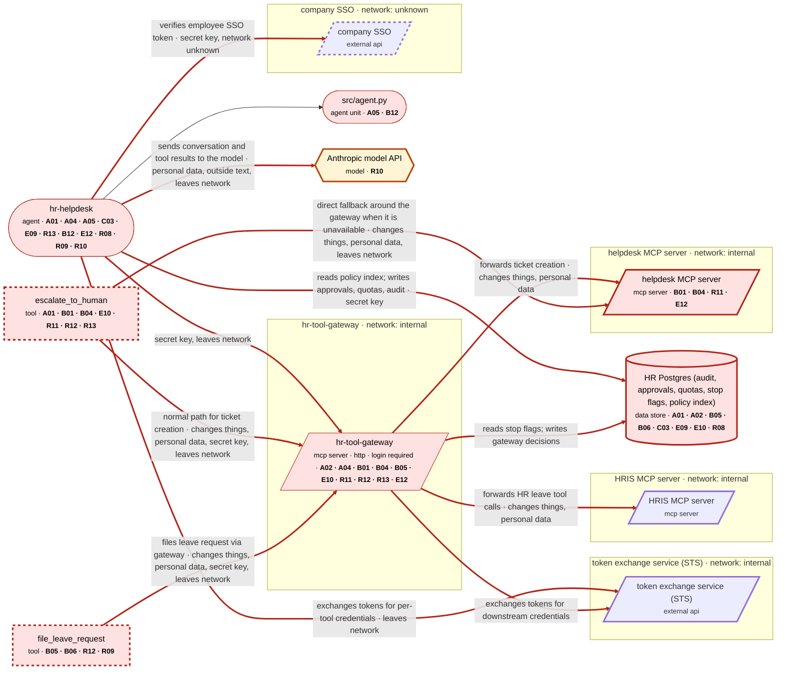

# Security map and action plan: hr-helpdesk

Review of `eval-v8/s-hr-agent (hr-helpdesk-agent)` at commit `unknown`, 2026-10-02T09:46:32Z.

**14 things to fix** and **5 things that need proof** were found. Each one below has a person to lead it, a place to write who is doing it, and steps to follow.

## 1. Map

This map shows what the agent connects to. Arrows point from the part that starts an action to the part it reaches.

- **Red box:** something here must be fixed. The codes in the box (like B06) are the actions in section 3.
- **Yellow box:** something here needs proof that it is safe.
- **Thick red arrow:** a connection that can cause harm if misused. Section 2 says why.
- **Dashed box:** we don't yet know which network it runs in.
- **Thick border:** found by reading the code, not just the settings files.

This map shows only the parts with actions or risky connections. The full map has 12 parts; draw it with `topology.py mermaid`.

## 2. Connections that matter

These connections could cause harm if someone misused the agent. Check them first.

| From | To | Why it matters | Open actions | Evidence |
|---|---|---|---|---|
| escalate_to_human | hr-tool-gateway | can change, send or delete things; carries personal data; uses a secret key or token; crosses into another system or network | A01, A02, A04, B01, B04, B05, E10, E12, R11, R12, R13 | src/gateway_client.py:50 |
| file_leave_request | hr-tool-gateway | can change, send or delete things; carries personal data; uses a secret key or token; crosses into another system or network | A02, A04, B01, B04, B05, B06, E10, E12, R09, R11, R12, R13 | src/gateway_client.py:50 |
| hr-helpdesk | Anthropic model API | carries personal data; brings in text an outsider could write; crosses into another system or network | A01, A04, A05, B12, C03, E09, E12, R08, R09, R10, R13 | src/agent.py:70 |
| escalate_to_human | helpdesk MCP server | can change, send or delete things; carries personal data; crosses into another system or network | A01, B01, B04, E10, E12, R11, R12, R13 | src/gateway_client.py:59 |
| hr-helpdesk | hr-tool-gateway | uses a secret key or token; crosses into another system or network | A01, A02, A04, A05, B01, B04, B05, B12, C03, E09, E10, E12, R08, R09, R10, R11, R12, R13 | .mcp.json:3 |
| hr-helpdesk | HR Postgres (audit, approvals, quotas, stop flags, policy index) | can change, send or delete things; uses a secret key or token | A01, A02, A04, A05, B05, B06, B12, C03, E09, E10, E12, R08, R09, R10, R13 | src/main.py:165 |
| hr-helpdesk | token exchange service (STS) | uses a secret key or token; crosses into another system or network | A01, A04, A05, B12, C03, E09, E12, R08, R09, R10, R13 | src/credentials.py:47 |
| hr-helpdesk | company SSO | uses a secret key or token; we don't yet know which network it is in | A01, A04, A05, B12, C03, E09, E12, R08, R09, R10, R13 | src/main.py:36 |
| hr-tool-gateway | HRIS MCP server | can change, send or delete things; carries personal data | A02, A04, B01, B04, B05, E10, E12, R11, R12, R13 | src/gateway.py:180 |
| hr-tool-gateway | helpdesk MCP server | can change, send or delete things; carries personal data | A02, A04, B01, B04, B05, E10, E12, R11, R12, R13 | src/gateway.py:180 |
| hr-tool-gateway | token exchange service (STS) | uses a secret key or token | A02, A04, B01, B04, B05, E10, E12, R11, R12, R13 | src/gateway.py:119 |
| hr-tool-gateway | HR Postgres (audit, approvals, quotas, stop flags, policy index) | can change, send or delete things | A01, A02, A04, B01, B04, B05, B06, C03, E09, E10, E12, R08, R11, R12, R13 | src/gateway.py:203 |

## 3. Action list

Fill in **Assigned to** with a person's name. The **Lead** is the team that owns the fix (see ROLES.md).

| # | What to fix | Where | Priority | Lead | Assigned to |
|---|---|---|---|---|---|
| [A01](#a01) | The agent has its own SA/SPIFFE identity, but its access is not all bound to it: DB access uses a static DATABASE_URL secret for role hr_agent, and escalations reach helpdesk-mcp around the gateway's ACTORS check. | hr-helpdesk, HR Postgres (audit, approvals, quotas, stop flags, policy index), escalate_to_human | Must fix before release (G1) | Infrastructure | _____ |
| [A02](#a02) | audit.events always carries the six fields, but gateway decision rows use caller-supplied or 'unknown'/'missing' values and a failed gateway deny log is swallowed, so some denials have no complete record. | hr-tool-gateway, HR Postgres (audit, approvals, quotas, stop flags, policy index) | Must fix before release (G1) | Agent team | _____ |
| [A04](#a04) | The gateway keys instance-scoped stop and rate decisions on a caller-supplied X-Agent-Instance header instead of a verified claim. | hr-tool-gateway, hr-helpdesk | Must fix before release (G1) | Infrastructure | _____ |
| [A05](#a05) | Audit rows carry the type id, but the only manifest store is a CI artifact keyed by git SHA with default retention, so an operator cannot go from a type id to its manifest. | hr-helpdesk, src/agent.py | Must fix before release (G1) | Operations | _____ |
| [B01](#b01) | One config allowlist drives the model's tools, but the direct_route fallback lets escalate_to_human run even when the gateway has disabled it (fingerprint mismatch), so the allowlist is not enforced on that path. | escalate_to_human, hr-tool-gateway, helpdesk MCP server | Must fix before release (G1) | Agent team | _____ |
| [B04](#b04) | Revocation via stop flags is enforced at the gateway, but escalate_to_human falls back to calling helpdesk-mcp directly when the gateway errors, so the trusted enforcement point is skipped. | escalate_to_human, hr-tool-gateway, helpdesk MCP server | Must fix before release (G1) | Infrastructure | _____ |
| [B05](#b05) | Approval is checked only inside the agent process, whose own DB role can write approved_by/approved_at, and the gateway forwards consequential calls without checking any approval. | file_leave_request, hr-tool-gateway, HR Postgres (audit, approvals, quotas, stop flags, policy index) | Must fix before release (G1) | Agent team | _____ |
| [B06](#b06) | Approval grants bind instance, operation, target, args hash and expiry, but not the scope the action runs under. | file_leave_request, HR Postgres (audit, approvals, quotas, stop flags, policy index) | Must fix before release (G1) | Agent team | _____ |
| [C03](#c03) | Only Kyverno (signature) and the pod itself check identity; nothing outside the agent compares the running digest, type id or served model with the approved manifest. | hr-helpdesk, HR Postgres (audit, approvals, quotas, stop flags, policy index) | Must fix before release (G1) | Infrastructure | _____ |
| [E09](#e09) | The stop cancels in-process work, but cached 300 s tokens are not dropped at stop (10 s target) and completed effects are not recorded for reconciliation. | hr-helpdesk, HR Postgres (audit, approvals, quotas, stop flags, policy index) | Must fix before release (G1) | Operations | _____ |
| [E10](#e10) | Gateway audit rows take type and instance from unverified headers, never store vendor receipt ids, and are absent for direct-route calls. | hr-tool-gateway, HR Postgres (audit, approvals, quotas, stop flags, policy index), escalate_to_human | Must fix before release (G1) | Infrastructure | _____ |
| [R11](#r11) | An agent_type stop is enforced only inside the agent; the gateway's stop query omits that scope, and a gateway error routes escalations around the gateway. | hr-tool-gateway, escalate_to_human, helpdesk MCP server | Must fix before release (G1) | Operations | _____ |
| [R12](#r12) | No per-operation stop policy exists, and a timed-out write is handed back to the model as an ordinary error instead of a tracked hold. | file_leave_request, escalate_to_human, hr-tool-gateway | Must fix before release (G1) | Agent team | _____ |
| [R13](#r13) | Most steps are audited, but a GatewayUnavailable for non-direct tools escapes without a step record, and SDK retries and direct-route fallbacks are not recorded. | hr-helpdesk, hr-tool-gateway, escalate_to_human | Must fix before release (G1) | Agent team | _____ |
| [B12](#b12) | Prompt and harness are versioned, owned and deployed only from main by CI; branch protection is not visible in code. | hr-helpdesk, src/agent.py | Show proof it works before release (G1) | Agent team | _____ |
| [E12](#e12) | Stop flags and tool fingerprints give quarantine controls, but no fleet incident drill, impact query or responder routing is in the repo. | hr-helpdesk, helpdesk MCP server, hr-tool-gateway | Show proof it works (G3) | Security | _____ |
| [R08](#r08) | Denials are recorded, but no security detection rules or alert routing are in the repo. | hr-helpdesk, HR Postgres (audit, approvals, quotas, stop flags, policy index) | Show proof it works (G3) | Security | _____ |
| [R09](#r09) | Each consequential action is checked by the employee against a rendered description, but sequence and context-range detection is not in the repo. | hr-helpdesk, file_leave_request | Show proof it works (G3) | Security | _____ |
| [R10](#r10) | No second-model reviewer or misalignment scope statement is in the repo. | hr-helpdesk, Anthropic model API | Show proof it works (G3) | Security | _____ |

## 4. How to fix each one

### A01

**Distinct agent identity** · Must fix before release (G1)

**The problem:** The agent has its own SA/SPIFFE identity, but its access is not all bound to it: DB access uses a static DATABASE_URL secret for role hr_agent, and escalations reach helpdesk-mcp around the gateway's ACTORS check.

**Where:** hr-helpdesk, HR Postgres (audit, approvals, quotas, stop flags, policy index), escalate_to_human — `k8s/deployment.yaml:31`

**Lead:** Infrastructure · **Assigned to:** _____ · **Effort:** medium

**Steps:**

1. Open `src/gateway_client.py` and go to line 51.
2. Delete the `except GatewayUnavailable` fallback on lines 51 to 59 so a gateway error is raised.
3. Delete the `direct_route` block of `escalate_to_human` in `config/tools.yaml` lines 91 to 94.
4. Delete the helpdesk-mcp egress rule from the agent policy in `k8s/networkpolicy.yaml` lines 48 to 50.
5. Replace the static `DATABASE_URL` secret in `k8s/deployment.yaml` line 51 with short-lived database credentials issued to the pod identity.
6. Add a test that stops the gateway and checks that `escalate_to_human` fails with no direct call.

**You are done when:** No access path uses a shared secret or skips the gateway.

**Also fixes or affects:** B01, B04, E06

### A02

**All six identity fields** · Must fix before release (G1)

**The problem:** audit.events always carries the six fields, but gateway decision rows use caller-supplied or 'unknown'/'missing' values and a failed gateway deny log is swallowed, so some denials have no complete record.

**Where:** hr-tool-gateway, HR Postgres (audit, approvals, quotas, stop flags, policy index) — `migrations/001_init.sql:8`

**Lead:** Agent team · **Assigned to:** _____ · **Effort:** medium

**Steps:**

1. Open `src/gateway.py` and go to line 129.
2. Fill type id and instance id from verified token claims, not from request headers.
3. Remove the `except Exception: pass` around the failed deny log at lines 194 to 197.
4. Make the request fail with 503 if the audit write fails.
5. Add a test that breaks the audit write and checks the call is refused.

**You are done when:** Each gateway log row, even a denial, has IDs taken from the signed token.

### A04

**Trustworthy attribution** · Must fix before release (G1)

**The problem:** The gateway keys instance-scoped stop and rate decisions on a caller-supplied X-Agent-Instance header instead of a verified claim.

**Where:** hr-tool-gateway, hr-helpdesk — `src/main.py:79`

**Lead:** Infrastructure · **Assigned to:** _____ · **Effort:** medium

**Steps:**

1. Open `src/main.py` line 79 and note how the instance id is built.
2. Add the instance id and type id as claims in the token request in `src/credentials.py`.
3. Change `src/gateway.py` line 170 to read the instance id from verified claims.
4. Do the same for the rate limit key at line 173.
5. Add a test that sends a forged `X-Agent-Instance` header and checks it is ignored.

**You are done when:** Gateway stop and rate decisions use an instance id taken from a verified token claim.

### A05

**Operational lookup** · Must fix before release (G1)

**The problem:** Audit rows carry the type id, but the only manifest store is a CI artifact keyed by git SHA with default retention, so an operator cannot go from a type id to its manifest.

**Where:** hr-helpdesk, src/agent.py — `config/agent.yaml:4`

**Lead:** Operations · **Assigned to:** _____ · **Effort:** small

**Steps:**

1. Open `config/agent.yaml` and find where the type id is built in `src/type_id.py`.
2. Store each manifest in a registry keyed by the type id, with the same retention as audit.
3. Or add the git SHA as a field on each `audit.events` row.
4. Write a short runbook step that looks up a manifest from a type id.
5. Test the lookup with a real audit row.

**You are done when:** An operator can go from an audit row type id to its approved manifest.

### B01

**Minimal tool surface** · Must fix before release (G1)

**The problem:** One config allowlist drives the model's tools, but the direct_route fallback lets escalate_to_human run even when the gateway has disabled it (fingerprint mismatch), so the allowlist is not enforced on that path.

**Where:** escalate_to_human, hr-tool-gateway, helpdesk MCP server — `src/tools.py:42`

**Lead:** Agent team · **Assigned to:** _____ · **Effort:** small

**Steps:**

1. Open `src/gateway_client.py` and go to line 51.
2. Delete the `except GatewayUnavailable` fallback on lines 51 to 59 so a gateway error is raised.
3. Delete the `direct_route` block of `escalate_to_human` in `config/tools.yaml` lines 91 to 94.
4. Delete the helpdesk-mcp egress rule from the agent policy in `k8s/networkpolicy.yaml` lines 48 to 50.
5. Add a test that disables a tool at the gateway and checks the agent cannot call it.

**You are done when:** Every MCP call passes the gateway allowlist and disabled-tool check.

**Also fixes or affects:** A01, B04, E06

### B04

**Independent revocation** · Must fix before release (G1)

**The problem:** Revocation via stop flags is enforced at the gateway, but escalate_to_human falls back to calling helpdesk-mcp directly when the gateway errors, so the trusted enforcement point is skipped.

**Where:** escalate_to_human, hr-tool-gateway, helpdesk MCP server — `src/gateway.py:101`

**Lead:** Infrastructure · **Assigned to:** _____ · **Effort:** small

**Steps:**

1. Open `src/gateway_client.py` and go to line 51.
2. Delete the `except GatewayUnavailable` fallback on lines 51 to 59 so a gateway error is raised.
3. Delete the `direct_route` block of `escalate_to_human` in `config/tools.yaml` lines 91 to 94.
4. Delete the helpdesk-mcp egress rule from the agent policy in `k8s/networkpolicy.yaml` lines 48 to 50.
5. Run the timed stop drill from recipe B04 and save the result with the date.

**You are done when:** A stop flag blocks every tool call, with no route around the gateway.

**Also fixes or affects:** E06, A01, B01

### B05

**Destructive-action interception** · Must fix before release (G1)

**The problem:** Approval is checked only inside the agent process, whose own DB role can write approved_by/approved_at, and the gateway forwards consequential calls without checking any approval.

**Where:** file_leave_request, hr-tool-gateway, HR Postgres (audit, approvals, quotas, stop flags, policy index) — `config/tools.yaml:61`

**Lead:** Agent team · **Assigned to:** _____ · **Effort:** large

**Steps:**

1. Open `migrations/001_init.sql` lines 83 and 84 and remove the agent role update rights on `approvals.grants`.
2. Create a separate approval service role that alone sets `approved_by` and `approved_at`.
3. Change `src/approvals.py` line 59 to call that service instead of updating the table.
4. Make `src/gateway.py` check a consumed approval for tools with `approval: subject` before line 177.
5. Add a test that sends a leave request through the gateway with no approval. It should be refused.

**You are done when:** A consequential call is refused at the gateway unless a consumed approval exists for it.

### B06

**Approval integrity** · Must fix before release (G1)

**The problem:** Approval grants bind instance, operation, target, args hash and expiry, but not the scope the action runs under.

**Where:** file_leave_request, HR Postgres (audit, approvals, quotas, stop flags, policy index) — `migrations/001_init.sql:56`

**Lead:** Agent team · **Assigned to:** _____ · **Effort:** small

**Steps:**

1. Open `migrations/001_init.sql` line 56 and add a `scope text NOT NULL` column to `approvals.grants`.
2. Store the tool scope in the insert at `src/approvals.py` line 47.
3. Compare the stored scope with the current tool scope when the approval is used.
4. Add a test that changes the scope after approval. The call should be refused.

**You are done when:** An approval is refused if the tool scope differs from the scope stored when it was granted.

### C03

**Match release identity to running state** · Must fix before release (G1)

**The problem:** Only Kyverno (signature) and the pod itself check identity; nothing outside the agent compares the running digest, type id or served model with the approved manifest.

**Where:** hr-helpdesk, HR Postgres (audit, approvals, quotas, stop flags, policy index) — `k8s/deployment.yaml:43`

**Lead:** Infrastructure · **Assigned to:** _____ · **Effort:** medium

**Steps:**

1. Open `k8s/admission.yaml` and review the current signature check.
2. Add a rule or scheduled job that reads the running image digest and type id.
3. Compare both with the approved manifest for that type id.
4. Raise an alert on any mismatch, naming a responder.
5. Test with a pod that has a wrong digest. It should be flagged.

**You are done when:** A scheduled check confirms the running digest and type id match the approved manifest.

### E09

**Recursive shutdown** · Must fix before release (G1)

**The problem:** The stop cancels in-process work, but cached 300 s tokens are not dropped at stop (10 s target) and completed effects are not recorded for reconciliation.

**Where:** hr-helpdesk, HR Postgres (audit, approvals, quotas, stop flags, policy index) — `src/killswitch.py:58`

**Lead:** Operations · **Assigned to:** _____ · **Effort:** medium

**Steps:**

1. Open `src/killswitch.py` line 58, where the stop cancels the task.
2. Call `drop_subject` in `src/credentials.py` line 68 for the stopped subject at that point.
3. Ask the token service to revoke the tokens already issued.
4. Write a record of each completed effect to the audit table at stop time.
5. Run a stop drill and check no cached token works after 10 seconds.

**You are done when:** A stop drops cached tokens within 10 seconds and records completed effects for reconciliation.

### E10

**Audit across service boundaries** · Must fix before release (G1)

**The problem:** Gateway audit rows take type and instance from unverified headers, never store vendor receipt ids, and are absent for direct-route calls.

**Where:** hr-tool-gateway, HR Postgres (audit, approvals, quotas, stop flags, policy index), escalate_to_human — `migrations/001_init.sql:81`

**Lead:** Infrastructure · **Assigned to:** _____ · **Effort:** medium

**Steps:**

1. Open `src/gateway.py` line 129 and change `_log` to use verified claims for type and instance.
2. Add a `receipt_id` column to `audit.gateway_decisions` in `migrations/001_init.sql` line 20.
3. Store the vendor receipt id from the upstream reply in `src/gateway.py` near line 190.
4. Open `src/gateway_client.py` and go to line 51.
5. Delete the `except GatewayUnavailable` fallback on lines 51 to 59 so a gateway error is raised.
6. Delete the `direct_route` block of `escalate_to_human` in `config/tools.yaml` lines 91 to 94.
7. Add a test that checks a row exists for each allowed call.

**You are done when:** Gateway audit rows hold verified identity and a vendor receipt id for every call.

**Also fixes or affects:** E06, E11

### R11

**Tested kill switch** · Must fix before release (G1)

**The problem:** An agent_type stop is enforced only inside the agent; the gateway's stop query omits that scope, and a gateway error routes escalations around the gateway.

**Where:** hr-tool-gateway, escalate_to_human, helpdesk MCP server — `src/gateway.py:99`

**Lead:** Operations · **Assigned to:** _____ · **Effort:** medium

**Steps:**

1. Open `src/gateway.py` line 99 and add `agent_type` to the stop query.
2. Read the type id from a verified token claim, not from a header.
3. Open `src/gateway_client.py` and go to line 51.
4. Delete the fallback on `src/gateway_client.py` lines 51 to 59.
5. Run a dated agent_type stop drill from recipe R11 and save the result.

**You are done when:** A stop of type agent_type blocks calls at the gateway, with no route around it.

### R12

**Safe state after stopping** · Must fix before release (G1)

**The problem:** No per-operation stop policy exists, and a timed-out write is handed back to the model as an ordinary error instead of a tracked hold.

**Where:** file_leave_request, escalate_to_human, hr-tool-gateway — `config/tools.yaml:55`

**Lead:** Agent team · **Assigned to:** _____ · **Effort:** medium

**Steps:**

1. Open `config/tools.yaml` and add a `stop_behavior` field to each tool.
2. Open `src/gateway_client.py` line 85 where a timeout becomes `ToolError(504)`.
3. Make `src/agent.py` place a hold with an owner when a write has an unknown outcome.
4. Block retries of that operation until someone reconciles it with HRIS or helpdesk.
5. Add a test where a write times out. The model must not retry it.

**You are done when:** A write with an unknown outcome is held with an owner and not retried until reconciled.

### R13

**Full execution audit** · Must fix before release (G1)

**The problem:** Most steps are audited, but a GatewayUnavailable for non-direct tools escapes without a step record, and SDK retries and direct-route fallbacks are not recorded.

**Where:** hr-helpdesk, hr-tool-gateway, escalate_to_human — `src/agent.py:193`

**Lead:** Agent team · **Assigned to:** _____ · **Effort:** small

**Steps:**

1. Open `src/agent.py` line 179 and add `except GatewayUnavailable` to `_execute`.
2. Write an audit record with the operation id in that handler.
3. Record each fallback in `src/gateway_client.py` line 54 as an audit event.
4. Record SDK retries from the model call in `src/agent.py` line 70.
5. Add a test that stops the gateway and checks an audit row exists.

**You are done when:** Every step, retry and fallback has an audit record with its operation id.

### B12

**Reviewed harness and instructions** · Show proof it works before release (G1)

**The problem:** Prompt and harness are versioned, owned and deployed only from main by CI; branch protection is not visible in code.

**Where:** hr-helpdesk, src/agent.py — `src/agent.py:28`

**Lead:** Agent team · **Assigned to:** _____ · **Effort:** small

**Steps:**

1. Open the repository settings on the source host and find the ruleset for the main branch.
2. Export the ruleset as a file.
3. Check it blocks force pushes and branch deletion.
4. Check it requires review from the owners in `CODEOWNERS`.
5. Attach the export to the review record with its date.

**You are done when:** The main branch ruleset blocks force pushes and deletion and needs code-owner review.

### E12

**Fleet incident response** · Show proof it works (G3)

**The problem:** Stop flags and tool fingerprints give quarantine controls, but no fleet incident drill, impact query or responder routing is in the repo.

**Where:** hr-helpdesk, helpdesk MCP server, hr-tool-gateway

**Lead:** Security · **Assigned to:** _____ · **Effort:** medium

**Steps:**

1. Write a drill plan that marks helpdesk-mcp as compromised.
2. Run a query over `audit.events` that lists every affected instance and user.
3. Set a stop flag for the server and check the gateway blocks its tools.
4. Revoke its tokens and check an alert reaches a named responder.
5. Save the drill results with the date.

**You are done when:** A dated drill shows a compromised helpdesk-mcp is found, quarantined and revoked.

### R08

**Security monitoring** · Show proof it works (G3)

**The problem:** Denials are recorded, but no security detection rules or alert routing are in the repo.

**Where:** hr-helpdesk, HR Postgres (audit, approvals, quotas, stop flags, policy index)

**Lead:** Security · **Assigned to:** _____ · **Effort:** medium

**Steps:**

1. List the denial and error events in `audit.events` and `audit.gateway_decisions`.
2. Write SIEM rules for repeated denials, header mismatches and direct-route use.
3. Route each rule to a named responder.
4. Run recipe R08 and save the alert results with the date.

**You are done when:** Alert rules over the audit data send alerts to a named person.

### R09

**Sequence and context-aware detection** · Show proof it works (G3)

**The problem:** Each consequential action is checked by the employee against a rendered description, but sequence and context-range detection is not in the repo.

**Where:** hr-helpdesk, file_leave_request — `src/approvals.py:31`

**Lead:** Security · **Assigned to:** _____ · **Effort:** medium

**Steps:**

1. Open `src/approvals.py` line 31 and note what the approval text shows.
2. Write rules that flag unusual tool sequences within one run.
3. Run recipe R09 over several context sizes.
4. Save the results for each context range with the date.

**You are done when:** Sequence rules flag risky action patterns and report results per context range.

### R10

**Misaligned-behavior review** · Show proof it works (G3)

**The problem:** No second-model reviewer or misalignment scope statement is in the repo.

**Where:** hr-helpdesk, Anthropic model API

**Lead:** Security · **Assigned to:** _____ · **Effort:** small

**Steps:**

1. Ask the owner if a model that turns bad on purpose is in scope.
2. Write the decision in the review record.
3. If in scope, add a second-model reviewer for consequential actions and run recipe R10.
4. If not in scope, ask governance for an N/A approval.

**You are done when:** A recorded statement says if deliberate misalignment is in scope, with a reviewer check if it is.

## 5. What this report does not show

- It comes from reading code and settings. It does not prove the agent is safe when it runs.
- The map may be missing parts. Parts reached only through code are included only if the reviewer traced them.
- We don't know which network these run in: company SSO, file_leave_request, escalate_to_human.
