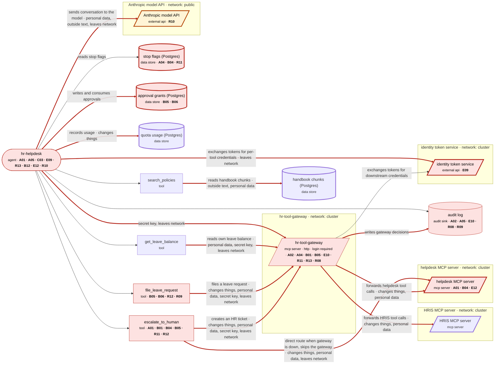

# Security map and action plan: hr-helpdesk

Review of `eval-v8/s-hr-agent (hr-helpdesk-agent)` at commit `unknown`, 2026-10-02T09:46:32Z.

**14 things to fix** and **5 things that need proof** were found. Each one below has a person to lead it, a place to write who is doing it, and steps to follow.

## 1. Map

This map shows what the agent connects to. Arrows point from the part that starts an action to the part it reaches.

- **Red box:** something here must be fixed. The codes in the box (like B06) are the actions in section 3.
- **Yellow box:** something here needs proof that it is safe.
- **Thick red arrow:** a connection that can cause harm if misused. Section 2 says why.
- **Dashed box:** we don't yet know which network it runs in.
- **Thick border:** found by reading the code, not just the settings files.



This map shows only the parts with actions or risky connections. The full map has 17 parts; draw it with `topology.py mermaid`.

## 2. Connections that matter

These connections could cause harm if someone misused the agent. Check them first.

| From | To | Why it matters | Open actions | Evidence |
|---|---|---|---|---|
| file_leave_request | hr-tool-gateway | can change, send or delete things; carries personal data; uses a secret key or token; crosses into another system or network | B05 | src/gateway_client.py:50 |
| escalate_to_human | hr-tool-gateway | can change, send or delete things; carries personal data; uses a secret key or token; crosses into another system or network | B01, B05, R11 | src/gateway_client.py:50 |
| hr-helpdesk | Anthropic model API | carries personal data; brings in text an outsider could write; crosses into another system or network | R10 | src/agent.py:70 |
| get_leave_balance | hr-tool-gateway | carries personal data; uses a secret key or token; crosses into another system or network | A02, A04, B01, B05, E10, R08, R11, R13 | src/gateway_client.py:50 |
| escalate_to_human | helpdesk MCP server | can change, send or delete things; carries personal data; crosses into another system or network | A01, B04 | src/gateway_client.py:59 |
| hr-helpdesk | hr-tool-gateway | uses a secret key or token; crosses into another system or network | R13 | .mcp.json:3 |
| search_policies | handbook chunks (Postgres) | brings in text an outsider could write; carries personal data | - | src/agent.py:167 |
| hr-tool-gateway | HRIS MCP server | can change, send or delete things; carries personal data | - | src/gateway.py:180 |
| hr-tool-gateway | helpdesk MCP server | can change, send or delete things; carries personal data | A01, B04, E12 | src/gateway.py:180 |
| hr-helpdesk | approval grants (Postgres) | can change, send or delete things | B05, B06 | src/approvals.py:46 |
| hr-helpdesk | quota usage (Postgres) | can change, send or delete things | - | src/budgets.py:85 |
| hr-helpdesk | identity token service | crosses into another system or network | E09 | src/credentials.py:47 |
| hr-helpdesk | employee SSO | we don't yet know which network it is in | - | src/main.py:38 |
| hr-tool-gateway | audit log | can change, send or delete things | A02, E10, R08 | src/gateway.py:133 |

## 3. Action list

Fill in **Assigned to** with a person's name. The **Lead** is the team that owns the fix (see ROLES.md).

| # | What to fix | Where | Priority | Lead | Assigned to |
|---|---|---|---|---|---|
| [A01](#a01) | The agent uses a shared database password. It can also reach the helpdesk server without the gateway checking it. | hr-helpdesk, escalate_to_human, helpdesk MCP server | Must fix before release (G1) | Infrastructure | _____ |
| [A02](#a02) | Some gateway audit rows hold made-up or missing identity values. A failed log write for a denial is ignored. | hr-tool-gateway, audit log | Must fix before release (G1) | Agent team | _____ |
| [A04](#a04) | The gateway trusts an instance id that the caller puts in a header. A caller could use another instance's id. | hr-tool-gateway, stop flags (Postgres) | Must fix before release (G1) | Infrastructure | _____ |
| [A05](#a05) | An operator cannot go from an audit row to the approved manifest. Manifests are only kept as build files. | hr-helpdesk, audit log | Must fix before release (G1) | Operations | _____ |
| [B01](#b01) | If the gateway is down, the agent sends escalate_to_human straight to the helpdesk server. That skips the gateway allowlist and its disabled-tool check. | escalate_to_human, hr-tool-gateway | Must fix before release (G1) | Agent team | _____ |
| [B04](#b04) | A gateway error sends escalations straight to the helpdesk server. A stop flag does not reach that path. | escalate_to_human, helpdesk MCP server, stop flags (Postgres) | Must fix before release (G1) | Infrastructure | _____ |
| [B05](#b05) | Only the agent checks approvals, and its own database role can write them. The gateway does not check approvals. | file_leave_request, escalate_to_human, approval grants (Postgres), hr-tool-gateway | Must fix before release (G1) | Agent team | _____ |
| [B06](#b06) | An approval does not record the tool scope. The action could run under a scope the employee never approved. | approval grants (Postgres), file_leave_request | Must fix before release (G1) | Agent team | _____ |
| [C03](#c03) | Nothing outside the agent checks that the running image matches the approved release. | hr-helpdesk | Must fix before release (G1) | Infrastructure | _____ |
| [E09](#e09) | On stop, cached tokens stay valid for up to five minutes. Finished effects are not listed for cleanup. | hr-helpdesk, identity token service | Must fix before release (G1) | Operations | _____ |
| [E10](#e10) | Gateway audit rows use unverified headers and lack vendor receipt ids. Direct route calls leave no gateway row. | hr-tool-gateway, audit log | Must fix before release (G1) | Infrastructure | _____ |
| [R11](#r11) | The gateway ignores stops by agent type. A gateway error sends escalations around the gateway. | hr-tool-gateway, stop flags (Postgres), escalate_to_human | Must fix before release (G1) | Operations | _____ |
| [R12](#r12) | No tool says what to do on stop. A write that timed out is given to the model as a plain error. | file_leave_request, escalate_to_human | Must fix before release (G1) | Agent team | _____ |
| [R13](#r13) | Some failed tool calls leave no step record. Model retries and gateway fallbacks are not recorded, and operation ids are mostly missing. | hr-helpdesk, hr-tool-gateway | Must fix before release (G1) | Agent team | _____ |
| [B12](#b12) | We cannot see from code that only reviewed changes reach the main branch. Branch rules live outside the repo. | hr-helpdesk | Show proof it works before release (G1) | Agent team | _____ |
| [E12](#e12) | No fleet incident drill, impact query or responder routing is in the repo. | hr-helpdesk, helpdesk MCP server | Show proof it works (G3) | Security | _____ |
| [R08](#r08) | Denials are saved, but no rules watch them and nobody is alerted. | audit log, hr-tool-gateway | Show proof it works (G3) | Security | _____ |
| [R09](#r09) | Nothing looks for risky tool sequences or checks detection across different context sizes. | audit log, file_leave_request | Show proof it works (G3) | Security | _____ |
| [R10](#r10) | It is not stated whether deliberate model misalignment is in scope. No second reviewer exists. | hr-helpdesk, Anthropic model API | Show proof it works (G3) | Security | _____ |

## 4. How to fix each one

### A01

**Distinct agent identity** · Must fix before release (G1)

**The problem:** The agent uses a shared database password. It can also reach the helpdesk server without the gateway checking it.

**Where:** hr-helpdesk, escalate_to_human, helpdesk MCP server — `k8s/deployment.yaml:31`

**Lead:** Infrastructure · **Assigned to:** _____ · **Effort:** medium

**Steps:**

1. Open `src/gateway_client.py` and delete the direct route fallback at lines 51 to 59.
2. Open `config/tools.yaml` and remove the `direct_route` block at line 91 under escalate_to_human.
3. Replace the static `DATABASE_URL` secret in `k8s/deployment.yaml` with short-lived database credentials tied to the pod identity.
4. Add a test that makes the gateway fail. The escalation must be refused and must not reach the helpdesk server.

**You are done when:** Every database and tool call uses the agent's own identity and passes the gateway check.

**Also fixes or affects:** B01, B04, E06

### A02

**All six identity fields** · Must fix before release (G1)

**The problem:** Some gateway audit rows hold made-up or missing identity values. A failed log write for a denial is ignored.

**Where:** hr-tool-gateway, audit log — `migrations/001_init.sql:8`

**Lead:** Agent team · **Assigned to:** _____ · **Effort:** medium

**Steps:**

1. Open `src/gateway.py` and go to the `_log` function at line 129.
2. Read the agent type and instance ids from the verified token claims, not from request headers.
3. In the `except` block near line 196, stop swallowing the error. Return a failure when the audit write fails.
4. Add a test that sends a denied call with no headers. The audit row must still hold all six fields.

**You are done when:** Every gateway audit row has all six identity fields taken from verified claims.

### A04

**Trustworthy attribution** · Must fix before release (G1)

**The problem:** The gateway trusts an instance id that the caller puts in a header. A caller could use another instance's id.

**Where:** hr-tool-gateway, stop flags (Postgres) — `src/main.py:79`

**Lead:** Infrastructure · **Assigned to:** _____ · **Effort:** medium

**Steps:**

1. Ask the identity service team to add the instance id and agent type id as claims in the exchanged token.
2. Open `src/gateway.py` and go to line 170. Read the instance id from the verified claims instead of the header.
3. Use the same claim for the rate limit at line 173 and the stop check at line 171.
4. Add a test that sends a forged instance header. The gateway must ignore it.

**You are done when:** A forged instance header changes no stop or rate decision at the gateway.

### A05

**Operational lookup** · Must fix before release (G1)

**The problem:** An operator cannot go from an audit row to the approved manifest. Manifests are only kept as build files.

**Where:** hr-helpdesk, audit log — `config/agent.yaml:4`

**Lead:** Operations · **Assigned to:** _____ · **Effort:** medium

**Steps:**

1. Open `.github/workflows/release.yml` and go to line 57, where the manifest is uploaded.
2. Store the manifest in a durable place, named by the agent type id, and keep it as long as the audit rows.
3. Add the git commit hash to each audit event in `src/audit.py` near line 36.
4. Check by picking one audit row and finding its manifest in under five minutes.

**You are done when:** From any audit row, a person can find the manifest it was released with.

### B01

**Minimal tool surface** · Must fix before release (G1)

**The problem:** If the gateway is down, the agent sends escalate_to_human straight to the helpdesk server. That skips the gateway allowlist and its disabled-tool check.

**Where:** escalate_to_human, hr-tool-gateway — `src/tools.py:42`

**Lead:** Agent team · **Assigned to:** _____ · **Effort:** small

**Steps:**

1. Open `src/gateway_client.py` and delete lines 51 to 59, the whole `except GatewayUnavailable:` block that uses the direct route.
2. In the same file, remove the `try:` at line 46. Leave `token = await self._creds.token(...)` and `return await self._post(GATEWAY_URL, ...)` as plain lines.
3. Open `config/tools.yaml` and delete lines 91 to 93, the `direct_route:` key and its `endpoint` and `audience` lines under escalate_to_human.
4. Open `src/tools.py`. Delete line 59, `direct_route=t.get("direct_route"),`, and line 31, the `direct_route` field. Also remove `field` from the import on line 5.
5. Open `k8s/networkpolicy.yaml` and delete lines 48 to 50, the egress rule to `helpdesk-mcp` in `hr-helpdesk-agent-egress`. Keep the gateway rule at line 78.
6. Run `pip install pytest`. Create a new file named tests/test_gateway_down.py. Import `asyncio`, `httpx` and `pytest`. Import `GatewayClient` and `GatewayUnavailable` from `src.gateway_client`.
7. In that file, import `RunContext` from `src.audit` and `ToolRegistry` from `src.tools`. Add `class Creds:` with `async def token(self, **kw): return "t"`.
8. Add `class Down:` with `urls = []` and `async def post(self, url, **kw): self.urls.append(url); raise httpx.ConnectError("down")`.
9. Add a test that calls `GatewayClient(Down(), Creds()).call` for `escalate_to_human` inside `pytest.raises(GatewayUnavailable)`. Use `ToolRegistry.from_config().get(...)`, `RunContext` with eight text fields, and `operation_id="op1"`.
10. In that test, assert `Down.urls` holds only `GATEWAY_URL`, imported from `src.gateway_client`.
11. Run `python -m pytest tests/test_gateway_down.py` from the repo root. It must pass.

**You are done when:** With the gateway down, escalate_to_human fails and nothing reaches the helpdesk server except through the gateway.

**Also fixes or affects:** A01, B04, E06

### B04

**Independent revocation** · Must fix before release (G1)

**The problem:** A gateway error sends escalations straight to the helpdesk server. A stop flag does not reach that path.

**Where:** escalate_to_human, helpdesk MCP server, stop flags (Postgres) — `src/gateway.py:101`

**Lead:** Infrastructure · **Assigned to:** _____ · **Effort:** medium

**Steps:**

1. Delete the direct route fallback in `src/gateway_client.py` lines 51 to 59.
2. Remove the agent's egress rule to the helpdesk server in `k8s/networkpolicy.yaml` lines 48 to 50.
3. Shorten token life in `src/credentials.py` line 20, or revoke tokens when a stop flag is set.
4. Run a timed stop drill. Set a stop flag and confirm no call succeeds within ten seconds.

**You are done when:** After a stop flag is set, no tool call succeeds within ten seconds.

**Also fixes or affects:** E06, A01, B01

### B05

**Destructive-action interception** · Must fix before release (G1)

**The problem:** Only the agent checks approvals, and its own database role can write them. The gateway does not check approvals.

**Where:** file_leave_request, escalate_to_human, approval grants (Postgres), hr-tool-gateway — `config/tools.yaml:61`

**Lead:** Agent team · **Assigned to:** _____ · **Effort:** large

**Steps:**

1. Open `migrations/001_init.sql` near line 84 and remove the agent role's right to write `approved_by` and `approved_at`.
2. Create a separate approval service with its own database role. Let only that service write approvals.
3. In `src/gateway.py` after line 168, refuse approval-required tools unless a consumed approval id is sent and valid.
4. Add a test that calls file_leave_request through the gateway with no approval. It must be refused.

**You are done when:** A leave request with no valid approval is refused by the gateway.

### B06

**Approval integrity** · Must fix before release (G1)

**The problem:** An approval does not record the tool scope. The action could run under a scope the employee never approved.

**Where:** approval grants (Postgres), file_leave_request — `migrations/001_init.sql:56`

**Lead:** Agent team · **Assigned to:** _____ · **Effort:** small

**Steps:**

1. Do this fix before R13, because both edit `src/agent.py`. Do not deploy the code steps until the platform team has run step 3.
2. Create `migrations/002_approval_scope.sql` with two lines: `ALTER TABLE approvals.grants ADD COLUMN scope text NOT NULL DEFAULT 'unset';` and `ALTER TABLE approvals.grants ALTER COLUMN scope DROP DEFAULT;`.
3. Ask the platform team to run that file on the approvals database. Grants made earlier keep the value `unset`, so they are refused. That is safe.
4. In `src/agent.py` line 135, change the call to `self.approvals.consume(ctx, approval_id, spec.qualified, target, args, spec.scope)`.
5. In `src/agent.py` line 114, change the call to `self.approvals.request(ctx, spec.qualified, target, args, tool_use_id, spec.scope)`.
6. In `src/approvals.py` line 82, add `scope,` after `args_digest(args),` so the last value passed is the scope.
7. In `src/approvals.py`, add a new line after line 80 with the same indent: `AND scope = $7`.
8. In `src/approvals.py` line 67, add the parameter `scope: str` after `args: dict[str, Any]` in the `consume` signature.
9. In `src/approvals.py` line 52, add `scope,` after `self._ttl,` so the scope is the twelfth value.
10. In `src/approvals.py` line 50, change `now() + $11)` to `now() + $11, $12)`.
11. In `src/approvals.py` line 49, change `expires_at)` to `expires_at, scope)`.
12. In `src/approvals.py` line 43, add the parameter `scope: str` after `tool_use_id: str` in the `request` signature.
13. Create the folder `tests` if it is missing. Create `tests/test_b06_approval_scope.py` with the test below.
14. From the repository root run `python -m pytest tests/test_b06_approval_scope.py`. All three tests must pass.

**Test to add** (`tests/test_b06_approval_scope.py`):

```py
import asyncio

from src.agent import Agent
from src.approvals import ApprovalStore
from src.audit import RunContext
from src.tools import ToolSpec

CTX = RunContext(run_id="r1", agent_instance_id="pod/r1", agent_type_id="hr", tenant="acme", subject="e1",
                 accountable_party="a", operational_owner="o", agent_principal="p")


class FakePool:
    def __init__(self):
        self.executed, self.fetched = [], []

    async def execute(self, sql, *args):
        self.executed.append((sql, args))

    async def fetchrow(self, sql, *args):
        self.fetched.append((sql, args))
        return {"approval_id": "a1", "approved_by": "e1", "approved_at": None, "expires_at": None}


def test_request_stores_scope():
    pool = FakePool()
    store = ApprovalStore(pool, 600)
    asyncio.run(store.request(CTX, "hris/file_leave_request", "employee:e1",
                              {"leave_type": "annual", "start_date": "2026-01-01", "end_date": "2026-01-02"},
                              "tu1", "hris.leave.request"))
    sql, args = pool.executed[0]
    assert "scope" in sql
    assert "hris.leave.request" in args


def test_consume_compares_scope():
    pool = FakePool()
    store = ApprovalStore(pool, 600)
    asyncio.run(store.consume(CTX, "a1", "hris/file_leave_request", "employee:e1", {"x": 1}, "hris.leave.request"))
    sql, args = pool.fetched[0]
    assert "AND scope = $7" in sql
    assert args[-1] == "hris.leave.request"


def test_agent_passes_spec_scope_to_consume(monkeypatch):
    seen = {}

    class FakeApprovals:
        async def pending(self, approval_id):
            return {"run_id": "r1", "operation": "hris/file_leave_request", "args": {"leave_type": "unpaid"},
                    "tool_use_id": "tu1"}

        async def consume(self, ctx, approval_id, operation, target, args, scope):
            seen["scope"] = scope
            return {"approved_by": "e1", "approved_at": __import__("datetime").datetime.now()}

    class FakeStop:
        async def raise_if_stopped(self, ctx):
            return None

    class FakeAudit:
        async def record(self, *a, **k):
            return "evt"

    spec = ToolSpec(name="file_leave_request", kind="mcp", qualified="hris/file_leave_request", reason="r",
                    scope="hris.leave.request", approval="subject", input_schema={}, target_template="employee:{subject}")

    class FakeRegistry:
        def by_qualified(self, q):
            return spec

    agent = Agent.__new__(Agent)
    agent.approvals, agent.stop, agent.audit, agent.registry = FakeApprovals(), FakeStop(), FakeAudit(), FakeRegistry()

    async def fake_execute(*a, **k):
        return {"type": "tool_result"}

    async def fake_run(ctx, state):
        return state

    agent._execute, agent.run = fake_execute, fake_run
    import src.agent as mod
    monkeypatch.setattr(mod, "validate_tool_args", lambda s, a: a)
    state = type("S", (), {"messages": [], "status": "", "pending_approval": 1, "last_step": None})()
    asyncio.run(agent.resume_with_approval(CTX, state, "a1"))
    assert seen["scope"] == "hris.leave.request"
```

Run it with `python -m pytest tests/test_b06_approval_scope.py`.

**You are done when:** An approval is refused if the tool scope at execution differs from the scope stored when it was requested.

### C03

**Match release identity to running state** · Must fix before release (G1)

**The problem:** Nothing outside the agent checks that the running image matches the approved release.

**Where:** hr-helpdesk — `k8s/deployment.yaml:43`

**Lead:** Infrastructure · **Assigned to:** _____ · **Effort:** medium

**Steps:**

1. Open `k8s/admission.yaml` and go to line 48, where only the signature is checked.
2. Add a rule that compares the running image digest and agent type id with the stamped manifest.
3. Add a scheduled job that also compares the served model name with the manifest.
4. Test by deploying an unlisted digest in a test cluster. The rule must refuse it.

**You are done when:** A pod running an unapproved digest or type id is refused or flagged.

### E09

**Recursive shutdown** · Must fix before release (G1)

**The problem:** On stop, cached tokens stay valid for up to five minutes. Finished effects are not listed for cleanup.

**Where:** hr-helpdesk, identity token service — `src/killswitch.py:58`

**Lead:** Operations · **Assigned to:** _____ · **Effort:** medium

**Steps:**

1. Open `src/killswitch.py` and go to line 58. Call `drop_subject` on the credential broker when a run is stopped.
2. Ask the identity service to revoke the run's tokens on stop. Shorten the token life in `src/credentials.py` line 20 if it cannot.
3. In `src/main.py` near line 91, write a record of the effects that finished before the stop.
4. Add a test that stops a run and then tries to use its token. The call must fail within ten seconds.

**You are done when:** After a stop, the run's tokens fail within ten seconds and finished effects are listed.

### E10

**Audit across service boundaries** · Must fix before release (G1)

**The problem:** Gateway audit rows use unverified headers and lack vendor receipt ids. Direct route calls leave no gateway row.

**Where:** hr-tool-gateway, audit log — `migrations/001_init.sql:81`

**Lead:** Infrastructure · **Assigned to:** _____ · **Effort:** medium

**Steps:**

1. Open `src/gateway.py` and go to line 138. Take the type and instance ids from verified claims.
2. Near line 190, read the receipt id from the upstream reply and store it in the audit row.
3. Add a `receipt_id` column in `migrations/001_init.sql` near line 81.
4. Remove the direct route in `src/gateway_client.py` and add a test that every tool call leaves a gateway row.

**You are done when:** Each tool call has one gateway audit row with verified ids and the vendor receipt id.

**Also fixes or affects:** E06, E11

### R11

**Tested kill switch** · Must fix before release (G1)

**The problem:** The gateway ignores stops by agent type. A gateway error sends escalations around the gateway.

**Where:** hr-tool-gateway, stop flags (Postgres), escalate_to_human — `src/gateway.py:99`

**Lead:** Operations · **Assigned to:** _____ · **Effort:** medium

**Steps:**

1. Open `src/gateway.py` and go to the stop query at line 99. Add the agent type scope.
2. Read the agent type from a verified token claim, not from a header.
3. Delete the direct route fallback in `src/gateway_client.py` lines 51 to 59.
4. Run a dated stop drill for each scope and save the results as evidence for recipe R11.

**You are done when:** A stop for any scope blocks calls at the gateway, proved by a dated drill.

### R12

**Safe state after stopping** · Must fix before release (G1)

**The problem:** No tool says what to do on stop. A write that timed out is given to the model as a plain error.

**Where:** file_leave_request, escalate_to_human — `config/tools.yaml:55`

**Lead:** Agent team · **Assigned to:** _____ · **Effort:** medium

**Steps:**

1. Open `config/tools.yaml` near line 55 and add a stop behaviour for each tool.
2. In `src/gateway_client.py` line 85, raise a distinct error when the outcome is unknown.
3. On that error, save a hold with an owner and block retries until someone checks HRIS or the helpdesk.
4. Add a test with a timed out write. It must create a hold and must not retry.

**You are done when:** A write with an unknown outcome creates a hold and is not retried.

### R13

**Full execution audit** · Must fix before release (G1)

**The problem:** Some failed tool calls leave no step record. Model retries and gateway fallbacks are not recorded, and operation ids are mostly missing.

**Where:** hr-helpdesk, hr-tool-gateway — `src/agent.py:193`

**Lead:** Agent team · **Assigned to:** _____ · **Effort:** medium

**Steps:**

1. Do B06 first, because it also edits `src/agent.py`. In each file below, make the edits from the bottom of the file upward.
2. In `src/agent.py`, add a new block after line 192, at the same indent as the other `except` lines: `except (GatewayUnavailable, httpx.HTTPError) as exc:`.
3. Inside that block, call `await self.audit.record(ctx, "tool_error", step_id=step_id, tool=spec.qualified, target=target, decision="error", reason=type(exc).__name__, approval_id=approval_id, args=args, result={"operation_id": operation_id})`.
4. On the next line of that block, add `return _tool_result(tool_use_id, f"{spec.name} is unavailable right now.", error=True)`.
5. In `src/agent.py` replace line 177 with a call that ends `operation_id=operation_id, on_fallback=note_fallback)`. Keep the rest of that call as it is.
6. Just above that call, in the same `else` block, define `async def note_fallback(route: str) -> None:`. It calls `await self.audit.record(ctx, "gateway_fallback", step_id=step_id, tool=spec.qualified, target=target, decision="retry", reason=route, approval_id=approval_id)`.
7. In `src/agent.py`, add a line after line 163 with 8 spaces of indent: `await self.audit.record(ctx, "tool_call_sent", step_id=step_id, tool=spec.qualified, target=target, approval_id=approval_id, result={"operation_id": operation_id})`.
8. In `src/agent.py` line 18, change the import to `from .gateway_client import GatewayClient, GatewayUnavailable, ToolDenied, ToolError`.
9. In `src/agent.py`, add the line `import httpx` after line 12, which is `from anthropic import AsyncAnthropic`.
10. In `src/gateway_client.py`, add two lines after line 54. The first is `if on_fallback is not None:` at 12 spaces of indent. The second is `await on_fallback("direct_route")` at 16.
11. In `src/gateway_client.py` line 44, add a new parameter after `operation_id: str`: `on_fallback: Callable[[str], Awaitable[None]] | None = None`.
12. In `src/gateway_client.py` line 6, change the import to `from typing import Any, Awaitable, Callable`.
13. In `src/main.py` line 172, change `AsyncAnthropic(max_retries=1)` to `AsyncAnthropic(max_retries=0)`, so the SDK cannot retry a model call without a record.
14. Create the folder `tests` if it is missing. Create `tests/test_r13_audit_steps.py` with the test below.
15. From the repository root run `python -m pytest tests/test_r13_audit_steps.py`. All four tests must pass.

**Test to add** (`tests/test_r13_audit_steps.py`):

```py
import asyncio
import pathlib

import httpx

from src.agent import Agent
from src.audit import RunContext
from src.gateway_client import GatewayClient, GatewayUnavailable
from src.tools import ToolSpec

CTX = RunContext(run_id="r1", agent_instance_id="pod/r1", agent_type_id="hr", tenant="acme", subject="e1",
                 accountable_party="a", operational_owner="o", agent_principal="p")


def make_spec(direct_route=None):
    return ToolSpec(name="escalate_to_human", kind="mcp", qualified="helpdesk/create_ticket", reason="r",
                    scope="helpdesk.ticket.create", approval="subject", input_schema={}, server="helpdesk",
                    target_template="queue:hr-advisors", direct_route=direct_route)


class FakeAudit:
    def __init__(self):
        self.events = []

    async def record(self, ctx, event_type, **kw):
        self.events.append((event_type, kw))
        return "evt"


def test_gateway_unavailable_is_audited():
    class DownGateway:
        async def call(self, *a, **k):
            raise GatewayUnavailable("down")

    agent = Agent.__new__(Agent)
    agent.audit, agent.gateway = FakeAudit(), DownGateway()
    agent.cfg = {"limits": {"max_tool_output_bytes": 1000}}
    args = {"summary": "x" * 12, "category": "leave"}
    result = asyncio.run(agent._execute(CTX, type("S", (), {"subject_token": "t"})(), "s1", "tu1", make_spec(),
                                        "queue:hr-advisors", args, approval_id=None))
    assert result["is_error"] is True
    types = [e[0] for e in agent.audit.events]
    assert "tool_error" in types
    err = dict(agent.audit.events)["tool_error"]
    assert err["tool"] == "helpdesk/create_ticket" and err["args"] == args


def test_operation_id_recorded_before_send():
    class DownGateway:
        async def call(self, *a, **k):
            raise GatewayUnavailable("down")

    agent = Agent.__new__(Agent)
    agent.audit, agent.gateway = FakeAudit(), DownGateway()
    agent.cfg = {"limits": {"max_tool_output_bytes": 1000}}
    asyncio.run(agent._execute(CTX, type("S", (), {"subject_token": "t"})(), "s1", "tu1", make_spec(),
                               "queue:hr-advisors", {}, approval_id=None))
    first = agent.audit.events[0]
    assert first[0] == "tool_call_sent"
    assert first[1]["result"]["operation_id"]


def test_direct_route_fallback_calls_hook():
    class Creds:
        async def token(self, **kw):
            return "tok"

    class Resp:
        status_code = 200

        def json(self):
            return {"result": {"structuredContent": {"ticket_id": "HR-000001"}}}

    class Http:
        def __init__(self):
            self.n = 0

        async def post(self, url, **kw):
            self.n += 1
            if self.n == 1:
                raise httpx.ConnectError("down")
            return Resp()

    seen = []

    async def hook(route):
        seen.append(route)

    spec = make_spec({"endpoint": "https://h/mcp", "audience": "helpdesk-mcp"})
    gw = GatewayClient(Http(), Creds())
    out = asyncio.run(gw.call(spec, {}, CTX, "subj", operation_id="op1", on_fallback=hook))
    assert out["ticket_id"] == "HR-000001"
    assert seen == ["direct_route"]


def test_model_client_does_not_retry_silently():
    text = pathlib.Path("src/main.py").read_text()
    assert "AsyncAnthropic(max_retries=0)" in text
```

Run it with `python -m pytest tests/test_r13_audit_steps.py`.

**You are done when:** A tool call that fails, retries or falls back leaves an audit record that holds its operation id.

### B12

**Reviewed harness and instructions** · Show proof it works before release (G1)

**The problem:** We cannot see from code that only reviewed changes reach the main branch. Branch rules live outside the repo.

**Where:** hr-helpdesk — `src/agent.py:28`

**Lead:** Agent team · **Assigned to:** _____ · **Effort:** small

**Steps:**

1. Open the repository settings and export the ruleset for the main branch.
2. Check that force push and deletion are blocked and that code owner review is required.
3. Save the export with its date in the evidence folder and link it from the record.
4. Check that `CODEOWNERS` covers `src/`, `prompts/` and `config/`.

**You are done when:** The main branch ruleset shows blocked force pushes and required code owner review.

### E12

**Fleet incident response** · Show proof it works (G3)

**The problem:** No fleet incident drill, impact query or responder routing is in the repo.

**Where:** hr-helpdesk, helpdesk MCP server

**Lead:** Security · **Assigned to:** _____ · **Effort:** medium

**Steps:**

1. Write down who responds when an outside tool server is found to be compromised.
2. Write a query over `audit.events` that lists agent instances that called a named tool server in a time range.
3. Run a drill. Mark helpdesk as compromised, run the query, set stop flags and revoke tokens.
4. Save the drill date, timings and results as evidence for recipe E12.

**You are done when:** A dated drill shows affected instances found and stopped within the target time.

### R08

**Security monitoring** · Show proof it works (G3)

**The problem:** Denials are saved, but no rules watch them and nobody is alerted.

**Where:** audit log, hr-tool-gateway

**Lead:** Security · **Assigned to:** _____ · **Effort:** medium

**Steps:**

1. List the attacks to catch, such as repeated denials, forged tokens and many approvals in a row.
2. Write detection rules over `audit.events` and `audit.gateway_decisions` in your monitoring tool.
3. Route each alert to a named person or team and write their name in the rule.
4. Replay a test denial and confirm an alert reaches that person.

**You are done when:** A test denial raises an alert that reaches a named responder.

### R09

**Sequence and context-aware detection** · Show proof it works (G3)

**The problem:** Nothing looks for risky tool sequences or checks detection across different context sizes.

**Where:** audit log, file_leave_request — `src/approvals.py:31`

**Lead:** Security · **Assigned to:** _____ · **Effort:** medium

**Steps:**

1. Write rules for risky tool sequences over `audit.events`, such as many leave requests in a short time.
2. Add rules that use `context_tokens`, which `src/audit.py` stores at line 36.
3. Test each rule with a short and a long conversation.
4. Save the results as evidence for recipe R09.

**You are done when:** Test sequences raise alerts for both short and long conversations.

### R10

**Misaligned-behavior review** · Show proof it works (G3)

**The problem:** It is not stated whether deliberate model misalignment is in scope. No second reviewer exists.

**Where:** hr-helpdesk, Anthropic model API

**Lead:** Security · **Assigned to:** _____ · **Effort:** small

**Steps:**

1. Ask the accountable owner to write whether deliberate model misalignment is in scope.
2. If it is in scope, add a second model reviewer for consequential actions and run recipe R10.
3. If it is not in scope, ask governance to approve a not applicable entry.
4. Save the decision in the record.

**You are done when:** A written decision on misalignment scope exists, with a reviewer or an approved exemption.

## 5. What this report does not show

- It comes from reading code and settings. It does not prove the agent is safe when it runs.
- The map may be missing parts. Parts reached only through code are included only if the reviewer traced them.
- We don't know which network these run in: employee SSO.
