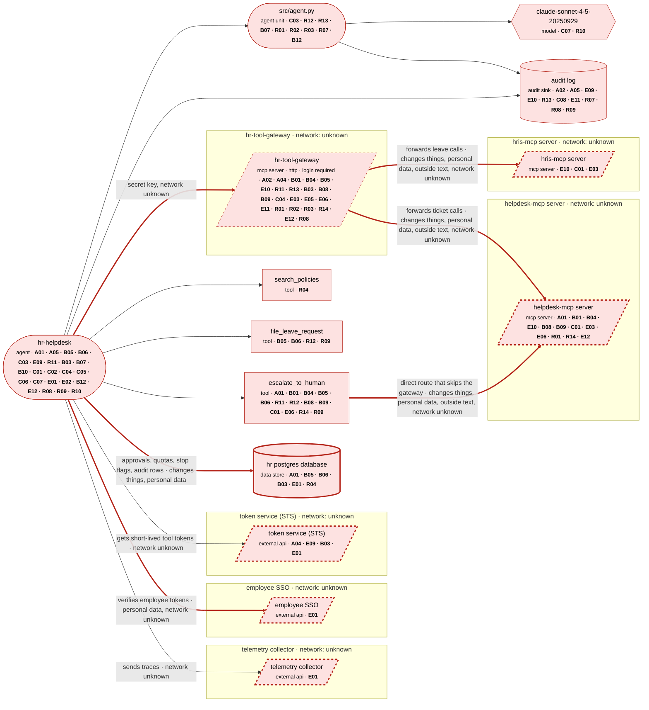

# Security map and action plan: hr-helpdesk

Review of `eval-v8/s-hr-agent (hr-helpdesk-agent)` at commit `unknown`, 2026-10-02T09:46:32Z.

**38 things to fix** and **5 things that need proof** were found. Each one below has a person to lead it, a place to write who is doing it, and steps to follow.

## 1. Map

This map shows what the agent connects to. Arrows point from the part that starts an action to the part it reaches.

- **Red box:** something here must be fixed. The codes in the box (like B06) are the actions in section 3.
- **Yellow box:** something here needs proof that it is safe.
- **Thick red arrow:** a connection that can cause harm if misused. Section 2 says why.
- **Dashed box:** we don't yet know which network it runs in.
- **Thick border:** found by reading the code, not just the settings files.



This map shows only the parts with actions or risky connections. The full map has 15 parts; draw it with `topology.py mermaid`.

## 2. Connections that matter

These connections could cause harm if someone misused the agent. Check them first.

| From | To | Why it matters | Open actions | Evidence |
|---|---|---|---|---|
| hr-tool-gateway | hris-mcp server | can change, send or delete things; carries personal data; brings in text an outsider could write; we don't yet know which network it is in | E03, E10 | src/gateway.py:180 |
| hr-tool-gateway | helpdesk-mcp server | can change, send or delete things; carries personal data; brings in text an outsider could write; we don't yet know which network it is in | B01, B04, B08, B09, E03, E06, E10, E12, R01, R14 | src/gateway.py:180 |
| escalate_to_human | helpdesk-mcp server | can change, send or delete things; carries personal data; brings in text an outsider could write; we don't yet know which network it is in | A01, B01, B04, B08, B09, C01, E06, R14 | src/gateway_client.py:59 |
| hr-helpdesk | hr-tool-gateway | uses a secret key or token; we don't yet know which network it is in | B03, B05, C04, E12, R08, R11 | .mcp.json:3 |
| hr-helpdesk | hr postgres database | can change, send or delete things; carries personal data | A01, B03, B05, B06, E01 | src/main.py:165 |
| hr-helpdesk | employee SSO | carries personal data; we don't yet know which network it is in | E01 | src/main.py:38 |
| hr-helpdesk | token service (STS) | we don't yet know which network it is in | B03, E01, E09 | src/credentials.py:18 |
| hr-helpdesk | telemetry collector | we don't yet know which network it is in | E01 | src/main.py:52 |

## 3. Action list

Fill in **Assigned to** with a person's name. The **Lead** is the team that owns the fix (see ROLES.md).

| # | What to fix | Where | Priority | Lead | Assigned to |
|---|---|---|---|---|---|
| [A01](#a01) | The agent logs in to its database with a fixed password. Escalations can also skip the gateway's identity check. | hr-helpdesk, hr postgres database, escalate_to_human, helpdesk-mcp server | Must fix before release (G1) | Infrastructure | _____ |
| [A02](#a02) | Some gateway denials are logged with caller-supplied or `unknown` ids. If the denial log write fails, the failure is ignored. | hr-tool-gateway, audit log | Must fix before release (G1) | Agent team | _____ |
| [A04](#a04) | The gateway takes the instance id from a header the caller sets. A caller can pick any id and dodge stop and rate limits. | hr-tool-gateway, token service (STS) | Must fix before release (G1) | Infrastructure | _____ |
| [A05](#a05) | An operator can read the agent type id from the audit log but cannot find its manifest. Manifests are kept in CI by git commit only. | hr-helpdesk, audit log | Must fix before release (G1) | Operations | _____ |
| [B01](#b01) | When the gateway fails, `escalate_to_human` goes straight to `helpdesk-mcp`. The gateway's tool allowlist and disable check are skipped. | escalate_to_human, hr-tool-gateway, helpdesk-mcp server | Must fix before release (G1) | Agent team | _____ |
| [B04](#b04) | When the gateway errors, the agent sends escalations straight to `helpdesk-mcp`. A stop flag is not enforced on that path. | escalate_to_human, hr-tool-gateway, helpdesk-mcp server | Must fix before release (G1) | Infrastructure | _____ |
| [B05](#b05) | Approval is checked only inside the agent. The agent's own database role can write approvals, and the gateway never checks one. | hr-helpdesk, hr postgres database, hr-tool-gateway, file_leave_request, escalate_to_human | Must fix before release (G1) | Agent team | _____ |
| [B06](#b06) | An approval is tied to the instance, operation, target and arguments, but not to the tool scope the action runs under. | hr-helpdesk, hr postgres database, file_leave_request, escalate_to_human | Must fix before release (G1) | Agent team | _____ |
| [C03](#c03) | Only Kyverno and the pod itself check what is running. Nothing outside the agent compares the running image and type id with the approved manifest. | hr-helpdesk, src/agent.py | Must fix before release (G1) | Infrastructure | _____ |
| [E09](#e09) | A stop cancels running work, but cached 300 second tokens stay. Effects that finished before the stop are not recorded for follow-up. | hr-helpdesk, token service (STS), audit log | Must fix before release (G1) | Operations | _____ |
| [E10](#e10) | Gateway audit rows take ids from unverified headers and never store the vendor's receipt id. Direct route calls leave no gateway row. | hr-tool-gateway, audit log, hris-mcp server, helpdesk-mcp server | Must fix before release (G1) | Infrastructure | _____ |
| [R11](#r11) | A stop on an agent type is enforced only in the agent. The gateway does not check it, and escalations can skip the gateway. | hr-tool-gateway, escalate_to_human, hr-helpdesk | Must fix before release (G1) | Operations | _____ |
| [R12](#r12) | No tool says what happens on a stop. A write that times out is returned to the model as a normal error, so it may be tried again. | file_leave_request, escalate_to_human, src/agent.py | Must fix before release (G1) | Agent team | _____ |
| [R13](#r13) | A gateway outage on a normal tool leaves no step record. Retries by the model library are not recorded. | src/agent.py, hr-tool-gateway, audit log | Must fix before release (G1) | Agent team | _____ |
| [B03](#b03) | The Anthropic key and database logins have no expiry or rotation. The gateway does not check how long its downstream tokens last. | hr-helpdesk, token service (STS), hr postgres database, hr-tool-gateway | Fix before release, or get a written risk approval (G2) | Infrastructure | _____ |
| [B07](#b07) | Wall time is checked only between model steps. One step with many tool calls can run well past the 90 second limit. | hr-helpdesk, src/agent.py | Fix before release, or get a written risk approval (G2) | Agent team | _____ |
| [B08](#b08) | The agent pod may open a network connection to the production helpdesk server directly. That path skips the tool gateway. | escalate_to_human, helpdesk-mcp server, hr-tool-gateway | Fix before release, or get a written risk approval (G2) | Infrastructure | _____ |
| [B09](#b09) | The agent's egress policy lets it reach `helpdesk-mcp` directly, and the client code uses it. Blocked traffic is not shown to reach a responder. | escalate_to_human, helpdesk-mcp server, hr-tool-gateway | Fix before release, or get a written risk approval (G2) | Infrastructure | _____ |
| [B10](#b10) | Kyverno accepts any digest-pinned image from `registry.acme.example` in `hr-agent`, even one that no signature rule covers. | hr-helpdesk | Fix before release, or get a written risk approval (G2) | Infrastructure | _____ |
| [C01](#c01) | The release manifest leaves out the direct route to `helpdesk-mcp`. Some entries have no owner or fixed version. | hr-helpdesk, escalate_to_human, hris-mcp server, helpdesk-mcp server | Fix before release, or get a written risk approval (G2) | Agent team | _____ |
| [C02](#c02) | One team, people-platform, owns every line of `CODEOWNERS`. It alone can approve config, k8s and release changes. No emergency path is written down. | hr-helpdesk | Fix before release, or get a written risk approval (G2) | Governance | _____ |
| [C04](#c04) | The only drift check is a hash at pod start. Network policy, permissions and the MCP server list are never compared, and no alert is sent. | hr-helpdesk, hr-tool-gateway | Fix before release, or get a written risk approval (G2) | Operations | _____ |
| [C05](#c05) | The Dockerfile pulls its build syntax image by the changeable tag `docker/dockerfile:1.10`. The tag can point to different code later. | hr-helpdesk | Fix before release, or get a written risk approval (G2) | Agent team | _____ |
| [C06](#c06) | Release test results are not stored with the release. The attack test suite is not in the repository. | hr-helpdesk | Fix before release, or get a written risk approval (G2) | Agent team | _____ |
| [C07](#c07) | There is no recovery or rollback procedure. The hosted model's retirement date is not recorded. | hr-helpdesk, claude-sonnet-4-5-20250929 | Fix before release, or get a written risk approval (G2) | Operations | _____ |
| [C08](#c08) | The nightly job keeps only six weekly audit partitions. Audit rows are deleted after about six weeks, not six months. | audit log | Fix before release, or get a written risk approval (G2) | Operations | _____ |
| [E01](#e01) | The release manifest leaves out services the code calls. Entries do not name an agent-team owner and a platform owner. | hr-helpdesk, token service (STS), employee SSO, telemetry collector, hr postgres database | Fix before release, or get a written risk approval (G2) | Governance | _____ |
| [E02](#e02) | No scan looks for known flaws in packages. The base image signature is not checked. Packages and remote MCP servers have no approval record. | hr-helpdesk | Fix before release, or get a written risk approval (G2) | Security | _____ |
| [E03](#e03) | The gateway checks tool descriptions, but nothing records which version of each MCP server is approved, or when it is next reviewed. | hris-mcp server, helpdesk-mcp server, hr-tool-gateway | Fix before release, or get a written risk approval (G2) | Infrastructure | _____ |
| [E05](#e05) | The lookalike name check misses letters from other alphabets that look the same, and it only writes a log line. | hr-tool-gateway | Fix before release, or get a written risk approval (G2) | Infrastructure | _____ |
| [E06](#e06) | When the gateway is down, `escalate_to_human` goes straight to `helpdesk-mcp` with a token the agent makes itself. All gateway checks are skipped. | escalate_to_human, helpdesk-mcp server, hr-tool-gateway | Fix before release, or get a written risk approval (G2) | Infrastructure | _____ |
| [E11](#e11) | Audit partitions are dropped after about six weeks. Rows have no way to show gaps. The gateway writes the allow record only after it acts. | audit log, hr-tool-gateway | Fix before release, or get a written risk approval (G2) | Infrastructure | _____ |
| [R01](#r01) | Error messages from tools reach the model as free text. They get no size, content or redaction checks. | src/agent.py, hr-tool-gateway, helpdesk-mcp server | Fix before release, or get a written risk approval (G2) | Agent team | _____ |
| [R02](#r02) | Tool results are labeled as untrusted, but error results pass raw text with no label. Injection tests are not repeated or adaptive. | src/agent.py, hr-tool-gateway | Fix before release, or get a written risk approval (G2) | Security | _____ |
| [R03](#r03) | Tool error text reaches the model without redaction. Logs, audit rows and tool output are redacted. | src/agent.py, hr-tool-gateway | Fix before release, or get a written risk approval (G2) | Agent team | _____ |
| [R04](#r04) | The handbook search cache ignores who is asking. A result cached for one employee can be shown to another. | hr postgres database, search_policies | Fix before release, or get a written risk approval (G2) | Agent team | _____ |
| [R07](#r07) | Only model call rows hold the context size. Action rows have none, and approved actions run under a new trace. | src/agent.py, audit log | Fix before release, or get a written risk approval (G2) | Agent team | _____ |
| [R14](#r14) | After a 503 from the gateway, the agent resends the helpdesk ticket on the direct route. The first call may already have gone through. | escalate_to_human, hr-tool-gateway, helpdesk-mcp server | Fix before release, or get a written risk approval (G2) | Agent team | _____ |
| [B12](#b12) | Code shows that only `main` is deployed. Nothing shows that the `main` branch blocks force pushes and needs code owner review. | hr-helpdesk, src/agent.py | Show proof it works before release (G1) | Agent team | _____ |
| [E12](#e12) | Stop flags and tool checks exist, but no drill shows the team can find and stop work tied to a bad MCP server. | hr-helpdesk, helpdesk-mcp server, hr-tool-gateway | Show proof it works (G3) | Security | _____ |
| [R08](#r08) | Denials are written to the audit tables, but no rule watches them and no named person receives an alert. | hr-helpdesk, audit log, hr-tool-gateway | Show proof it works (G3) | Security | _____ |
| [R09](#r09) | Each action is checked by the employee, but nothing looks at action sequences or tests different kinds of content separately. | hr-helpdesk, audit log, file_leave_request, escalate_to_human | Show proof it works (G3) | Security | _____ |
| [R10](#r10) | Nothing says whether deliberate model misalignment is in scope. No second reviewer model is present. | hr-helpdesk, claude-sonnet-4-5-20250929 | Show proof it works (G3) | Security | _____ |

## 4. How to fix each one

### A01

**Distinct agent identity** · Must fix before release (G1)

**The problem:** The agent logs in to its database with a fixed password. Escalations can also skip the gateway's identity check.

**Where:** hr-helpdesk, hr postgres database, escalate_to_human, helpdesk-mcp server — `k8s/deployment.yaml:31`

**Lead:** Infrastructure · **Assigned to:** _____ · **Effort:** large

**Steps:**

1. Do E06 first. It removes the direct route to `helpdesk-mcp` that skips the gateway.
2. Ask the platform team for short-lived database logins for role `hr_agent`. Tie them to the agent's service account. Vault dynamic roles can do this.
3. Open `k8s/deployment.yaml`. Replace the `DATABASE_URL` secret on lines 51 and 52 with the short-lived login the platform team gives you.
4. In `release/manifest.yaml` line 61, write the new login lifetime next to `database_role`.
5. Ask the platform team to show that the agent database login expires on its own. Run the E06 test to confirm no call skips the gateway.

**You are done when:** The agent database login expires on its own, and no tool call skips the gateway.

**Also fixes or affects:** B01, B04, E06

### A02

**All six identity fields** · Must fix before release (G1)

**The problem:** Some gateway denials are logged with caller-supplied or `unknown` ids. If the denial log write fails, the failure is ignored.

**Where:** hr-tool-gateway, audit log — `migrations/001_init.sql:8`

**Lead:** Agent team · **Assigned to:** _____ · **Effort:** medium

**Steps:**

1. Ask the identity team to add `agent_type_id` and `agent_instance_id` claims to the tokens the STS issues. Do not start the code steps until they confirm.
2. Open `src/gateway.py`. Replace lines 196 and 197 with `except Exception:` then `log.critical("gateway deny not audited", extra={"tool": tool})`.
3. In the same file, replace line 139 with `c.get("agent_instance_id") or "unknown",` and line 138's header lookup with `c.get("agent_type_id") or "unknown"`.
4. Ask the security team to add an alert on the log message `gateway deny not audited`.
5. Send the gateway a request with a bad token. Check that the new `audit.gateway_decisions` row has no `missing` values, or that the alert fires.

**You are done when:** Every row in `audit.gateway_decisions` has verified type and instance ids, and a failed denial write raises an alert.

### A04

**Trustworthy attribution** · Must fix before release (G1)

**The problem:** The gateway takes the instance id from a header the caller sets. A caller can pick any id and dodge stop and rate limits.

**Where:** hr-tool-gateway, token service (STS) — `src/main.py:79`

**Lead:** Infrastructure · **Assigned to:** _____ · **Effort:** medium

**Steps:**

1. Ask the identity team to add `agent_instance_id` and `agent_type_id` claims to STS tokens. Do not deploy the code steps before they confirm.
2. Open `src/credentials.py`. In the `data` dict on lines 49 to 59, add `"agent_instance_id": instance_id`. Add `instance_id` as an argument of `token()` and update its callers in `src/gateway_client.py`.
3. Open `src/gateway.py`. Replace line 170 with `instance = claims.get("agent_instance_id", "")`.
4. In the same file, add `OR (scope = 'agent_type' AND value = $4)` to the SQL on line 101, and pass `claims.get("agent_type_id")` as the fourth argument on line 102.
5. Send a call with a forged `X-Agent-Instance` header. Check that the gateway uses the id in the token, not the header.

**You are done when:** A stop flag on an instance or agent type blocks the gateway call, even when the header says another id.

### A05

**Operational lookup** · Must fix before release (G1)

**The problem:** An operator can read the agent type id from the audit log but cannot find its manifest. Manifests are kept in CI by git commit only.

**Where:** hr-helpdesk, audit log — `config/agent.yaml:4`

**Lead:** Operations · **Assigned to:** _____ · **Effort:** medium

**Steps:**

1. Ask the platform team for a store that keeps manifests by `agent_type_id`, for as long as audit rows are kept (at least six months).
2. Open `.github/workflows/release.yml`. After line 58, add a step that copies `release/manifest.yaml` and the file made by the type id step into that store under the id `${{ steps.typeid.outputs.id }}`.
3. Open `config/agent.yaml`. On line 4, add the store location to the ownership text so an operator knows where to look.
4. Take one agent type id from `audit.events` and fetch its manifest from the store. Confirm the owner and image digest show up.

**You are done when:** Given an `agent_type_id` from an audit row, an operator can fetch the matching manifest from the store.

### B01

**Minimal tool surface** · Must fix before release (G1)

**The problem:** When the gateway fails, `escalate_to_human` goes straight to `helpdesk-mcp`. The gateway's tool allowlist and disable check are skipped.

**Where:** escalate_to_human, hr-tool-gateway, helpdesk-mcp server — `src/tools.py:42`

**Lead:** Agent team · **Assigned to:** _____ · **Effort:** small

**Steps:**

1. Open `src/tools.py`. Delete line 59 (`direct_route=t.get("direct_route"),`). Then delete line 31, the `direct_route` field of `ToolSpec`.
2. Open `src/gateway_client.py`. Delete lines 51 to 59, the whole `except GatewayUnavailable:` block.
3. In the same file, delete line 46 (`try:`). Then move lines 47 to 50 left by four spaces so they sit directly under `async def call`.
4. Open `config/tools.yaml`. Delete lines 91 to 93, the `direct_route:` key with its `endpoint` and `audience`, under `escalate_to_human`.
5. Open `k8s/networkpolicy.yaml`. Delete lines 48 to 50, the egress rule that lets the agent reach `helpdesk-mcp` directly.
6. Create the test below, then run it. Also ask the it-service-desk team to make `helpdesk-mcp` accept calls only from the gateway identity.

**Test to add** (`tests/test_no_direct_route.py`):

```py
import pathlib
import yaml


def test_no_tool_has_a_direct_route():
    cfg = yaml.safe_load(pathlib.Path("config/tools.yaml").read_text())
    assert all("direct_route" not in t for t in cfg["tools"].values())
```

Run it with `python -m pytest tests/test_no_direct_route.py`.

**You are done when:** Every MCP tool call must pass the gateway allowlist, and no tool in `config/tools.yaml` has a `direct_route`.

**Also fixes or affects:** A01, B04, E06

### B04

**Independent revocation** · Must fix before release (G1)

**The problem:** When the gateway errors, the agent sends escalations straight to `helpdesk-mcp`. A stop flag is not enforced on that path.

**Where:** escalate_to_human, hr-tool-gateway, helpdesk-mcp server — `src/gateway.py:101`

**Lead:** Infrastructure · **Assigned to:** _____ · **Effort:** small

**Steps:**

1. Open `src/tools.py`. Delete line 59 (`direct_route=t.get("direct_route"),`). Then delete line 31, the `direct_route` field of `ToolSpec`.
2. Open `src/gateway_client.py`. Delete lines 51 to 59, the whole `except GatewayUnavailable:` block.
3. In the same file, delete line 46 (`try:`). Then move lines 47 to 50 left by four spaces so they sit directly under `async def call`.
4. Open `config/tools.yaml`. Delete lines 91 to 93, the `direct_route:` key with its `endpoint` and `audience`, under `escalate_to_human`.
5. Open `k8s/networkpolicy.yaml`. Delete lines 48 to 50, the egress rule that lets the agent reach `helpdesk-mcp` directly.
6. Create the test below, then run it. Also ask the it-service-desk team to make `helpdesk-mcp` accept calls only from the gateway identity.
7. Run the timed revocation drill (recipe B04): set a stop flag, then time how long until all calls are refused.

**Test to add** (`tests/test_no_direct_route.py`):

```py
import pathlib
import yaml


def test_no_tool_has_a_direct_route():
    cfg = yaml.safe_load(pathlib.Path("config/tools.yaml").read_text())
    assert all("direct_route" not in t for t in cfg["tools"].values())
```

Run it with `python -m pytest tests/test_no_direct_route.py`.

**You are done when:** A stop flag blocks every tool call, because every call passes through the gateway.

**Also fixes or affects:** E06, A01, B01

### B05

**Destructive-action interception** · Must fix before release (G1)

**The problem:** Approval is checked only inside the agent. The agent's own database role can write approvals, and the gateway never checks one.

**Where:** hr-helpdesk, hr postgres database, hr-tool-gateway, file_leave_request, escalate_to_human — `config/tools.yaml:61`

**Lead:** Agent team · **Assigned to:** _____ · **Effort:** large

**Steps:**

1. Do not deploy this until the platform team has created database role `hr_approver` and given it a login.
2. Open `src/gateway.py`. Before line 177, add: if `spec.approval == "subject"`, look up `approvals.grants` for the `Approval-Id` header. Deny with 403 unless `used_at` is under 60 seconds old and `approved_by = subject`.
3. Open `src/gateway_client.py`. In `_post` after line 71, add the header `"Approval-Id": operation_id`. For approved calls, `operation_id` is the approval id.
4. Open `src/main.py`. Create a second pool from env `APPROVER_DATABASE_URL`. Pass it to `ApprovalStore` on line 169 for `confirm()` only.
5. Create `migrations/002_approval_roles.sql`. Add `REVOKE UPDATE (approved_by, approved_at) ON approvals.grants FROM hr_agent;` and grant that update plus select to `hr_approver`. Grant `hr_gateway` select on the table.
6. Send a tool call with no approval to the gateway. It must be refused with 403.

**You are done when:** The gateway refuses an approval-required tool call that has no consumed approval, and `hr_agent` cannot write `approved_by`.

### B06

**Approval integrity** · Must fix before release (G1)

**The problem:** An approval is tied to the instance, operation, target and arguments, but not to the tool scope the action runs under.

**Where:** hr-helpdesk, hr postgres database, file_leave_request, escalate_to_human — `migrations/001_init.sql:56`

**Lead:** Agent team · **Assigned to:** _____ · **Effort:** medium

**Steps:**

1. Do not deploy the code steps until the platform team has run the new migration.
2. Create `migrations/002_approval_scope.sql` with `ALTER TABLE approvals.grants ADD COLUMN scope text NOT NULL DEFAULT '';`.
3. Open `src/approvals.py`. In `consume`, add `AND scope = $7` after line 80. Add `spec_scope` as the last value on line 82. Add `spec_scope` to the signature on line 67.
4. In the same file, in `request`, add `scope` to the column list on line 48. Add a `$12` placeholder on line 50.
5. Still in `request`, pass `scope` as the last value on line 52. Add `scope` to the function signature on line 43.
6. Open `src/agent.py`. Pass `spec.scope` to `self.approvals.consume(...)` on line 135, and to `self.approvals.request(...)` on line 114.
7. Approve a request, change the scope in the database, and try to consume it. It must fail with `ApprovalInvalid`.

**You are done when:** An approval that was granted for one tool scope cannot be used under a different scope.

### C03

**Match release identity to running state** · Must fix before release (G1)

**The problem:** Only Kyverno and the pod itself check what is running. Nothing outside the agent compares the running image and type id with the approved manifest.

**Where:** hr-helpdesk, src/agent.py — `k8s/deployment.yaml:43`

**Lead:** Infrastructure · **Assigned to:** _____ · **Effort:** medium

**Steps:**

1. Ask the platform team for read-only cluster access for a CI job, limited to the `hr-agent` namespace.
2. Create `.github/workflows/verify-running.yml` with a daily schedule. It runs `kubectl get deploy hr-helpdesk-agent -n hr-agent -o jsonpath='{.spec.template.spec.containers[0].image}'`.
3. In the same job, read `.release.image.digest` and `.release.agent_type_id` from `release/manifest.yaml` with `yq`. Fail the job if the digest or the type id differs.
4. Add a step that sends the failure to the on-call channel. Ask the operations team to name the channel.
5. Change the digest in a staging copy of the manifest. Run the job. It must fail and alert.

**You are done when:** A scheduled job outside the agent fails and alerts when the running image digest or type id differs from the approved manifest.

### E09

**Recursive shutdown** · Must fix before release (G1)

**The problem:** A stop cancels running work, but cached 300 second tokens stay. Effects that finished before the stop are not recorded for follow-up.

**Where:** hr-helpdesk, token service (STS), audit log — `src/killswitch.py:58`

**Lead:** Operations · **Assigned to:** _____ · **Effort:** medium

**Steps:**

1. Open `src/main.py`. Make `startup` (line 163) build `creds = CredentialBroker(mtls)`, and use `creds` on line 172. Add `creds` to the `global` list on line 164. Declare `creds: CredentialBroker` near line 60.
2. In `_drive`, after the `audit.record` calls on lines 91 and 94, add `creds.drop_subject(ctx.subject)`.
3. In the same two places, also record `await audit.record(ctx, "stop_reconcile", decision="stop", result={"completed": _runs[ctx.run_id][1].extra.get("completed", [])})`.
4. Open `src/agent.py`. After line 193 (`tool_result` audit call), add `state.extra.setdefault("completed", []).append(f"{spec.qualified}:{operation_id}")`.
5. Ask the identity team for a token revoke call on the STS. Add it next to `drop_subject`.
6. Set a stop flag mid-run. Check that the cache is empty and a `stop_reconcile` row lists the finished calls, within 10 seconds.

**You are done when:** After a stop, the agent holds no cached tokens for that employee, and a `stop_reconcile` audit row lists completed tool calls.

### E10

**Audit across service boundaries** · Must fix before release (G1)

**The problem:** Gateway audit rows take ids from unverified headers and never store the vendor's receipt id. Direct route calls leave no gateway row.

**Where:** hr-tool-gateway, audit log, hris-mcp server, helpdesk-mcp server — `migrations/001_init.sql:81`

**Lead:** Infrastructure · **Assigned to:** _____ · **Effort:** medium

**Steps:**

1. Do E06 first. It removes the direct route. Do A02 first. It fixes the unverified ids.
2. Create `migrations/002_gateway_receipt.sql` with `ALTER TABLE audit.gateway_decisions ADD COLUMN vendor_receipt_id text;`.
3. Open `src/gateway.py`. In line 190, pass `receipt=structured.get("request_id") or structured.get("ticket_id")` to `_log`.
4. In `_log` (line 129), add `receipt: str | None = None`. Add `vendor_receipt_id` and `$13` to the SQL on lines 134 to 136, and pass `receipt` on line 140.
5. Make one allowed call in staging. Check that the new row holds the ticket or request id.

**You are done when:** Every allowed gateway call has a row in `audit.gateway_decisions` with the vendor receipt id.

**Also fixes or affects:** E06, E11

### R11

**Tested kill switch** · Must fix before release (G1)

**The problem:** A stop on an agent type is enforced only in the agent. The gateway does not check it, and escalations can skip the gateway.

**Where:** hr-tool-gateway, escalate_to_human, hr-helpdesk — `src/gateway.py:99`

**Lead:** Operations · **Assigned to:** _____ · **Effort:** small

**Steps:**

1. Do A04 first. It puts `agent_type_id` in the token. Do E06 first. It removes the direct route.
2. Open `src/gateway.py`. On line 102, add `claims.get("agent_type_id")` as a fourth argument after `claims["act"]["sub"]`.
3. On line 101, add `OR (scope = 'agent_type' AND value = $4)` inside the `WHERE`.
4. Run recipe R11. Set an `agent_type` stop flag, time how long until the gateway refuses calls, and save the dated result.

**You are done when:** A stop flag with scope `agent_type` makes the gateway refuse that agent's tool calls.

### R12

**Safe state after stopping** · Must fix before release (G1)

**The problem:** No tool says what happens on a stop. A write that times out is returned to the model as a normal error, so it may be tried again.

**Where:** file_leave_request, escalate_to_human, src/agent.py — `config/tools.yaml:55`

**Lead:** Agent team · **Assigned to:** _____ · **Effort:** medium

**Steps:**

1. Open `src/agent.py`. In `_execute`, before line 183, add a branch: if `exc.status == 504`, store `state.extra["hold"] = operation_id`, record an `outcome_unknown` audit event, and return a fixed message.
2. In `_handle_tool`, before line 106, add: if `state.extra.get("hold")`, return `_tool_result(tool_use_id, "An advisor will check this first.", error=True)`.
3. Open `config/tools.yaml`. Under each tool (lines 18, 30, 55 and 82) add `on_stop:` as `cancel`, `complete` or `reconcile`.
4. Ask hris-platform and it-service-desk how to check a request by its `Idempotency-Key`. Write the answer in `release/runbook.md`. Create it.
5. Simulate a timeout in staging. Check that no second call is sent and a hold row exists.

**You are done when:** A timed-out write is held with an owner, and no retry is sent until someone checks the other system.

### R13

**Full execution audit** · Must fix before release (G1)

**The problem:** A gateway outage on a normal tool leaves no step record. Retries by the model library are not recorded.

**Where:** src/agent.py, hr-tool-gateway, audit log — `src/agent.py:193`

**Lead:** Agent team · **Assigned to:** _____ · **Effort:** small

**Steps:**

1. Open `src/main.py`. On line 172, change `AsyncAnthropic(max_retries=1)` to `AsyncAnthropic(max_retries=0)`.
2. Open `src/agent.py`. Before line 179, add `except GatewayUnavailable as exc:`. Record `tool_error` with `reason=f"gateway unavailable, operation {operation_id}"`. Return `_tool_result(tool_use_id, "The tool is not available right now.", error=True)`.
3. On line 18, add `GatewayUnavailable` to the import from `.gateway_client`.
4. Do E06 first, so no fallback call goes unrecorded.
5. Stop the gateway in staging and make one call. Check that an `audit.events` row shows the failure.

**You are done when:** A call that fails because the gateway is down has an audit row naming the operation id.

### B03

**Credential lifetime and handling** · Fix before release, or get a written risk approval (G2)

**The problem:** The Anthropic key and database logins have no expiry or rotation. The gateway does not check how long its downstream tokens last.

**Where:** hr-helpdesk, token service (STS), hr postgres database, hr-tool-gateway — `.mcp.json:7`

**Lead:** Infrastructure · **Assigned to:** _____ · **Effort:** medium

**Steps:**

1. Ask the platform team to rotate secrets `hr-agent-anthropic` and `hr-agent-db` on a schedule, for example every 30 days. Ask them to write the lifetime down.
2. Open `src/gateway.py`. Replace line 126 with `data = resp.json()`. Then add `if data.get("expires_in", 10**9) > 300:` and, indented under it, `raise PermissionError("downstream token too long")`.
3. On the next line of the same function add `return data["access_token"]`.
4. Open `release/manifest.yaml`. Under `permissions:` near line 60, add the rotation period of each secret.
5. Ask the identity team to cap downstream token lifetime at 300 seconds for audiences `hris-mcp` and `helpdesk-mcp`. Check that a longer token is refused.

**You are done when:** Each secret has a written rotation period, and the gateway refuses a downstream token that lives longer than 300 seconds.

### B07

**Hard execution budgets** · Fix before release, or get a written risk approval (G2)

**The problem:** Wall time is checked only between model steps. One step with many tool calls can run well past the 90 second limit.

**Where:** hr-helpdesk, src/agent.py — `config/agent.yaml:18`

**Lead:** Agent team · **Assigned to:** _____ · **Effort:** small

**Steps:**

1. Open `src/agent.py`. Replace line 177 with `raw = await asyncio.wait_for(self.gateway.call(spec, args, ctx, state.subject_token, operation_id=operation_id), timeout=max(state.budget.remaining_seconds(), 0.1))`.
2. In the same file, add `import asyncio` as a new line 4, above `import json`.
3. Open `src/budgets.py`. At the start of `check_tool_call` (line 58), add `if time.monotonic() - self.started > self.cfg["max_wall_seconds"]:` then, indented, `raise BudgetExceeded("max_wall_seconds")`.
4. Create the test below and run it.

**Test to add** (`tests/test_budget_wall.py`):

```py
import time

import pytest

from src.budgets import BudgetExceeded, RunBudget


def test_tool_call_refused_after_wall_time():
    cfg = {"max_steps": 12, "max_wall_seconds": 90, "max_total_tokens": 60000,
           "max_cost_usd": 0.4, "max_tool_calls_per_minute": 20, "max_subagents": 0}
    budget = RunBudget(cfg, {})
    budget.started = time.monotonic() - 100
    with pytest.raises(BudgetExceeded):
        budget.check_tool_call()
```

Run it with `python -m pytest tests/test_budget_wall.py`.

**You are done when:** A tool call that starts after the 90 second wall limit is refused with `BudgetExceeded`.

### B08

**Environment isolation** · Fix before release, or get a written risk approval (G2)

**The problem:** The agent pod may open a network connection to the production helpdesk server directly. That path skips the tool gateway.

**Where:** escalate_to_human, helpdesk-mcp server, hr-tool-gateway — `k8s/networkpolicy.yaml:8`

**Lead:** Infrastructure · **Assigned to:** _____ · **Effort:** small

**Steps:**

1. Open `src/tools.py`. Delete line 59 (`direct_route=t.get("direct_route"),`). Then delete line 31, the `direct_route` field of `ToolSpec`.
2. Open `src/gateway_client.py`. Delete lines 51 to 59, the whole `except GatewayUnavailable:` block.
3. In the same file, delete line 46 (`try:`). Then move lines 47 to 50 left by four spaces so they sit directly under `async def call`.
4. Open `config/tools.yaml`. Delete lines 91 to 93, the `direct_route:` key with its `endpoint` and `audience`, under `escalate_to_human`.
5. Open `k8s/networkpolicy.yaml`. Delete lines 48 to 50, the egress rule that lets the agent reach `helpdesk-mcp` directly.
6. Create the test below, then run it. Also ask the it-service-desk team to make `helpdesk-mcp` accept calls only from the gateway identity.

**Test to add** (`tests/test_no_direct_route.py`):

```py
import pathlib
import yaml


def test_no_tool_has_a_direct_route():
    cfg = yaml.safe_load(pathlib.Path("config/tools.yaml").read_text())
    assert all("direct_route" not in t for t in cfg["tools"].values())
```

Run it with `python -m pytest tests/test_no_direct_route.py`.

**You are done when:** The agent pod has no network route to `helpdesk-mcp`, and no tool has a `direct_route`.

**Also fixes or affects:** B09, E06

### B09

**Egress allowlist** · Fix before release, or get a written risk approval (G2)

**The problem:** The agent's egress policy lets it reach `helpdesk-mcp` directly, and the client code uses it. Blocked traffic is not shown to reach a responder.

**Where:** escalate_to_human, helpdesk-mcp server, hr-tool-gateway — `k8s/networkpolicy.yaml:32`

**Lead:** Infrastructure · **Assigned to:** _____ · **Effort:** small

**Steps:**

1. Open `src/tools.py`. Delete line 59 (`direct_route=t.get("direct_route"),`). Then delete line 31, the `direct_route` field of `ToolSpec`.
2. Open `src/gateway_client.py`. Delete lines 51 to 59, the whole `except GatewayUnavailable:` block.
3. In the same file, delete line 46 (`try:`). Then move lines 47 to 50 left by four spaces so they sit directly under `async def call`.
4. Open `config/tools.yaml`. Delete lines 91 to 93, the `direct_route:` key with its `endpoint` and `audience`, under `escalate_to_human`.
5. Open `k8s/networkpolicy.yaml`. Delete lines 48 to 50, the egress rule that lets the agent reach `helpdesk-mcp` directly.
6. Create the test below, then run it. Also ask the it-service-desk team to make `helpdesk-mcp` accept calls only from the gateway identity.
7. Ask the platform team to show that Cilium drop alerts for the `hr-agent` namespace reach the on-call person.

**Test to add** (`tests/test_no_direct_route.py`):

```py
import pathlib
import yaml


def test_no_tool_has_a_direct_route():
    cfg = yaml.safe_load(pathlib.Path("config/tools.yaml").read_text())
    assert all("direct_route" not in t for t in cfg["tools"].values())
```

Run it with `python -m pytest tests/test_no_direct_route.py`.

**You are done when:** The agent cannot reach `helpdesk-mcp`, and a blocked connection raises an alert for the on-call person.

**Also fixes or affects:** B08, E06

### B10

**Pinned, verified image** · Fix before release, or get a written risk approval (G2)

**The problem:** Kyverno accepts any digest-pinned image from `registry.acme.example` in `hr-agent`, even one that no signature rule covers.

**Where:** hr-helpdesk — `k8s/deployment.yaml:43`

**Lead:** Infrastructure · **Assigned to:** _____ · **Effort:** small

**Steps:**

1. Open `k8s/admission.yaml`. On line 35, replace the pattern with `"registry.acme.example/people/hr-helpdesk-agent@sha256:* | registry.acme.example/platform/*@sha256:*"`.
2. On line 33 (the `initContainers` pattern), make the same replacement.
3. Ask the platform team for the Kyverno version. In `release/manifest.yaml`, change line 74 to `admission: [k8s/admission.yaml]  # kyverno <version>`.
4. Run `kyverno test` with a pod whose image is `registry.acme.example/other/app@sha256:...`. It must be rejected.

**You are done when:** Kyverno rejects a pod in `hr-agent` whose image is not under the two signed registry paths.

### C01

**Complete release manifest** · Fix before release, or get a written risk approval (G2)

**The problem:** The release manifest leaves out the direct route to `helpdesk-mcp`. Some entries have no owner or fixed version.

**Where:** hr-helpdesk, escalate_to_human, hris-mcp server, helpdesk-mcp server — `release/manifest.yaml:31`

**Lead:** Agent team · **Assigned to:** _____ · **Effort:** medium

**Steps:**

1. Do E06 first. It removes the direct route, so the manifest needs no entry for it.
2. Open `release/manifest.yaml`. On lines 54 and 55, add `version_or_digest:` to each MCP server. Ask hris-platform and it-service-desk for the values.
3. On lines 34, 31 to 33 and 36, add `owner:` and a `ref:` (a git commit or digest) to the prompt, harness and configuration entries.
4. Compare the manifest with `config/tools.yaml`. Every server and tool in that file must appear in the manifest.

**You are done when:** Every artifact in the release manifest has an owner and a fixed version, and the manifest lists no direct route.

**Also fixes or affects:** E01

### C02

**Review security-relevant changes** · Fix before release, or get a written risk approval (G2)

**The problem:** One team, people-platform, owns every line of `CODEOWNERS`. It alone can approve config, k8s and release changes. No emergency path is written down.

**Where:** hr-helpdesk — `CODEOWNERS:3`

**Lead:** Governance · **Assigned to:** _____ · **Effort:** small

**Steps:**

1. Open `CODEOWNERS`. After line 10, add `/src/ @acme/people-platform @acme/security-engineering`, `/Dockerfile @acme/security-engineering` and `/requirements.txt @acme/security-engineering`.
2. On line 8 (`/release/`) and line 3 (`/config/`), keep only the security team. Remove `@acme/people-platform` from both.
3. On line 6 (`/k8s/`), keep only `@acme/platform-security`. On line 1, change the owner to `@acme/people-platform @acme/security-engineering`.
4. Create `release/break-glass.md`. List who may approve an emergency change, what to record (reason, time, approver), and that a second review follows within two working days.
5. Ask the security team to turn on "Require review from Code Owners" for `main`. Then open a test pull request that edits `config/agent.yaml`. It must need a security reviewer.

**You are done when:** A change to `config/`, `k8s/` or `release/` cannot be merged with only a people-platform approval.

### C04

**Detect drift per agent** · Fix before release, or get a written risk approval (G2)

**The problem:** The only drift check is a hash at pod start. Network policy, permissions and the MCP server list are never compared, and no alert is sent.

**Where:** hr-helpdesk, hr-tool-gateway — `src/type_id.py:20`

**Lead:** Operations · **Assigned to:** _____ · **Effort:** large

**Steps:**

1. Ask the platform team to turn on GitOps drift detection, for example Argo CD or Flux, for everything in `k8s/` in the `hr-agent` namespace.
2. Ask them to set an alert on any drift and a response time limit, for example one hour. Ask them to write both in `release/manifest.yaml`.
3. Create `.github/workflows/verify-config.yml` that compares `.mcp.json` and `config/tools.yaml` with the copy in the release artifact. Fail on any difference.
4. Change a network rule in a staging cluster by hand. Check that the alert fires within the time limit.

**You are done when:** A hand change to a network rule, permission or MCP server list raises an alert within the stated time limit.

### C05

**Control dependency, model, and training changes** · Fix before release, or get a written risk approval (G2)

**The problem:** The Dockerfile pulls its build syntax image by the changeable tag `docker/dockerfile:1.10`. The tag can point to different code later.

**Where:** hr-helpdesk — `requirements.txt:2`

**Lead:** Agent team · **Assigned to:** _____ · **Effort:** small

**Steps:**

1. Run `docker buildx imagetools inspect docker/dockerfile:1.10`. Copy the `Digest:` value.
2. Open `Dockerfile`. Change line 1 to `# syntax=docker/dockerfile:1.10@sha256:<digest>` using the digest you copied.
3. Create the test below and run it. Then run the release build once to check that it still works.

**Test to add** (`tests/test_dockerfile_pin.py`):

```py
def test_syntax_frontend_is_pinned_by_digest():
    with open("Dockerfile", encoding="utf-8") as fh:
        assert "@sha256:" in fh.readline()
```

Run it with `python -m pytest tests/test_dockerfile_pin.py`.

**You are done when:** Line 1 of `Dockerfile` names the syntax image with a `sha256` digest.

### C06

**Re-test changed behavior** · Fix before release, or get a written risk approval (G2)

**The problem:** Release test results are not stored with the release. The attack test suite is not in the repository.

**Where:** hr-helpdesk — `.github/workflows/release.yml:58`

**Lead:** Agent team · **Assigned to:** _____ · **Effort:** medium

**Steps:**

1. Open `.github/workflows/release.yml`. Replace line 58 with `path: |`. Below it, list three files on three lines: the type id file from the earlier step, the manifest and the test results.
2. On line 29, change the command to `python -m pytest -q tests/release --junitxml=test-results.xml`.
3. Create `tests/release/test_attacks.py`. Add tests that send injected tool output, a forged approval and a tool name that looks like another. Each must be refused.
4. Run the release workflow on a test branch. Check that the artifact `release-<sha>` now contains `test-results.xml`.

**You are done when:** The release artifact holds the test results next to the manifest and type id.

### C07

**Rollback and restart** · Fix before release, or get a written risk approval (G2)

**The problem:** There is no recovery or rollback procedure. The hosted model's retirement date is not recorded.

**Where:** hr-helpdesk, claude-sonnet-4-5-20250929 — `.github/workflows/release.yml:60`

**Lead:** Operations · **Assigned to:** _____ · **Effort:** medium

**Steps:**

1. Open `config/agent.yaml`. After line 11, add `retirement_date: "YYYY-MM-DD"`. Copy the date from the provider's model deprecation page for this model id.
2. Open `release/manifest.yaml`. Under `release:`, add `previous:` with the last approved image digest and type id.
3. Create the file `release/rollback.md`. Give the exact `kubectl` steps to go back to `previous`, and say that stop flags in `control.stop_flags` must stay on.
4. Ask the operations team to run the rollback in staging. Write the date in that new rollback file.

**You are done when:** `release/rollback.md` exists with a tested date, and `config/agent.yaml` states the model retirement date.

### C08

**Connect configuration to execution** · Fix before release, or get a written risk approval (G2)

**The problem:** The nightly job keeps only six weekly audit partitions. Audit rows are deleted after about six weeks, not six months.

**Where:** audit log — `src/agent.py:79`

**Lead:** Operations · **Assigned to:** _____ · **Effort:** small

**Steps:**

1. Open `k8s/audit-maintenance.yaml`. On line 35, change `value: "6"` to `value: "27"`. That is 26 weeks plus one spare.
2. Open `release/manifest.yaml`. Line 79 says `6 months`. Leave it, and add a note that the value is set by `KEEP_PARTITIONS`.
3. Do A05 so manifests are kept as long as the audit rows. Then create the test below and run it.

**Test to add** (`tests/test_audit_retention.py`):

```py
import pathlib
import re


def test_keep_partitions_covers_six_months():
    text = pathlib.Path("k8s/audit-maintenance.yaml").read_text()
    m = re.search(r'name: KEEP_PARTITIONS\s+value: "(\d+)"', text)
    assert m and int(m.group(1)) >= 27
```

Run it with `python -m pytest tests/test_audit_retention.py`.

**You are done when:** `KEEP_PARTITIONS` in `k8s/audit-maintenance.yaml` is at least 27.

**Also fixes or affects:** E11

### E01

**Map shared responsibilities** · Fix before release, or get a written risk approval (G2)

**The problem:** The release manifest leaves out services the code calls. Entries do not name an agent-team owner and a platform owner.

**Where:** hr-helpdesk, token service (STS), employee SSO, telemetry collector, hr postgres database — `release/manifest.yaml:69`

**Lead:** Governance · **Assigned to:** _____ · **Effort:** small

**Steps:**

1. Open `release/manifest.yaml`. After line 80, add a `dependencies:` list. Add one entry each for STS, SSO, the stop channel `control.stop_flags` and the telemetry collector.
2. Give each entry a `service`, an `agent_team_owner`, a `platform_owner` and `evidence:`. Use `src/credentials.py:18`, `src/main.py:36`, `src/killswitch.py:18` and `src/main.py:52`.
3. Add the same two owners to the MCP server entries on lines 54 and 55.
4. Compare the list with every URL in `src/`. Each outside service must be in the manifest.

**You are done when:** Every service the code calls has a manifest entry with an agent-team owner and a platform owner.

**Also fixes or affects:** C01

### E02

**Vet and pin dependencies** · Fix before release, or get a written risk approval (G2)

**The problem:** No scan looks for known flaws in packages. The base image signature is not checked. Packages and remote MCP servers have no approval record.

**Where:** hr-helpdesk — `requirements.txt:3`

**Lead:** Security · **Assigned to:** _____ · **Effort:** medium

**Steps:**

1. Open `.github/workflows/release.yml`. After line 39, add a step that runs Trivy on `${IMAGE}@${{ steps.build.outputs.digest }}` with `--exit-code 1 --severity HIGH,CRITICAL`.
2. After line 29, add a step that runs `cosign verify` on the base image from `Dockerfile` line 8. Use the publisher's identity and issuer.
3. After line 28, add `pip install pip-audit` and `pip-audit -r requirements.txt --require-hashes`.
4. Create `release/dependency-approvals.md`. For each package and MCP server, record the publisher, its permissions, the update source and who approved it.
5. Push a test branch with a known-bad package version pinned. The workflow must fail.

**You are done when:** The release build fails on a package with a known flaw. Every package and server has an approval record.

### E03

**Re-check tools on load** · Fix before release, or get a written risk approval (G2)

**The problem:** The gateway checks tool descriptions, but nothing records which version of each MCP server is approved, or when it is next reviewed.

**Where:** hris-mcp server, helpdesk-mcp server, hr-tool-gateway — `config/tools.yaml:38`

**Lead:** Infrastructure · **Assigned to:** _____ · **Effort:** small

**Steps:**

1. Ask hris-platform and it-service-desk for the image digest or version of `hris-mcp` and `helpdesk-mcp`, and for the date of their last review.
2. Open `release/manifest.yaml`. On lines 54 and 55, add `version_or_digest:` and `review_by:` to each server.
3. Open `config/tools.yaml`. Under each server on lines 4 to 13, add `version_or_digest:` with the same value.
4. Check that every server in `config/tools.yaml` has the two fields in the manifest.

**You are done when:** Each MCP server in the manifest has a recorded version or digest and a review date.

### E05

**Verified, namespaced tools** · Fix before release, or get a written risk approval (G2)

**The problem:** The lookalike name check misses letters from other alphabets that look the same, and it only writes a log line.

**Where:** hr-tool-gateway — `src/tools.py:72`

**Lead:** Infrastructure · **Assigned to:** _____ · **Effort:** medium

**Steps:**

1. Open `src/gateway.py`. After line 48, add `_blocked_servers: set[str] = set()`.
2. In `mcp()`, change line 166 to also deny when `spec.server in _blocked_servers`.
3. In `refresh_fingerprints`, replace lines 66 and 67 with: if the name is a lookalike, add both server ids to `_blocked_servers` and log the error.
4. Before line 65, add `if not name.isascii(): _blocked_servers.add(server_id)`. After line 60, add `_blocked_servers.clear()`.
5. Make a test server list a tool named with a Cyrillic `а`. Check that every call to that server is refused with 403.

**You are done when:** A server that lists a non-ASCII or lookalike tool name has all its tools refused by the gateway.

### E06

**Enforced gateway boundary** · Fix before release, or get a written risk approval (G2)

**The problem:** When the gateway is down, `escalate_to_human` goes straight to `helpdesk-mcp` with a token the agent makes itself. All gateway checks are skipped.

**Where:** escalate_to_human, helpdesk-mcp server, hr-tool-gateway — `src/gateway_client.py:59`

**Lead:** Infrastructure · **Assigned to:** _____ · **Effort:** small

**Steps:**

1. Open `src/tools.py`. Delete line 59 (`direct_route=t.get("direct_route"),`). Then delete line 31, the `direct_route` field of `ToolSpec`.
2. Open `src/gateway_client.py`. Delete lines 51 to 59, the whole `except GatewayUnavailable:` block.
3. In the same file, delete line 46 (`try:`). Then move lines 47 to 50 left by four spaces so they sit directly under `async def call`.
4. Open `config/tools.yaml`. Delete lines 91 to 93, the `direct_route:` key with its `endpoint` and `audience`, under `escalate_to_human`.
5. Open `k8s/networkpolicy.yaml`. Delete lines 48 to 50, the egress rule that lets the agent reach `helpdesk-mcp` directly.
6. Create the test below, then run it. Also ask the it-service-desk team to make `helpdesk-mcp` accept calls only from the gateway identity.
7. Update `README.md` line 36, which says escalations are delivered during gateway maintenance. State that they now wait.

**Test to add** (`tests/test_no_direct_route.py`):

```py
import pathlib
import yaml


def test_no_tool_has_a_direct_route():
    cfg = yaml.safe_load(pathlib.Path("config/tools.yaml").read_text())
    assert all("direct_route" not in t for t in cfg["tools"].values())
```

Run it with `python -m pytest tests/test_no_direct_route.py`.

**You are done when:** No tool call can reach `helpdesk-mcp` without passing the gateway, and `config/tools.yaml` has no `direct_route`.

**Also fixes or affects:** B04, E11, A01, B01, E10

### E11

**Protect shared evidence** · Fix before release, or get a written risk approval (G2)

**The problem:** Audit partitions are dropped after about six weeks. Rows have no way to show gaps. The gateway writes the allow record only after it acts.

**Where:** audit log, hr-tool-gateway — `k8s/audit-maintenance.yaml:35`

**Lead:** Infrastructure · **Assigned to:** _____ · **Effort:** medium

**Steps:**

1. Open `src/gateway.py`. Before line 177, add `await _log(request, claims, tool, "pending", "forwarding")` so a record exists before the call is sent.
2. Open `k8s/audit-maintenance.yaml`. On line 35, change `value: "6"` to `value: "27"`.
3. Ask the data-platform team to add a sequence number or hash chain to `audit.events`, and an alert when numbers skip.
4. Create the test below and run it. Then ask the data-platform team to show a gap alert firing in staging.

**Test to add** (`tests/test_audit_retention.py`):

```py
import pathlib
import re


def test_keep_partitions_covers_six_months():
    text = pathlib.Path("k8s/audit-maintenance.yaml").read_text()
    m = re.search(r'name: KEEP_PARTITIONS\s+value: "(\d+)"', text)
    assert m and int(m.group(1)) >= 27
```

Run it with `python -m pytest tests/test_audit_retention.py`.

**You are done when:** Audit rows are kept for at least 26 weeks, and a missing row raises an alert.

**Also fixes or affects:** C08, E06, E10

### R01

**Validate every input boundary, including API responses** · Fix before release, or get a written risk approval (G2)

**The problem:** Error messages from tools reach the model as free text. They get no size, content or redaction checks.

**Where:** src/agent.py, hr-tool-gateway, helpdesk-mcp server — `src/agent.py:188`

**Lead:** Agent team · **Assigned to:** _____ · **Effort:** small

**Steps:**

1. Open `src/gateway_client.py`. Replace line 94 with `raise ToolError(200, "upstream error")`. Replace line 91 with `raise ToolError(resp.status_code, "upstream error")`.
2. Open `src/gateway.py`. Replace line 184 with `return JSONResponse({"error": "upstream_error"}, status_code=502)`.
3. Open `src/agent.py`. Replace line 188 with `return _tool_result(tool_use_id, f"{spec.name} failed with status {exc.status}.", error=True)`.
4. Keep line 186. The audit log still stores the detail, and the audit writer redacts it.
5. Make a fake tool return an error that says "ignore previous instructions". Check that the model sees only the fixed text.

**You are done when:** The model only ever sees a fixed error message with the status number, never text from a tool.

**Also fixes or affects:** R02, R03

### R02

**Separate data from instructions and test injection containment** · Fix before release, or get a written risk approval (G2)

**The problem:** Tool results are labeled as untrusted, but error results pass raw text with no label. Injection tests are not repeated or adaptive.

**Where:** src/agent.py, hr-tool-gateway — `src/agent.py:71`

**Lead:** Security · **Assigned to:** _____ · **Effort:** medium

**Steps:**

1. Do R01 first. It makes error text fixed.
2. Open `src/agent.py`. On line 188, wrap the fixed text in the envelope: `json.dumps({"source": spec.qualified, "trust": "untrusted_data", "data": {"error": f"status {exc.status}"}})`.
3. Create `tests/release/test_injection.py`. Send 20 different injected strings in tool results, retried with new wording. Record how many get the model to act.
4. Write the success rate in `release/manifest.yaml` and set a maximum, for example zero.
5. Run `python -m pytest tests/release/test_injection.py`.

**You are done when:** Every tool result and error reaches the model inside the `untrusted_data` envelope, and injection test results are recorded.

**Also fixes or affects:** R01, R03

### R03

**Prevent output and log leakage** · Fix before release, or get a written risk approval (G2)

**The problem:** Tool error text reaches the model without redaction. Logs, audit rows and tool output are redacted.

**Where:** src/agent.py, hr-tool-gateway — `src/agent.py:188`

**Lead:** Agent team · **Assigned to:** _____ · **Effort:** small

**Steps:**

1. Open `src/agent.py`. Replace line 188 with `return _tool_result(tool_use_id, f"{spec.name} failed with status {exc.status}.", error=True)`.
2. Keep lines 186 and 187. The audit row and the log already redact the detail.
3. Ask the HR portal team to confirm that its content security policy has `img-src` limited to approved hosts.
4. Make a fake tool return an error with an email address. Check that the model sees only the fixed text.

**You are done when:** The model never sees raw tool error text, and the HR portal blocks images from other hosts.

**Also fixes or affects:** R01, R02

### R04

**Retrieval-corpus integrity** · Fix before release, or get a written risk approval (G2)

**The problem:** The handbook search cache ignores who is asking. A result cached for one employee can be shown to another.

**Where:** hr postgres database, search_policies — `migrations/001_init.sql:102`

**Lead:** Agent team · **Assigned to:** _____ · **Effort:** small

**Steps:**

1. Open `src/retrieval.py`. Replace line 46 with `key = self._key(query, employee_id)`.
2. In the same file, change line 40 to `def _key(self, query: str, employee_id: str) -> str:`.
3. Change line 42 to `return hashlib.sha256(f"{self._top_k}|{employee_id}|{normalized}".encode()).hexdigest()`.
4. Create the test below and run it.

**Test to add** (`tests/test_retrieval_cache.py`):

```py
from src.retrieval import PolicyIndex


def test_cache_key_differs_per_employee():
    index = PolicyIndex(None, 5, 900.0)
    assert index._key("leave policy", "emp-1") != index._key("leave policy", "emp-2")
```

Run it with `python -m pytest tests/test_retrieval_cache.py`.

**You are done when:** Two different employees asking the same question never share a cache entry.

### R07

**Decision-time context size** · Fix before release, or get a written risk approval (G2)

**The problem:** Only model call rows hold the context size. Action rows have none, and approved actions run under a new trace.

**Where:** src/agent.py, audit log — `src/agent.py:79`

**Lead:** Agent team · **Assigned to:** _____ · **Effort:** medium

**Steps:**

1. Open `src/agent.py`. After line 76, add `state.extra["context_tokens"] = ctx_tokens`.
2. In `_handle_tool` and `_execute`, add `context_tokens=state.extra.get("context_tokens"), context_tokens_method="measured:provider_usage_input+cache_read+cache_write"` to every `self.audit.record(...)` call.
3. On line 76, if `resp.usage.cache_read_input_tokens` is `None`, set the method text to `"measured:input_only_cache_unreported"` instead of counting it as 0.
4. Before line 119 (pause for approval), save the trace headers: `inject(carrier := {})` and `state.extra["carrier"] = carrier`.
5. In `resume_with_approval` (line 124), start the span with `context=TraceContextTextMapPropagator().extract(state.extra["carrier"])`.
6. Run one approved action. Check that all its `audit.events` rows share one `trace_id` and carry `context_tokens`.

**You are done when:** Every audit row for a model step or action has `context_tokens`, and an approved action keeps the trace id of its run.

### R14

**Recovery integrity** · Fix before release, or get a written risk approval (G2)

**The problem:** After a 503 from the gateway, the agent resends the helpdesk ticket on the direct route. The first call may already have gone through.

**Where:** escalate_to_human, hr-tool-gateway, helpdesk-mcp server — `src/gateway_client.py:86`

**Lead:** Agent team · **Assigned to:** _____ · **Effort:** medium

**Steps:**

1. Do R12 first. It adds the hold for an unknown outcome.
2. Open `src/tools.py`. Delete line 59 (`direct_route=t.get("direct_route"),`). Then delete line 31, the `direct_route` field of `ToolSpec`.
3. Open `src/gateway_client.py`. Delete lines 51 to 59, the whole `except GatewayUnavailable:` block.
4. In the same file, delete line 46 (`try:`). Then move lines 47 to 50 left by four spaces so they sit directly under `async def call`.
5. Open `config/tools.yaml`. Delete lines 91 to 93, the `direct_route:` key with its `endpoint` and `audience`, under `escalate_to_human`.
6. Open `k8s/networkpolicy.yaml`. Delete lines 48 to 50, the egress rule that lets the agent reach `helpdesk-mcp` directly.
7. Create the test below, then run it. Also ask the it-service-desk team to make `helpdesk-mcp` accept calls only from the gateway identity.
8. Open `src/gateway_client.py`. Replace lines 86 and 87 with: if the status is 503, `raise ToolError(503, f"outcome unknown for operation {operation_id}")`.
9. Ask it-service-desk to confirm that `helpdesk-mcp` ignores a repeat `Idempotency-Key`.

**Test to add** (`tests/test_no_direct_route.py`):

```py
import pathlib
import yaml


def test_no_tool_has_a_direct_route():
    cfg = yaml.safe_load(pathlib.Path("config/tools.yaml").read_text())
    assert all("direct_route" not in t for t in cfg["tools"].values())
```

Run it with `python -m pytest tests/test_no_direct_route.py`.

**You are done when:** After a 503 the agent never resends a write. It marks the outcome unknown and holds it.

### B12

**Reviewed harness and instructions** · Show proof it works before release (G1)

**The problem:** Code shows that only `main` is deployed. Nothing shows that the `main` branch blocks force pushes and needs code owner review.

**Where:** hr-helpdesk, src/agent.py — `src/agent.py:28`

**Lead:** Agent team · **Assigned to:** _____ · **Effort:** small

**Steps:**

1. Ask a repository admin to open the settings page. Then they open Rules and the rule set for `main`.
2. Ask them to run `gh api repos/acme/hr-helpdesk-agent/rulesets` and save the JSON output.
3. Check that the ruleset blocks force pushes, blocks deletion, and requires review from code owners.
4. Save the output as `release/evidence/main-ruleset.json`. Create the folder if it does not exist.
5. Ask the security team to read the file and confirm the three rules are on.

**You are done when:** A saved export of the `main` ruleset shows force push blocked, deletion blocked and code owner review required.

### E12

**Fleet incident response** · Show proof it works (G3)

**The problem:** Stop flags and tool checks exist, but no drill shows the team can find and stop work tied to a bad MCP server.

**Where:** hr-helpdesk, helpdesk-mcp server, hr-tool-gateway

**Lead:** Security · **Assigned to:** _____ · **Effort:** medium

**Steps:**

1. Create `runbooks/compromised-mcp.md`. List who runs the drill, who is paged, and the steps below.
2. In staging, pretend `helpdesk-mcp` is bad. Run `SELECT DISTINCT agent_instance_id FROM audit.events WHERE tool LIKE 'helpdesk/%'` to find the affected instances.
3. Set a stop flag in `control.stop_flags` and disable the tool in the gateway. Revoke the tokens. Check that an alert reaches the responder.
4. Write the date, the time taken and any problem at the end of the runbook.

**You are done when:** `runbooks/compromised-mcp.md` has a dated drill record showing instances found, work stopped and the responder alerted.

### R08

**Security monitoring** · Show proof it works (G3)

**The problem:** Denials are written to the audit tables, but no rule watches them and no named person receives an alert.

**Where:** hr-helpdesk, audit log, hr-tool-gateway

**Lead:** Security · **Assigned to:** _____ · **Effort:** medium

**Steps:**

1. Ask the security team which SIEM they use and who is on call for this agent.
2. Create `detections/hr-agent-rules.md`. Write rules over `audit.events` and `audit.gateway_decisions`: many denials per employee in 5 minutes, any `authn` failure, and any `tool_denied` event.
3. Ask the security team to load the rules and route them to the named responder.
4. Run recipe R08. Trigger each rule in staging and note the time the responder was paged.

**You are done when:** Each rule fires in staging and pages the named responder.

### R09

**Sequence and context-aware detection** · Show proof it works (G3)

**The problem:** Each action is checked by the employee, but nothing looks at action sequences or tests different kinds of content separately.

**Where:** hr-helpdesk, audit log, file_leave_request, escalate_to_human — `src/approvals.py:31`

**Lead:** Security · **Assigned to:** _____ · **Effort:** medium

**Steps:**

1. Ask the security team who owns sequence detection for this agent.
2. Create `detections/hr-agent-sequences.md`. Write rules such as: three approval requests in one run, or a ticket right after a policy search.
3. Add a test run per content range: handbook text, employee messages and tool output. Write the result of each in the same file.
4. Ask the security team to load the rules and show one firing in staging.

**You are done when:** Sequence rules exist, fire in staging, and results are listed per content range.

### R10

**Misaligned-behavior review** · Show proof it works (G3)

**The problem:** Nothing says whether deliberate model misalignment is in scope. No second reviewer model is present.

**Where:** hr-helpdesk, claude-sonnet-4-5-20250929

**Lead:** Security · **Assigned to:** _____ · **Effort:** small

**Steps:**

1. Ask the security team and the business owner to decide if a model that acts against its goals is in scope.
2. Open `release/manifest.yaml`. After line 29, add `misalignment_scope:` with `in_scope: yes` or `no`, the reason and the approver.
3. If it is in scope, run recipe R10 and store the result in `release/evidence/`. If not, ask governance to approve an N/A record.

**You are done when:** `release/manifest.yaml` states whether misalignment is in scope, who decided, and links the R10 result or N/A approval.

## 5. What this report does not show

- It comes from reading code and settings. It does not prove the agent is safe when it runs.
- The map may be missing parts. Parts reached only through code are included only if the reviewer traced them.
- We don't know which network these run in: hr-tool-gateway, hris-mcp server, helpdesk-mcp server, token service (STS), employee SSO, telemetry collector.
