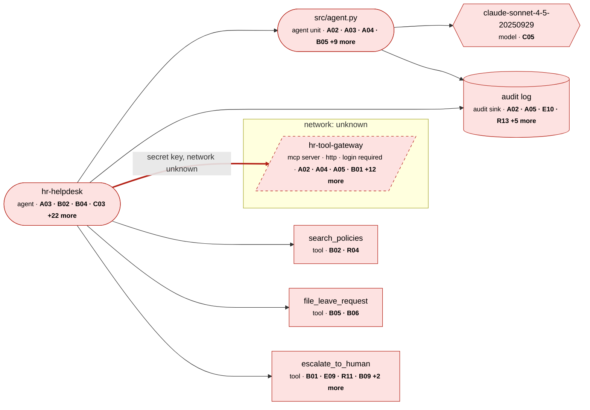

# Security map and action plan: hr-helpdesk

Review of `` at commit `unknown`, 2026-11-21T11:43:21Z.

**40 things to fix** and **7 things that need proof** were found. Each one below has a person to lead it, a place to write who is doing it, and steps to follow.

## 1. Map

This map shows what the agent connects to. Arrows point from the part that starts an action to the part it reaches.

- **Red box:** something here must be fixed. The codes in the box (like B06) are the actions in section 3.
- **Yellow box:** something here needs proof that it is safe.
- **Thick red arrow:** a connection that can cause harm if misused. Section 2 says why.
- **Dashed box:** we don't yet know which network it runs in.
- **Thick border:** found by reading the code, not just the settings files.

This map shows only the parts with actions or risky connections. The full map has 9 parts; draw it with `topology.py mermaid`.

## 2. Connections that matter

These connections could cause harm if someone misused the agent. Check them first.

| From | To | Why it matters | Open actions | Evidence |
|---|---|---|---|---|
| hr-helpdesk | hr-tool-gateway | uses a secret key or token; we don't yet know which network it is in | B04, E01, E04 | .mcp.json:3 |

## 3. Action list

Fill in **Assigned to** with a person's name. The **Lead** is the team that owns the fix (see ROLES.md).

| # | What to fix | Where | Priority | Lead | Assigned to |
|---|---|---|---|---|---|
| [A02](#a02) | Refused requests are not audited, and gateway denials may lack identity fields. | src/agent.py, hr-tool-gateway, audit log | Must fix before release (G1) | Agent team | _____ |
| [A03](#a03) | The type ID code looks sound, but nobody has shown that each input changes it. | src/agent.py, hr-helpdesk | Must fix before release (G1) | Agent team | _____ |
| [A04](#a04) | The gateway trusts an instance header from the caller, and an approval resume starts a new trace. | hr-tool-gateway, src/agent.py | Must fix before release (G1) | Infrastructure | _____ |
| [A05](#a05) | Stopping an agent type is not enforced at the gateway, and its audit rows hold caller-supplied IDs. | hr-tool-gateway, audit log | Must fix before release (G1) | Operations | _____ |
| [B01](#b01) | The escalate tool can skip the gateway and call the helpdesk server directly. | escalate_to_human, hr-tool-gateway | Must fix before release (G1) | Agent team | _____ |
| [B02](#b02) | One employee's private handbook results can be served to another employee from the search cache. | search_policies, hr-helpdesk | Must fix before release (G1) | Infrastructure | _____ |
| [B04](#b04) | The gateway stop check ignores agent type, and tokens stay valid for 300 seconds after a stop. | hr-tool-gateway, hr-helpdesk | Must fix before release (G1) | Infrastructure | _____ |
| [B05](#b05) | The employee approves a leave request but is not shown the note that is sent with it. | file_leave_request, src/agent.py | Must fix before release (G1) | Agent team | _____ |
| [B06](#b06) | The approval screen leaves out one argument that is later sent. | file_leave_request, src/agent.py | Must fix before release (G1) | Agent team | _____ |
| [C03](#c03) | Only the agent checks its own identity. Nothing outside it compares the running setup with the manifest. | hr-helpdesk | Must fix before release (G1) | Infrastructure | _____ |
| [E09](#e09) | Stop sets a flag, but 300 second tokens stay valid and the direct route skips the stop check. | hr-tool-gateway, escalate_to_human | Must fix before release (G1) | Operations | _____ |
| [E10](#e10) | Gateway audit rows lack verified identity, a trace link and a vendor ID, and are written after the call. | hr-tool-gateway, audit log | Must fix before release (G1) | Infrastructure | _____ |
| [R11](#r11) | The stop check can be skipped by the direct route and is not run before each tool call. | escalate_to_human, hr-tool-gateway, src/agent.py | Must fix before release (G1) | Operations | _____ |
| [R12](#r12) | There is no per-tool rule for work in progress at stop, and unknown outcomes are not held. | src/agent.py, hr-helpdesk | Must fix before release (G1) | Agent team | _____ |
| [R13](#r13) | Some tool calls and cancelled calls leave no linked audit step. | src/agent.py, audit log | Must fix before release (G1) | Agent team | _____ |
| [B03](#b03) | Some secrets are fixed keys and the repository does not show their rotation or lifetime. | hr-helpdesk | Fix before release, or get a written risk approval (G2) | Infrastructure | _____ |
| [B07](#b07) | Limits were not shown to hold with parallel runs, retries and charging order. | hr-helpdesk, src/agent.py | Fix before release, or get a written risk approval (G2) | Agent team | _____ |
| [B09](#b09) | The agent can reach the helpdesk server directly and skips the gateway. | escalate_to_human, hr-helpdesk | Fix before release, or get a written risk approval (G2) | Infrastructure | _____ |
| [B10](#b10) | The cluster does not refuse images that no signing rule covers, and one rule skips build provenance. | hr-helpdesk | Fix before release, or get a written risk approval (G2) | Infrastructure | _____ |
| [C01](#c01) | The release manifest leaves out some required settings and most items have no owner or fixed version. | hr-helpdesk | Fix before release, or get a written risk approval (G2) | Agent team | _____ |
| [C02](#c02) | One team can change the Dockerfile, dependencies and most of `src/` with no second owner. | hr-helpdesk | Fix before release, or get a written risk approval (G2) | Governance | _____ |
| [C04](#c04) | Nothing compares the running prompts, tools, permissions or network rules with the approved baseline. | hr-helpdesk | Fix before release, or get a written risk approval (G2) | Operations | _____ |
| [C05](#c05) | The model is pinned, but nobody re-tests it or watches provider notices on a schedule. | hr-helpdesk, claude-sonnet-4-5-20250929 | Fix before release, or get a written risk approval (G2) | Agent team | _____ |
| [C06](#c06) | The release workflow runs a test folder that does not exist and saves no results. | hr-helpdesk | Fix before release, or get a written risk approval (G2) | Agent team | _____ |
| [C07](#c07) | There is no recovery setup, no tested rollback, and no model retirement date. | hr-helpdesk | Fix before release, or get a written risk approval (G2) | Operations | _____ |
| [C08](#c08) | Traces cannot be linked to a stored manifest, and audit rows are kept about 6 weeks, not 6 months. | audit log, hr-tool-gateway | Fix before release, or get a written risk approval (G2) | Operations | _____ |
| [E01](#e01) | No list covers the gateway, STS, registry, audit and stop services, and each entry has one owner. | hr-tool-gateway, hr-helpdesk | Fix before release, or get a written risk approval (G2) | Governance | _____ |
| [E02](#e02) | No vulnerability scan runs in CI and dependency approvals are not recorded. | hr-helpdesk | Fix before release, or get a written risk approval (G2) | Security | _____ |
| [E03](#e03) | Tool fingerprints are checked only every 300 seconds, and a gateway 503 skips the block. | hr-tool-gateway, escalate_to_human | Fix before release, or get a written risk approval (G2) | Infrastructure | _____ |
| [E04](#e04) | MCP tool names and descriptions are not scanned before the model sees them. | hr-helpdesk, hr-tool-gateway | Fix before release, or get a written risk approval (G2) | Security | _____ |
| [E05](#e05) | Lookalike tool names across servers are only logged, and look-alike letters are not caught. | hr-tool-gateway | Fix before release, or get a written risk approval (G2) | Infrastructure | _____ |
| [E06](#e06) | When the gateway returns 503, the agent calls the helpdesk server directly. | escalate_to_human, hr-tool-gateway | Fix before release, or get a written risk approval (G2) | Infrastructure | _____ |
| [E11](#e11) | Audit rows are kept about six weeks, there is no gap check, and the gateway logs after acting. | audit log | Fix before release, or get a written risk approval (G2) | Infrastructure | _____ |
| [R01](#r01) | Error text from tools goes to the model with no limit or check. | src/agent.py | Fix before release, or get a written risk approval (G2) | Agent team | _____ |
| [R02](#r02) | Error text reaches the model with no label for where it came from. | src/agent.py | Fix before release, or get a written risk approval (G2) | Security | _____ |
| [R03](#r03) | Error text is not redacted, and the approval text skips the link remover. | src/agent.py, hr-tool-gateway | Fix before release, or get a written risk approval (G2) | Agent team | _____ |
| [R04](#r04) | Handbook search results are cached by query only and can cross between employees. | search_policies | Fix before release, or get a written risk approval (G2) | Agent team | _____ |
| [R07](#r07) | Only model-call audit rows hold the context size. Tool action rows do not. | src/agent.py, audit log | Fix before release, or get a written risk approval (G2) | Agent team | _____ |
| [R14](#r14) | Approval and audit rows can be changed without detection, and an unclear 503 re-sends an action. | audit log, hr-tool-gateway | Fix before release, or get a written risk approval (G2) | Agent team | _____ |
| [R09](#r09) | Only fixed per-run limits exist. No rule looks at chains of actions or context size. | hr-helpdesk, audit log | Fix soon; track until done (G3) | Security | _____ |
| [A01](#a01) | The agent has its own identity, but cutting off only the agent is defined outside the repository. | hr-helpdesk | Show proof it works before release (G1) | Infrastructure | _____ |
| [B12](#b12) | Branch protection is set in GitHub, not in the code, so it was not checked. | hr-helpdesk | Show proof it works before release (G1) | Agent team | _____ |
| [B08](#b08) | The network controls are in config files only. They have not been tested in a running cluster. | hr-helpdesk | Show proof it works, or get a written risk approval (G2) | Infrastructure | _____ |
| [B11](#b11) | The audit CronJob image contents cannot be seen in this repository. | hr-helpdesk | Show proof it works, or get a written risk approval (G2) | Infrastructure | _____ |
| [E12](#e12) | The incident drill, impact query and reporting owner are not in this repository. | hr-helpdesk | Show proof it works (G3) | Security | _____ |
| [R08](#r08) | No rules or alert paths for security events are in this repo. They may be kept elsewhere. | hr-helpdesk | Show proof it works (G3) | Security | _____ |
| [R10](#r10) | No record says whether deliberate agent misbehaviour is in scope. | hr-helpdesk | Show proof it works (G3) | Security | _____ |

## 4. How to fix each one

### A02

**All six identity fields** · Must fix before release (G1)

**The problem:** Refused requests are not audited, and gateway denials may lack identity fields.

**Where:** src/agent.py, hr-tool-gateway, audit log — `src/main.py:114`

**Lead:** Agent team · **Assigned to:** _____ · **Effort:** medium

**Steps:**

1. Open `src/main.py` and in `chat` at line 113 add an audit row for the 401 with event `auth_refused` and the six identity fields.
2. Do the same in `confirm` near line 139.
3. Open `src/gateway.py` line 132. For an unknown actor, write `untrusted_caller` instead of `unknown` and keep the header values.
4. Make `_log` raise if the insert fails, at line 133, so the request is refused.
5. Add a test that a bad token creates one audit row.

**You are done when:** A request with a bad token leaves an audit row with the six identity fields.

### A03

**Content-derived type identity** · Must fix before release (G1)

**The problem:** The type ID code looks sound, but nobody has shown that each input changes it.

**Where:** src/agent.py, hr-helpdesk — `src/type_id.py:42`

**Lead:** Agent team · **Assigned to:** _____ · **Effort:** small

**Steps:**

1. Run `python -m src.type_id sha256:<64 hex digits>` from the repo root and save the output.
2. Run it again and check the ID is the same.
3. Change one input at a time: the digest, the model id in `config/agent.yaml`, a prompt line, a `src` file, `requirements.txt`, `Dockerfile`. Run it after each.
4. Check each change gives a new ID, and undo it.
5. Create `tests/test_type_id.py` that does these checks with temporary copies of the files.

**You are done when:** Changing any single input produces a different agent-type-id and the same input gives the same ID.

### A04

**Trustworthy attribution** · Must fix before release (G1)

**The problem:** The gateway trusts an instance header from the caller, and an approval resume starts a new trace.

**Where:** hr-tool-gateway, src/agent.py — `src/gateway.py:170`

**Lead:** Infrastructure · **Assigned to:** _____ · **Effort:** large

**Steps:**

1. Open `src/gateway.py` line 170. Stop reading the instance from `x-agent-instance`.
2. Ask the identity team to add an `instance` claim to tokens made by `src/credentials.py` line 47. Read it from `claims` instead.
3. In `migrations/001_init.sql` line 54 add a `traceparent text` column to `approvals.grants`.
4. Store it in `src/approvals.py` line 46 and restore it in `src/agent.py` line 124 when resuming.
5. Add a test that a forged `x-agent-instance` header is ignored.

**You are done when:** A caller cannot choose the instance used for stop and rate decisions, and a resumed run keeps its trace.

### A05

**Operational lookup** · Must fix before release (G1)

**The problem:** Stopping an agent type is not enforced at the gateway, and its audit rows hold caller-supplied IDs.

**Where:** hr-tool-gateway, audit log — `migrations/001_init.sql:23`

**Lead:** Operations · **Assigned to:** _____ · **Effort:** medium

**Steps:**

1. Do B04 first, which adds the agent-type stop check.
2. Ask the identity team to put the `agent_type_id` in the STS token.
3. In `src/gateway.py` line 138 write the token value, not the header, into the audit row.
4. In `migrations/001_init.sql` lines 23, rename `agent_type_id_hint` and `agent_instance_hint` to `agent_type_id` and `agent_instance_id`.
5. Add a test that a forged header value is not stored.

**You are done when:** Gateway audit rows hold IDs taken from the verified token.

### B01

**Minimal tool surface** · Must fix before release (G1)

**The problem:** The escalate tool can skip the gateway and call the helpdesk server directly.

**Where:** escalate_to_human, hr-tool-gateway — `config/tools.yaml:17`

**Lead:** Agent team · **Assigned to:** _____ · **Effort:** small

**Steps:**

1. Open `config/tools.yaml` and delete the `direct_route:` block under `escalate_to_human` (lines 91-93).
2. Open `src/gateway_client.py`. In `call`, delete the whole `except GatewayUnavailable:` block (lines 51-59) so a gateway outage raises an error.
3. Run `grep -rn direct_route src config` and check it prints nothing.
4. Add a test that makes the gateway return 503 for `escalate_to_human`. It should raise `GatewayUnavailable` and make no second call.

**You are done when:** When the gateway is down, `escalate_to_human` fails and no call is sent to the helpdesk server.

**Also fixes or affects:** E06, B04, E03, E10, R14

### B02

**Least-privilege access** · Must fix before release (G1)

**The problem:** One employee's private handbook results can be served to another employee from the search cache.

**Where:** search_policies, hr-helpdesk — `src/retrieval.py:42`

**Lead:** Infrastructure · **Assigned to:** _____ · **Effort:** medium

**Steps:**

1. Open `src/retrieval.py` and go to `_key` at line 40. Change its signature to `def _key(self, query: str, employee_id: str) -> str:`.
2. In `_key`, change line 42 so the hashed text is `f"{self._top_k}|{employee_id}|{normalized}"`.
3. In `search`, change line 46 to `key = self._key(query, employee_id)`.
4. Create `tests/test_retrieval_cache.py`. Call `search` twice with the same query and two employee ids, using a fake pool. Check the second call runs its own query.
5. Ask the platform team for the IAM and STS policy exports that show each credential is limited to its tenant and audience. Attach them to the B02 record.

**You are done when:** Two employees who send the same query never share a cached result.

**Also fixes or affects:** R04

### B04

**Independent revocation** · Must fix before release (G1)

**The problem:** The gateway stop check ignores agent type, and tokens stay valid for 300 seconds after a stop.

**Where:** hr-tool-gateway, hr-helpdesk — `src/gateway.py:101`

**Lead:** Infrastructure · **Assigned to:** _____ · **Effort:** medium

**Steps:**

1. Do the B01 fix first so no call skips the gateway.
2. Open `src/gateway.py` and go to `_stop_reason` at line 97. In the SQL add `OR (scope = 'agent_type' AND value = $4)` before the closing parenthesis.
3. In the same call at line 102 add a fourth argument `request_agent_type`, and pass it from `mcp` at line 171.
4. Set `TOKEN_TTL_SECONDS` in `src/credentials.py` line 20 to the longest stop time the owners accept, for example 60.
5. Add a test that sets an `agent_type` stop flag and checks the gateway returns 403 `stopped`.

**You are done when:** A stop flag for the agent type makes the gateway refuse the next call.

**Also fixes or affects:** B01, R13, E03, E06, E10, R14

### B05

**Destructive-action interception** · Must fix before release (G1)

**The problem:** The employee approves a leave request but is not shown the note that is sent with it.

**Where:** file_leave_request, src/agent.py — `config/tools.yaml:61`

**Lead:** Agent team · **Assigned to:** _____ · **Effort:** small

**Steps:**

1. Open `src/approvals.py` and go to `describe` at line 29.
2. In the leave branch, add `f" Note: {args.get('note') or 'none'}."` before the sentence about the manager.
3. Create `tests/test_approvals.py` with a test that calls `describe` with a note and checks the note text is in the result.
4. Run `python -m pytest tests/test_approvals.py`.

**You are done when:** The approval text for a leave request contains the note field.

**Also fixes or affects:** B06

### B06

**Approval integrity** · Must fix before release (G1)

**The problem:** The approval screen leaves out one argument that is later sent.

**Where:** file_leave_request, src/agent.py — `src/approvals.py:80`

**Lead:** Agent team · **Assigned to:** _____ · **Effort:** small

**Steps:**

1. Open `src/approvals.py` and go to `describe` at line 29.
2. Make the leave branch print `leave_type`, `start_date`, `end_date` and `note`, so every approved argument is shown.
3. Create `tests/test_approvals.py` and add a test that every key in the tool input schema appears in the text from `describe`.
4. Run `python -m pytest tests/test_approvals.py`.

**You are done when:** The approval description shows every argument that the approval hash covers.

**Also fixes or affects:** B05

### C03

**Match release identity to running state** · Must fix before release (G1)

**The problem:** Only the agent checks its own identity. Nothing outside it compares the running setup with the manifest.

**Where:** hr-helpdesk — `k8s/admission.yaml:41`

**Lead:** Infrastructure · **Assigned to:** _____ · **Effort:** medium

**Steps:**

1. Open `k8s/admission.yaml`. Add a Kyverno rule that checks the pod's `AGENT_TYPE_ID` env value equals the value in the signed release manifest.
2. Or create a scheduled job that reads the pod's env and the stamped `release/manifest.yaml` and alerts on a difference.
3. Deploy it in a test cluster with a changed `AGENT_TYPE_ID`. It must be refused or alerted.

**You are done when:** A pod whose ID differs from the manifest is blocked or raises an alert.

### E09

**Recursive shutdown** · Must fix before release (G1)

**The problem:** Stop sets a flag, but 300 second tokens stay valid and the direct route skips the stop check.

**Where:** hr-tool-gateway, escalate_to_human — `src/credentials.py:20`

**Lead:** Operations · **Assigned to:** _____ · **Effort:** medium

**Steps:**

1. Do B01 first.
2. Open `src/credentials.py` line 20. Lower `TOKEN_TTL_SECONDS` to the stop time the owners set, for example 60.
3. In `src/credentials.py` line 68, call `drop_subject` when a stop flag is seen in `src/killswitch.py` line 56.
4. Write the in-flight tool calls into the audit log at stop, in `src/main.py` line 91.
5. Run a stop drill and record the longest time before calls fail.

**You are done when:** After a stop, the next gateway call fails within the stated time.

**Also fixes or affects:** E06

### E10

**Audit across service boundaries** · Must fix before release (G1)

**The problem:** Gateway audit rows lack verified identity, a trace link and a vendor ID, and are written after the call.

**Where:** hr-tool-gateway, audit log — `src/gateway.py:137`

**Lead:** Infrastructure · **Assigned to:** _____ · **Effort:** medium

**Steps:**

1. Do B01 and A05 first.
2. Open `src/gateway.py` line 177. Before the upstream call add `await _log(request, claims, tool, "allow", "forwarding")`.
3. At line 190, write the vendor receipt id from the upstream response into the audit row.
4. Add `vendor_request_id` and `agent_instance_id` columns to `audit.gateway_decisions` in `migrations/001_init.sql` line 20.
5. Add a test that a call writes its audit row before the upstream call.

**You are done when:** Each gateway audit row has the verified IDs, the trace and the vendor ID, and is written before forwarding.

**Also fixes or affects:** B01, B04, E03, E06, R14

### R11

**Tested kill switch** · Must fix before release (G1)

**The problem:** The stop check can be skipped by the direct route and is not run before each tool call.

**Where:** escalate_to_human, hr-tool-gateway, src/agent.py — `src/gateway_client.py:52`

**Lead:** Operations · **Assigned to:** _____ · **Effort:** medium

**Steps:**

1. Do B01 first so no call skips the gateway.
2. Open `src/agent.py` and in `_handle_tool` add `await self.stop.raise_if_stopped(ctx)` after line 105, before the tool runs.
3. Create a test that sets a stop flag during a run. No tool call must be sent after it.
4. Run a stop drill in staging, and write down the date and the time to stop.
5. Create `docs/stop-drill.md` and save the drill record in it.

**You are done when:** After a stop flag is set, no new tool call is sent and a dated drill proves it.

**Also fixes or affects:** B09, E03, E06

### R12

**Safe state after stopping** · Must fix before release (G1)

**The problem:** There is no per-tool rule for work in progress at stop, and unknown outcomes are not held.

**Where:** src/agent.py, hr-helpdesk — `src/agent.py:161`

**Lead:** Agent team · **Assigned to:** _____ · **Effort:** medium

**Steps:**

1. Open `config/tools.yaml` and add `on_stop: cancel` to `get_leave_balance` and `search_policies`, and `on_stop: hold_for_review` to `file_leave_request` and `escalate_to_human`.
2. Open `src/agent.py` line 185. When a `ToolError` has status 504, write an audit event `outcome_unknown` with the operation id.
3. Block a repeat of that operation until a person clears it. Check `outcome_unknown` rows in `_handle_tool` before line 120.
4. Add a test that a 504 on `file_leave_request` blocks an identical second request.

**You are done when:** An unknown outcome blocks a repeat of the same action until a person clears it.

### R13

**Full execution audit** · Must fix before release (G1)

**The problem:** Some tool calls and cancelled calls leave no linked audit step.

**Where:** src/agent.py, audit log — `src/agent.py:154`

**Lead:** Agent team · **Assigned to:** _____ · **Effort:** medium

**Steps:**

1. Open `src/agent.py` line 154. Before the call add `await self.audit.record(ctx, "proposed_action", step_id=sid, tool="hris/get_leave_balance")` with a new `sid = str(uuid.uuid4())`.
2. After the call at line 156, record `tool_result` with the same `sid`.
3. In `src/gateway_client.py` line 54, record the retry before sending. Remove it if B01 is done.
4. In `src/main.py` line 91, record a `tool_cancelled` event with the pending `step_id`.
5. Add a test that every `proposed_action` has a later result, denial or cancel row.

**You are done when:** Every proposed action has a linked outcome row, including failed or cancelled ones.

**Also fixes or affects:** B04

### B03

**Credential lifetime and handling** · Fix before release, or get a written risk approval (G2)

**The problem:** Some secrets are fixed keys and the repository does not show their rotation or lifetime.

**Where:** hr-helpdesk — `k8s/deployment.yaml:54`

**Lead:** Infrastructure · **Assigned to:** _____ · **Effort:** medium

**Steps:**

1. Ask the platform team for the rotation policy of secrets `hr-agent-db`, `hr-gateway-db` and `hr-agent-anthropic` used in `k8s/deployment.yaml`.
2. Ask them if the database supports short-lived or federated logins, and write the answer down.
3. Ask the identity team for an STS token sample showing the `cnf` field on downstream tokens.
4. Write the lifetime and revocation gap of each static key in `release/manifest.yaml` under `permissions`.
5. Check that each secret has a dated rotation record. The platform team confirms this.

**You are done when:** Each static secret has a recorded owner, rotation period and revocation gap.

### B07

**Hard execution budgets** · Fix before release, or get a written risk approval (G2)

**The problem:** Limits were not shown to hold with parallel runs, retries and charging order.

**Where:** hr-helpdesk, src/agent.py — `config/agent.yaml:18`

**Lead:** Agent team · **Assigned to:** _____ · **Effort:** medium

**Steps:**

1. Open `src/agent.py` line 70 and see that the model call can retry inside the SDK. Change `AsyncAnthropic(max_retries=1)` to `max_retries=0` at `src/main.py` line 172.
2. Open `src/budgets.py` line 104 (`reserve_run`) and read how tokens are charged after each call.
3. Add a test that starts 30 runs at once for one user. The user quota of 150 runs and 400000 tokens must hold.
4. Add a test where usage is just under a limit and one more call is made. It must stop with `BudgetExceeded`.
5. Record the worst-case overshoot as a number in `config/agent.yaml` near line 18.

**You are done when:** A test shows that parallel runs and retries cannot pass the per-user quota.

### B09

**Egress allowlist** · Fix before release, or get a written risk approval (G2)

**The problem:** The agent can reach the helpdesk server directly and skips the gateway.

**Where:** escalate_to_human, hr-helpdesk — `k8s/networkpolicy.yaml:32`

**Lead:** Infrastructure · **Assigned to:** _____ · **Effort:** small

**Steps:**

1. Open `config/tools.yaml` and delete the `direct_route:` block under `escalate_to_human` (lines 91-93).
2. Open `src/gateway_client.py`. In `call`, delete the whole `except GatewayUnavailable:` block (lines 51-59) so a gateway outage raises an error.
3. Open `k8s/networkpolicy.yaml` and delete the egress rule for `helpdesk-mcp` at lines 48-50 in the agent policy.
4. Apply the network policy in a test cluster. Check from the agent pod that `helpdesk-mcp:8443` is refused.

**You are done when:** The agent pod cannot open a connection to the helpdesk server.

**Also fixes or affects:** E03, E06, R11

### B10

**Pinned, verified image** · Fix before release, or get a written risk approval (G2)

**The problem:** The cluster does not refuse images that no signing rule covers, and one rule skips build provenance.

**Where:** hr-helpdesk — `k8s/deployment.yaml:43`

**Lead:** Infrastructure · **Assigned to:** _____ · **Effort:** medium

**Steps:**

1. Open `k8s/admission.yaml` and go to line 72, the `registry.acme.example/platform/*` rule.
2. Under that rule add an `attestations:` list copied from lines 51-71, with the platform build workflow as subject.
3. Add a new rule after line 81 named `deny-unverified` that denies pods in `hr-agent` whose images match no `imageReferences` pattern.
4. Apply the policy in a test cluster and deploy an unsigned image. It must be refused.

**You are done when:** A pod with an unsigned or unlisted image is rejected in `hr-agent`.

### C01

**Complete release manifest** · Fix before release, or get a written risk approval (G2)

**The problem:** The release manifest leaves out some required settings and most items have no owner or fixed version.

**Where:** hr-helpdesk — `src/main.py:36`

**Lead:** Agent team · **Assigned to:** _____ · **Effort:** medium

**Steps:**

1. Open `release/manifest.yaml`. Add `issuer: https://sts.acme.example` and `audience: hr-tool-gateway` under `permissions` (line 58).
2. Add an `mcp_protocol_version:` key and a `cache_settings:` block copied from `config/agent.yaml` (retrieval).
3. Add each tool fingerprint from `config/tools.yaml` under `tools.mcp_servers` (line 54).
4. Add `owner:` and `digest:` for each file in `configuration` (line 36).
5. Ask CI to fail when a field is empty.

**You are done when:** Every item in the release manifest has an owner and a digest or commit.

### C02

**Review security-relevant changes** · Fix before release, or get a written risk approval (G2)

**The problem:** One team can change the Dockerfile, dependencies and most of `src/` with no second owner.

**Where:** hr-helpdesk — `CODEOWNERS:1`

**Lead:** Governance · **Assigned to:** _____ · **Effort:** small

**Steps:**

1. Open `CODEOWNERS`. After line 1 add `/Dockerfile @acme/people-platform @acme/security-engineering`.
2. Add `/requirements.txt @acme/people-platform @acme/security-engineering` and `/src/ @acme/people-platform @acme/security-engineering`.
3. Create `docs/emergency-change.md`. Say who may approve an emergency change and how it is reviewed later.
4. In GitHub, check that code owner review is required on `main`.

**You are done when:** A change to the Dockerfile, `requirements.txt` or `src/` needs a security engineering reviewer.

### C04

**Detect drift per agent** · Fix before release, or get a written risk approval (G2)

**The problem:** Nothing compares the running prompts, tools, permissions or network rules with the approved baseline.

**Where:** hr-helpdesk — `k8s/admission.yaml:22`

**Lead:** Operations · **Assigned to:** _____ · **Effort:** medium

**Steps:**

1. Create `k8s/drift-check.yaml`, a CronJob that hashes `prompts/system.md`, `config/tools.yaml` and the applied network policies.
2. Compare each hash with `release/manifest.yaml` and alert on a difference.
3. Put the alert contact and the response time limit in `config/agent.yaml`.
4. Change a prompt in a test cluster and check the alert fires.

**You are done when:** A change to a running prompt, tool list or network policy raises an alert.

### C05

**Control dependency, model, and training changes** · Fix before release, or get a written risk approval (G2)

**The problem:** The model is pinned, but nobody re-tests it or watches provider notices on a schedule.

**Where:** hr-helpdesk, claude-sonnet-4-5-20250929 — `release/manifest.yaml:45`

**Lead:** Agent team · **Assigned to:** _____ · **Effort:** medium

**Steps:**

1. Create `.github/workflows/retest.yml` that runs weekly and runs `python -m pytest tests/release`.
2. Add a step that checks the provider model page for notices on `claude-sonnet-4-5-20250929` and opens an issue.
3. Name an owner for notices in `release/manifest.yaml` line 43.
4. Run the workflow once and check it passes.

**You are done when:** A scheduled job re-runs the release tests and a named owner reads provider notices.

### C06

**Re-test changed behavior** · Fix before release, or get a written risk approval (G2)

**The problem:** The release workflow runs a test folder that does not exist and saves no results.

**Where:** hr-helpdesk — `.github/workflows/release.yml:29`

**Lead:** Agent team · **Assigned to:** _____ · **Effort:** medium

**Steps:**

1. Create the folder `tests/release`.
2. Create `tests/release/test_attacks.py` with cases for injected tool output, a forged approval and a cross-employee search. Add two normal task cases.
3. In `.github/workflows/release.yml` after line 29 add `--junitxml=results.xml`.
4. Add `results.xml` to the `path:` list at line 58 so results are saved with the manifest.
5. Run `python -m pytest -q tests/release` and check it passes.

**You are done when:** The release run saves test results tied to the release manifest.

### C07

**Rollback and restart** · Fix before release, or get a written risk approval (G2)

**The problem:** There is no recovery setup, no tested rollback, and no model retirement date.

**Where:** hr-helpdesk — `.github/workflows/release.yml:75`

**Lead:** Operations · **Assigned to:** _____ · **Effort:** medium

**Steps:**

1. Create `release/recovery.yaml` with the last good image digest and agent type ID.
2. Add a `rollback` job to `.github/workflows/release.yml` after line 75 that applies the recovery file.
3. Add `retirement_date:` under `models.primary` at `release/manifest.yaml` line 42, taken from the provider page.
4. Run the rollback in staging and record the date.

**You are done when:** A rollback to the recovery setup has been run and the model retirement date is recorded.

### C08

**Connect configuration to execution** · Fix before release, or get a written risk approval (G2)

**The problem:** Traces cannot be linked to a stored manifest, and audit rows are kept about 6 weeks, not 6 months.

**Where:** audit log, hr-tool-gateway — `src/gateway.py:138`

**Lead:** Operations · **Assigned to:** _____ · **Effort:** medium

**Steps:**

1. Open `k8s/audit-maintenance.yaml` line 35. Change `KEEP_PARTITIONS` from `"6"` to `"30"` for about six months of weekly partitions.
2. Do A05 first so the gateway logs a verified ID.
3. Create a table `release.manifests` keyed by agent-type-id, and write the stamped manifest into it from the deploy job at `.github/workflows/release.yml` line 69.
4. Check a trace can join to its manifest with one query.

**You are done when:** From any audit row, one query returns the release manifest and the rows are kept six months.

**Also fixes or affects:** E11

### E01

**Map shared responsibilities** · Fix before release, or get a written risk approval (G2)

**The problem:** No list covers the gateway, STS, registry, audit and stop services, and each entry has one owner.

**Where:** hr-tool-gateway, hr-helpdesk — `release/manifest.yaml:53`

**Lead:** Governance · **Assigned to:** _____ · **Effort:** small

**Steps:**

1. Open `release/manifest.yaml` and go to line 53 (`mcp_servers`).
2. Add a new key `services:` listing the gateway, STS, registry, audit store and stop store.
3. For each entry give `agent_team_owner:` and `platform_owner:`.
4. For the two MCP servers, add a `platform_owner:` next to the existing `owner:`.

**You are done when:** Every outside service in the manifest has an agent team owner and a platform or vendor owner.

### E02

**Vet and pin dependencies** · Fix before release, or get a written risk approval (G2)

**The problem:** No vulnerability scan runs in CI and dependency approvals are not recorded.

**Where:** hr-helpdesk — `.github/workflows/release.yml:28`

**Lead:** Security · **Assigned to:** _____ · **Effort:** small

**Steps:**

1. Open `.github/workflows/release.yml`. After line 28 add `- run: pip-audit -r requirements.txt --require-hashes`.
2. Create `release/dependencies.md` with publisher, permissions and update source for each package in `requirements.txt`.
3. Add the unsigned or remote limits of each package in the same file.
4. Push a branch and check the new step runs and fails on a known bad package.

**You are done when:** CI fails when `requirements.txt` holds a package with a known vulnerability.

### E03

**Re-check tools on load** · Fix before release, or get a written risk approval (G2)

**The problem:** Tool fingerprints are checked only every 300 seconds, and a gateway 503 skips the block.

**Where:** hr-tool-gateway, escalate_to_human — `config/tools.yaml:8`

**Lead:** Infrastructure · **Assigned to:** _____ · **Effort:** medium

**Steps:**

1. Do B01 first so no call skips the gateway.
2. Open `src/gateway.py` line 213. Change `await asyncio.sleep(300)` to `60`.
3. In `mcp` near line 166, call `refresh_fingerprints()` for the called server before the call is forwarded.
4. On any failure in that check, add the tool to `_disabled` and deny the call.
5. Add a test where the server's tool list changes a description. The next call must be denied.

**You are done when:** A changed tool description makes the gateway refuse that tool until it is reviewed.

**Also fixes or affects:** B09, E06, R11, B01, B04, E10, R14

### E04

**Inspect tool metadata** · Fix before release, or get a written risk approval (G2)

**The problem:** MCP tool names and descriptions are not scanned before the model sees them.

**Where:** hr-helpdesk, hr-tool-gateway — `src/tools.py:78`

**Lead:** Security · **Assigned to:** _____ · **Effort:** medium

**Steps:**

1. Create `src/metadata_scan.py` with a function `scan_tool(tool: dict)` that checks name, title, description, schemas and annotations.
2. Make it reject invisible characters, role words like `ignore previous`, base64 blobs, URLs and other servers' tool names.
3. Call it in `refresh_fingerprints` in `src/gateway.py` at line 63 for each live tool. Add failures to `_disabled`.
4. Make it also check lines of any length and multi-line text.
5. Create `tests/test_metadata_scan.py` with one case for each rule.

**You are done when:** A tool whose description has hidden instructions is disabled before the model sees it.

### E05

**Verified, namespaced tools** · Fix before release, or get a written risk approval (G2)

**The problem:** Lookalike tool names across servers are only logged, and look-alike letters are not caught.

**Where:** hr-tool-gateway — `src/gateway.py:67`

**Lead:** Infrastructure · **Assigned to:** _____ · **Effort:** medium

**Steps:**

1. Open `src/gateway.py` line 66. Where it logs `lookalike tool name`, also call `_disabled.update(s.qualified for s in MCP_TOOLS)` for the two tools.
2. On line 65, replace the normalising with a table for look-alike letters, for example Cyrillic `а` to `a`, before `casefold()`.
3. In `src/approvals.py` line 24, add the server name to the hashed text so an approval is bound to one server.
4. Add a test with tool names `get_leave_balance` and `get_leаve_balance`. Both must be disabled.

**You are done when:** Two tools with names that look alike are both disabled and flagged.

### E06

**Enforced gateway boundary** · Fix before release, or get a written risk approval (G2)

**The problem:** When the gateway returns 503, the agent calls the helpdesk server directly.

**Where:** escalate_to_human, hr-tool-gateway — `src/gateway_client.py:52`

**Lead:** Infrastructure · **Assigned to:** _____ · **Effort:** small

**Steps:**

1. Open `config/tools.yaml` and delete the `direct_route:` block under `escalate_to_human` (lines 91-93).
2. Open `src/gateway_client.py`. In `call`, delete the whole `except GatewayUnavailable:` block (lines 51-59) so a gateway outage raises an error.
3. Open `k8s/networkpolicy.yaml` and delete the egress rule for `helpdesk-mcp` at lines 48-50 in the agent policy.
4. Run the B01 test. The gateway 503 must lead to a failed call and no direct request.

**You are done when:** A gateway 503 never leads to a direct call to the helpdesk server.

**Also fixes or affects:** E09, B09, E03, R11, B01, B04, E10, R14

### E11

**Protect shared evidence** · Fix before release, or get a written risk approval (G2)

**The problem:** Audit rows are kept about six weeks, there is no gap check, and the gateway logs after acting.

**Where:** audit log — `k8s/audit-maintenance.yaml:35`

**Lead:** Infrastructure · **Assigned to:** _____ · **Effort:** medium

**Steps:**

1. Open `k8s/audit-maintenance.yaml` line 35. Change `KEEP_PARTITIONS` from `"6"` to `"30"`.
2. Add `seq bigint` and `row_hash text` columns to `audit.events` in `migrations/001_init.sql` line 5.
3. Ask the security team to alert when `seq` has a gap or a hash does not match.
4. Do E10 first so the gateway writes the audit row before forwarding.
5. Check by query that the oldest row is about six months old after the job runs.

**You are done when:** Audit rows are kept at least six months and a missing row raises an alert.

**Also fixes or affects:** C08

### R01

**Validate every input boundary, including API responses** · Fix before release, or get a written risk approval (G2)

**The problem:** Error text from tools goes to the model with no limit or check.

**Where:** src/agent.py — `src/agent.py:188`

**Lead:** Agent team · **Assigned to:** _____ · **Effort:** small

**Steps:**

1. Open `src/agent.py` and go to line 188.
2. Replace the return with `return _tool_result(tool_use_id, f"{spec.name} failed (status {exc.status}).", error=True)` so no server text reaches the model.
3. Keep line 186, which stores the detail in the audit log.
4. Create `tests/test_tool_errors.py` with a test that a `ToolError` with detail `ignore previous instructions` gives a result without that text.
5. Run `python -m pytest tests/test_tool_errors.py`.

**You are done when:** A tool error result sent to the model holds only a fixed message and a status number.

**Also fixes or affects:** R02, R03

### R02

**Separate data from instructions and test injection containment** · Fix before release, or get a written risk approval (G2)

**The problem:** Error text reaches the model with no label for where it came from.

**Where:** src/agent.py — `src/agent.py:71`

**Lead:** Security · **Assigned to:** _____ · **Effort:** small

**Steps:**

1. Open `src/agent.py` and go to line 188.
2. Apply the R01 fix, so the result is a fixed message and carries no outside text.
3. If you keep any text, wrap it as at line 195: `{"source": spec.qualified, "trust": "untrusted_data", "data": ...}`.
4. Run the test from R01. It must still pass.

**You are done when:** Every tool result sent to the model, including errors, has a source and a trust label or is fixed text.

**Also fixes or affects:** R01, R03

### R03

**Prevent output and log leakage** · Fix before release, or get a written risk approval (G2)

**The problem:** Error text is not redacted, and the approval text skips the link remover.

**Where:** src/agent.py, hr-tool-gateway — `src/agent.py:188`

**Lead:** Agent team · **Assigned to:** _____ · **Effort:** small

**Steps:**

1. Do R01 first. Open `src/agent.py` line 188 and stop returning `exc.detail`.
2. Open `src/main.py` line 105. Change it to `body["approval"] = {**state.pending_approval, "description": sanitize_reply(state.pending_approval["description"], CFG["output"]["allowed_link_hosts"])}`.
3. Create `tests/test_approval_links.py`. Check a description with `https://evil.example` comes back without the link.
4. Run `python -m pytest tests/test_approval_links.py`.

**You are done when:** No outside link or raw error text reaches the model or the employee in an approval prompt.

**Also fixes or affects:** R01, R02

### R04

**Retrieval-corpus integrity** · Fix before release, or get a written risk approval (G2)

**The problem:** Handbook search results are cached by query only and can cross between employees.

**Where:** search_policies — `src/retrieval.py:42`

**Lead:** Agent team · **Assigned to:** _____ · **Effort:** small

**Steps:**

1. Do B02 first. It changes `_key` in `src/retrieval.py` to include `employee_id`.
2. Create `tests/test_retrieval_cache.py` if B02 is not done. Add a test with two employee ids and one employee-only chunk.
3. Check that the second employee gets no chunk the first employee saw.
4. Run `python -m pytest tests/test_retrieval_cache.py`.

**You are done when:** A cached employee-only chunk is never returned to a different employee.

**Also fixes or affects:** B02

### R07

**Decision-time context size** · Fix before release, or get a written risk approval (G2)

**The problem:** Only model-call audit rows hold the context size. Tool action rows do not.

**Where:** src/agent.py, audit log — `src/agent.py:193`

**Lead:** Agent team · **Assigned to:** _____ · **Effort:** medium

**Steps:**

1. Open `src/audit.py`. In `AuditWriter.record` (line 60) the `context_tokens` argument already exists. Keep it.
2. In `src/agent.py` store `ctx_tokens` in `state.extra["ctx_tokens"]` after line 76.
3. In `_handle_tool` (line 97) and `_execute` (line 161), pass `context_tokens=state.extra["ctx_tokens"]` and `context_tokens_method="measured:provider_usage"` to every `audit.record`.
4. For gateway rows, add a `context_tokens` column in `migrations/001_init.sql` for `audit.gateway_decisions` and send it in a header.
5. Add a test that a `proposed_action` row has a non-null `context_tokens`.

**You are done when:** Every action audit row has the context size in tokens and the method.

### R14

**Recovery integrity** · Fix before release, or get a written risk approval (G2)

**The problem:** Approval and audit rows can be changed without detection, and an unclear 503 re-sends an action.

**Where:** audit log, hr-tool-gateway — `migrations/001_init.sql:54`

**Lead:** Agent team · **Assigned to:** _____ · **Effort:** large

**Steps:**

1. Do B01 first, which removes the direct-route resend.
2. In `migrations/001_init.sql` add a `prev_hash text` and `row_hash text` column to `audit.events` and to `approvals.grants` (line 54).
3. Set `row_hash` to SHA-256 of the row plus the previous hash. Compute it in `src/audit.py` before the insert at line 87.
4. Ask the platform team to store the latest hash outside the database each hour.
5. Add a test that a changed row makes the chain check fail.

**You are done when:** A changed audit row is detected by the hash chain check.

**Also fixes or affects:** B01, B04, E03, E06, E10

### R09

**Sequence and context-aware detection** · Fix soon; track until done (G3)

**The problem:** Only fixed per-run limits exist. No rule looks at chains of actions or context size.

**Where:** hr-helpdesk, audit log — `src/budgets.py:62`

**Lead:** Security · **Assigned to:** _____ · **Effort:** large

**Steps:**

1. Ask the security team to create a rule over `audit.events` that alerts on `tool_denied` three times in 10 minutes for one subject.
2. Add a second rule for `search_policies` followed by `escalate_to_human` with long text in one run.
3. Set thresholds by `context_tokens` using the data from R07.
4. Create a test trace for each rule and check the alert fires.

**You are done when:** A test trace of denials and read-then-send raises an alert.

### A01

**Distinct agent identity** · Show proof it works before release (G1)

**The problem:** The agent has its own identity, but cutting off only the agent is defined outside the repository.

**Where:** hr-helpdesk — `src/credentials.py:50`

**Lead:** Infrastructure · **Assigned to:** _____ · **Effort:** small

**Steps:**

1. Ask the identity team for the STS and database role policy that applies to `spiffe://acme.example/ns/hr-agent/sa/hr-helpdesk-agent`.
2. Ask them to revoke only that identity in staging, with employees still signed in.
3. Check agent calls fail and employee access to other systems still works.
4. Save the drill date and result as evidence for A01.

**You are done when:** A dated drill shows revoking the agent identity does not affect the employees.

### B12

**Reviewed harness and instructions** · Show proof it works before release (G1)

**The problem:** Branch protection is set in GitHub, not in the code, so it was not checked.

**Where:** hr-helpdesk — `src/agent.py:28`

**Lead:** Agent team · **Assigned to:** _____ · **Effort:** small

**Steps:**

1. Ask a repository admin to open Settings, Rules for the `main` branch.
2. Export the ruleset JSON with `gh api repos/acme/hr-helpdesk-agent/rulesets`.
3. Check it blocks force pushes and branch deletion, and requires code owner review.
4. Attach the export with its date as evidence for B12.

**You are done when:** The saved ruleset shows force pushes and deletion are blocked on `main`.

### B08

**Environment isolation** · Show proof it works, or get a written risk approval (G2)

**The problem:** The network controls are in config files only. They have not been tested in a running cluster.

**Where:** hr-helpdesk — `k8s/networkpolicy.yaml:4`

**Lead:** Infrastructure · **Assigned to:** _____ · **Effort:** small

**Steps:**

1. Ask the platform team to run a pod in `hr-agent` that tries to reach `169.254.169.254` and a public host.
2. Check both attempts fail and record the time and command output.
3. Ask them to confirm the policies in `k8s/networkpolicy.yaml` are applied with `kubectl get cnp -n hr-agent`.
4. Attach the output to the B08 evidence record.

**You are done when:** A recorded test shows the agent pod cannot reach the metadata address or unlisted hosts.

### B11

**Minimal, isolated runtime** · Show proof it works, or get a written risk approval (G2)

**The problem:** The audit CronJob image contents cannot be seen in this repository.

**Where:** hr-helpdesk — `k8s/deployment.yaml:40`

**Lead:** Infrastructure · **Assigned to:** _____ · **Effort:** small

**Steps:**

1. Ask the platform team for the file list of `registry.acme.example/platform/psql@sha256:9b2e...` used at `k8s/audit-maintenance.yaml` line 26.
2. Check the list has no shell, no download tool and no package manager.
3. Save the list with its date as evidence for B11.

**You are done when:** A dated image file list shows no shell, downloader or package manager.

### E12

**Fleet incident response** · Show proof it works (G3)

**The problem:** The incident drill, impact query and reporting owner are not in this repository.

**Where:** hr-helpdesk

**Lead:** Security · **Assigned to:** _____ · **Effort:** medium

**Steps:**

1. Ask the security team to run a drill for a bad tool server in staging.
2. Create `docs/impact-query.sql`. Write the query that lists every run that used the tool.
3. Create `docs/incident.md` and name the person who decides on outside reporting.
4. Save alert times and the quarantine and revocation records as evidence for E12.
5. Note that `src/gateway.py` line 99 ignores agent type, so fix B04 first.

**You are done when:** A dated drill record shows the impact query, quarantine, revocation and the reporting owner.

### R08

**Security monitoring** · Show proof it works (G3)

**The problem:** No rules or alert paths for security events are in this repo. They may be kept elsewhere.

**Where:** hr-helpdesk

**Lead:** Security · **Assigned to:** _____ · **Effort:** medium

**Steps:**

1. Ask the security team where the alert rules live for stop events, denials, bad approvals, audit failures and quota hits.
2. Ask them to send a test event for each type.
3. Check each test alert reaches the security responder, and note the time.
4. Save the rule names and alert times as evidence for R08.

**You are done when:** A dated record shows each of the five event types raises an alert to a named responder.

### R10

**Misaligned-behavior review** · Show proof it works (G3)

**The problem:** No record says whether deliberate agent misbehaviour is in scope.

**Where:** hr-helpdesk

**Lead:** Security · **Assigned to:** _____ · **Effort:** medium

**Steps:**

1. Ask the VP People Operations to decide if an agent that misbehaves on purpose is in scope.
2. Write the decision in `release/manifest.yaml` under a new `misalignment_scope:` key.
3. If in scope, ask the security team to build a reviewer and a labelled trace set, and measure misses.
4. Save the decision with its date as evidence for R10.

**You are done when:** A dated decision on misalignment scope is in `release/manifest.yaml`.

## 5. What this report does not show

- It comes from reading code and settings. It does not prove the agent is safe when it runs.
- The map may be missing parts. Parts reached only through code are included only if the reviewer traced them.
- We don't know which network these run in: hr-tool-gateway.
