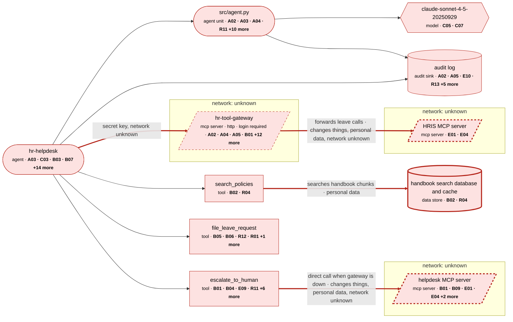

# Security map and action plan: hr-helpdesk

Review of `` at commit `unknown`, 2026-11-21T11:43:21Z.

**40 things to fix** and **7 things that need proof** were found. Each one below has a person to lead it, a place to write who is doing it, and steps to follow.

## 1. Map

This map shows what the agent connects to. Arrows point from the part that starts an action to the part it reaches.

- **Red box:** something here must be fixed. The codes in the box (like B06) are the actions in section 3.
- **Yellow box:** something here needs proof that it is safe.
- **Thick red arrow:** a connection that can cause harm if misused. Section 2 says why.
- **Dashed box:** we don't yet know which network it runs in.
- **Thick border:** found by reading the code, not just the settings files.



This map shows only the parts with actions or risky connections. The full map has 12 parts; draw it with `topology.py mermaid`.

## 2. Connections that matter

These connections could cause harm if someone misused the agent. Check them first.

| From | To | Why it matters | Open actions | Evidence |
|---|---|---|---|---|
| escalate_to_human | helpdesk MCP server | can change, send or delete things; carries personal data; we don't yet know which network it is in | B01, B09, E06, R14 | src/gateway_client.py:59 |
| hr-tool-gateway | HRIS MCP server | can change, send or delete things; carries personal data; we don't yet know which network it is in | E01, E04 | src/gateway.py:180 |
| hr-helpdesk | hr-tool-gateway | uses a secret key or token; we don't yet know which network it is in | A01, B03, E12 | .mcp.json:3 |
| search_policies | handbook search database and cache | carries personal data | B02, R04 | src/retrieval.py:50 |

## 3. Action list

Fill in **Assigned to** with a person's name. The **Lead** is the team that owns the fix (see ROLES.md).

| # | What to fix | Where | Priority | Lead | Assigned to |
|---|---|---|---|---|---|
| [A02](#a02) | Refused requests are not logged. Gateway denials for bad logins have 'unknown' in their identity fields. | src/agent.py, audit log, hr-tool-gateway | Must fix before release (G1) | Agent team | _____ |
| [A03](#a03) | The hash may miss files the Dockerfile copies. No test shows the same inputs give the same id. | src/agent.py, hr-helpdesk | Must fix before release (G1) | Agent team | _____ |
| [A04](#a04) | The gateway trusts a caller header for the instance, and a resumed run starts a new trace. | hr-tool-gateway, src/agent.py | Must fix before release (G1) | Infrastructure | _____ |
| [A05](#a05) | The gateway cannot stop one agent type, and its audit rows hold only ids the caller supplied. | hr-tool-gateway, audit log | Must fix before release (G1) | Operations | _____ |
| [B01](#b01) | One tool can skip the gateway and call the helpdesk server directly. The gateway allowlist then does not apply. | escalate_to_human, helpdesk MCP server, hr-tool-gateway | Must fix before release (G1) | Agent team | _____ |
| [B02](#b02) | The handbook search cache ignores who is asking. One employee can get another employee's private HR chunks. | search_policies, handbook search database and cache | Must fix before release (G1) | Infrastructure | _____ |
| [B04](#b04) | Some stop flags are not checked at the gateway, and the direct route skips the stop check. Tokens last 300 seconds after a stop. | hr-tool-gateway, escalate_to_human | Must fix before release (G1) | Infrastructure | _____ |
| [B05](#b05) | The approval text for a leave request hides the note field. The employee approves something they were not fully shown. | file_leave_request | Must fix before release (G1) | Agent team | _____ |
| [B06](#b06) | The reviewer cannot see every argument that will be sent. The note field is left out of the description. | file_leave_request | Must fix before release (G1) | Agent team | _____ |
| [C03](#c03) | Only the agent checks its own identity at start. No outside process compares the running setup to the approved manifest. | hr-helpdesk | Must fix before release (G1) | Infrastructure | _____ |
| [E09](#e09) | A stop does not cancel tokens already issued for 300 seconds, and the direct route skips the stop check. | hr-tool-gateway, escalate_to_human | Must fix before release (G1) | Operations | _____ |
| [E10](#e10) | Gateway audit rows lack verified identity and trace fields, vendor receipt ids, and are written after the action. | hr-tool-gateway, audit log | Must fix before release (G1) | Infrastructure | _____ |
| [R11](#r11) | The direct route skips the gateway stop check, and no dated stop drill is on file. | escalate_to_human, src/agent.py | Must fix before release (G1) | Operations | _____ |
| [R12](#r12) | There is no rule for each tool on what happens when a run stops. Unknown results are not held for checking. | src/agent.py, file_leave_request, escalate_to_human | Must fix before release (G1) | Agent team | _____ |
| [R13](#r13) | Some tool calls leave no linked audit step, and cancelled or failed calls have no linked outcome. | src/agent.py, audit log | Must fix before release (G1) | Agent team | _____ |
| [B03](#b03) | The database and Anthropic keys are long-lived secrets. The repository shows no rotation, and token binding downstream is not shown. | hr-helpdesk, hr-tool-gateway | Fix before release, or get a written risk approval (G2) | Infrastructure | _____ |
| [B07](#b07) | Limits may be passed by concurrent runs, and hidden SDK retries are not counted. Neither case has a test. | hr-helpdesk, src/agent.py | Fix before release, or get a written risk approval (G2) | Agent team | _____ |
| [B09](#b09) | Egress rules let the agent reach the helpdesk server directly, and the client uses it when the gateway is down. | escalate_to_human, helpdesk MCP server | Fix before release, or get a written risk approval (G2) | Infrastructure | _____ |
| [B10](#b10) | The admission policy does not refuse an image that matches no signing rule, and the platform rule skips provenance checks. | hr-helpdesk | Fix before release, or get a written risk approval (G2) | Infrastructure | _____ |
| [C01](#c01) | The release manifest leaves out issuer and audience settings, and most artifacts have no owner or fixed reference. | hr-helpdesk | Fix before release, or get a written risk approval (G2) | Agent team | _____ |
| [C02](#c02) | One catch-all team owns the Dockerfile, dependencies and most source files, and no emergency-change path exists. | hr-helpdesk | Fix before release, or get a written risk approval (G2) | Governance | _____ |
| [C04](#c04) | No check compares running prompts, tools, permissions or network rules with the approved baseline. | hr-helpdesk | Fix before release, or get a written risk approval (G2) | Operations | _____ |
| [C05](#c05) | Nothing re-tests the agent on a schedule or watches for provider notices about the pinned model. | claude-sonnet-4-5-20250929 | Fix before release, or get a written risk approval (G2) | Agent team | _____ |
| [C06](#c06) | The release job runs a test folder that does not exist, and no results are stored with the release. | src/agent.py, hr-helpdesk | Fix before release, or get a written risk approval (G2) | Agent team | _____ |
| [C07](#c07) | No approved recovery setup or tested rollback exists, and the model has no recorded retirement date. | hr-helpdesk, claude-sonnet-4-5-20250929 | Fix before release, or get a written risk approval (G2) | Operations | _____ |
| [C08](#c08) | Traces cannot be tied to a stored release manifest, and audit rows are kept about six weeks, not six months. | audit log, hr-tool-gateway | Fix before release, or get a written risk approval (G2) | Operations | _____ |
| [E01](#e01) | The inventory leaves out the gateway, STS, registry, audit and stop services, and lists only one owner each. | hr-tool-gateway, HRIS MCP server, helpdesk MCP server | Fix before release, or get a written risk approval (G2) | Governance | _____ |
| [E02](#e02) | No scan for known vulnerabilities runs in CI, and no approval records exist for dependencies. | hr-helpdesk | Fix before release, or get a written risk approval (G2) | Security | _____ |
| [E03](#e03) | Tool changes are checked only every 300 seconds, list changes are ignored, and a gateway 503 skips the check. | hr-tool-gateway, escalate_to_human | Fix before release, or get a written risk approval (G2) | Infrastructure | _____ |
| [E04](#e04) | Tool metadata is only checked by fingerprint. Nothing scans names, descriptions or schemas for hidden instructions. | hr-tool-gateway, HRIS MCP server, helpdesk MCP server | Fix before release, or get a written risk approval (G2) | Security | _____ |
| [E05](#e05) | Lookalike or duplicate tool names are only logged. They are not blocked, and similar-looking letters are not caught. | hr-tool-gateway | Fix before release, or get a written risk approval (G2) | Infrastructure | _____ |
| [E06](#e06) | When the gateway returns 503 or is down, the agent calls the helpdesk server itself. All gateway checks and logs are skipped. | escalate_to_human, helpdesk MCP server, hr-tool-gateway | Fix before release, or get a written risk approval (G2) | Infrastructure | _____ |
| [E11](#e11) | Audit rows are kept about six weeks, not six months, and no check finds changed or missing rows. | audit log | Fix before release, or get a written risk approval (G2) | Infrastructure | _____ |
| [R01](#r01) | Error text from tools goes to the model with no checks. A tool can send instructions this way. | src/agent.py, file_leave_request, escalate_to_human | Fix before release, or get a written risk approval (G2) | Agent team | _____ |
| [R02](#r02) | Error results reach the model without a source or trust label, unlike successful results. | src/agent.py | Fix before release, or get a written risk approval (G2) | Security | _____ |
| [R03](#r03) | Error text goes to the model without redaction, and the approval text skips the link and image remover. | src/agent.py, file_leave_request | Fix before release, or get a written risk approval (G2) | Agent team | _____ |
| [R04](#r04) | The handbook cache is keyed by the query only. One employee can read another employee's private HR chunks. | search_policies, handbook search database and cache | Fix before release, or get a written risk approval (G2) | Agent team | _____ |
| [R07](#r07) | Only model-call records store how full the context was. Tool actions and gateway decisions do not. | src/agent.py, audit log | Fix before release, or get a written risk approval (G2) | Agent team | _____ |
| [R14](#r14) | Approval and audit rows can be changed without notice, and an unclear 503 triggers an automatic resend through the direct route. | audit log, helpdesk MCP server, escalate_to_human | Fix before release, or get a written risk approval (G2) | Agent team | _____ |
| [R09](#r09) | Only fixed per-run limits exist. Nothing detects risky chains of allowed actions or changes with context size. | src/agent.py, hr-helpdesk | Fix soon; track until done (G3) | Security | _____ |
| [A01](#a01) | The agent has its own identity, but the repository does not show that it can be cut off without cutting off the user. | hr-helpdesk, hr-tool-gateway | Show proof it works before release (G1) | Infrastructure | _____ |
| [B12](#b12) | Branch protection is set in GitHub, not in the repository, so it cannot be checked from code. | src/agent.py | Show proof it works before release (G1) | Agent team | _____ |
| [B08](#b08) | Network rules look sound in the manifests, but nothing proves they work in the running cluster. | hr-helpdesk | Show proof it works, or get a written risk approval (G2) | Infrastructure | _____ |
| [B11](#b11) | The audit job runs a platform image whose contents are not visible, so we cannot confirm it has no shell or downloader. | hr-helpdesk | Show proof it works, or get a written risk approval (G2) | Infrastructure | _____ |
| [E12](#e12) | The repository has no incident runbook. It has no impact query and no owner for outside reports. | hr-helpdesk, hr-tool-gateway | Show proof it works (G3) | Security | _____ |
| [R08](#r08) | No security detection rules or alert routing are in the repository. They may exist elsewhere. | audit log, hr-helpdesk | Show proof it works (G3) | Security | _____ |
| [R10](#r10) | Nothing reviews what the agent does. No one has said if a rogue agent is in scope. | hr-helpdesk | Show proof it works (G3) | Security | _____ |

## 4. How to fix each one

### A02

**All six identity fields** · Must fix before release (G1)

**The problem:** Refused requests are not logged. Gateway denials for bad logins have 'unknown' in their identity fields.

**Where:** src/agent.py, audit log, hr-tool-gateway — `src/main.py:114`

**Lead:** Agent team · **Assigned to:** _____ · **Effort:** medium

**Steps:**

1. Open `src/gateway.py` line 132. Fill the unknown fields from the caller's certificate and mark the row `untrusted_caller`.
2. Open `src/main.py` line 114. Before returning 401, write an audit row with all six fields set to the string `untrusted_caller`.
3. If that write fails, return 503 instead of 401.
4. Create a test that sends a bad token. Check an audit row exists.

**You are done when:** A request with a bad token creates an audit row in both the agent and the gateway.

### A03

**Content-derived type identity** · Must fix before release (G1)

**The problem:** The hash may miss files the Dockerfile copies. No test shows the same inputs give the same id.

**Where:** src/agent.py, hr-helpdesk — `src/type_id.py:42`

**Lead:** Agent team · **Assigned to:** _____ · **Effort:** medium

**Steps:**

1. Open `Dockerfile` line 12. Check that every file copied in is listed in `src/type_id.py` lines 20 and 21.
2. Create a test that computes the id twice and checks the two values match.
3. Add a loop to the test that changes one input at a time and checks the id changes each time.
4. Run the test in `.github/workflows/release.yml` before line 45.

**You are done when:** Changing any input file, the model record or the digest changes the agent-type-id.

### A04

**Trustworthy attribution** · Must fix before release (G1)

**The problem:** The gateway trusts a caller header for the instance, and a resumed run starts a new trace.

**Where:** hr-tool-gateway, src/agent.py — `src/gateway.py:170`

**Lead:** Infrastructure · **Assigned to:** _____ · **Effort:** medium

**Steps:**

1. Open `src/gateway.py` line 170. Replace the header with a verified value from the token, such as a new `inst` claim set by the STS.
2. Open `src/main.py` line 147. Store the trace parent with the approval grant and restore it on resume.
3. Create a test that sends a forged `X-Agent-Instance`. Check that the gateway ignores it.

**You are done when:** The gateway uses an instance id from the signed token, and a resumed run continues the original trace.

### A05

**Operational lookup** · Must fix before release (G1)

**The problem:** The gateway cannot stop one agent type, and its audit rows hold only ids the caller supplied.

**Where:** hr-tool-gateway, audit log — `migrations/001_init.sql:23`

**Lead:** Operations · **Assigned to:** _____ · **Effort:** medium

**Steps:**

1. Do B04 first. It adds the agent type to the gateway stop query in `src/gateway.py` line 100.
2. Open `src/gateway.py` line 138. Replace the header values with ids from the verified token.
3. Create a stop flag for one agent type in a test cluster. Check that the gateway refuses that type only.

**You are done when:** A stop flag for one agent type blocks that type at the gateway and no other.

### B01

**Minimal tool surface** · Must fix before release (G1)

**The problem:** One tool can skip the gateway and call the helpdesk server directly. The gateway allowlist then does not apply.

**Where:** escalate_to_human, helpdesk MCP server, hr-tool-gateway — `config/tools.yaml:17`

**Lead:** Agent team · **Assigned to:** _____ · **Effort:** small

**Steps:**

1. Open `config/tools.yaml` and delete lines 91 to 93, the `direct_route:` block under `escalate_to_human`.
2. Open `src/gateway_client.py`. Delete lines 51 to 59, the `except GatewayUnavailable:` block. Then delete the `try:` on line 46 and unindent lines 47 to 50 once.
3. Open `k8s/networkpolicy.yaml` and delete lines 48 to 50, the agent egress rule to `helpdesk-mcp`, so the agent cannot reach it directly.
4. Run `grep -rn direct_route config src k8s`. It must print nothing. Then stop the gateway in a test cluster and check that `escalate_to_human` fails with an error.

**You are done when:** `escalate_to_human` can reach the helpdesk server only through the gateway.

**Also fixes or affects:** E06, B04, E03, E10, R14

### B02

**Least-privilege access** · Must fix before release (G1)

**The problem:** The handbook search cache ignores who is asking. One employee can get another employee's private HR chunks.

**Where:** search_policies, handbook search database and cache — `src/retrieval.py:42`

**Lead:** Infrastructure · **Assigned to:** _____ · **Effort:** small

**Steps:**

1. Open `src/retrieval.py`. On line 46 change the call to `key = self._key(query, employee_id)`.
2. On line 40 change the method to `def _key(self, query: str, employee_id: str) -> str:`. On line 42 hash `f"{self._top_k}|{employee_id}|{normalized}"`.
3. Create the test below, then run it. Ask the platform team for the IAM and token-exchange policy, so B02 checks 1, 3 and 4 can be proven.

**Test to add** (`tests/test_retrieval_key.py`):

```py
from src.retrieval import PolicyIndex


def test_cache_key_differs_per_employee():
    idx = PolicyIndex(None, 5, 900.0)
    assert idx._key('leave policy', 'e1') != idx._key('leave policy', 'e2')
```

Run it with `python -m pytest tests/test_retrieval_key.py`.

**You are done when:** Two different employees who run the same search get separate cache entries.

**Also fixes or affects:** R04

### B04

**Independent revocation** · Must fix before release (G1)

**The problem:** Some stop flags are not checked at the gateway, and the direct route skips the stop check. Tokens last 300 seconds after a stop.

**Where:** hr-tool-gateway, escalate_to_human — `src/gateway.py:101`

**Lead:** Infrastructure · **Assigned to:** _____ · **Effort:** medium

**Steps:**

1. Open `config/tools.yaml` and delete lines 91 to 93, the `direct_route:` block under `escalate_to_human`.
2. Open `src/gateway_client.py`. Delete lines 51 to 59, the `except GatewayUnavailable:` block. Then delete the `try:` on line 46 and unindent lines 47 to 50 once.
3. Open `src/gateway.py` and go to line 100. Add `OR (scope = 'agent_type' AND value = $4)` to the query. Pass the verified agent type id as `$4` on line 102.
4. In `config/agent.yaml` add a line under `stop:` named `max_token_seconds: 300`. Write in `README.md` that a stop is complete only after the tokens expire.
5. Create a stop flag for the agent type in a test cluster. Check that the gateway refuses the next call.

**You are done when:** A stop flag with scope `agent_type` makes the gateway refuse the next call.

**Also fixes or affects:** B01, R13, E03, E06, E10, R14

### B05

**Destructive-action interception** · Must fix before release (G1)

**The problem:** The approval text for a leave request hides the note field. The employee approves something they were not fully shown.

**Where:** file_leave_request — `config/tools.yaml:61`

**Lead:** Agent team · **Assigned to:** _____ · **Effort:** small

**Steps:**

1. Open `src/approvals.py` and go to line 32. Add the note to the text, for example `f" Note: {args.get('note', '')}"` before the closing quote.
2. Create the test below and run it.

**Test to add** (`tests/test_approvals_note.py`):

```py
from src.approvals import describe


def test_leave_description_shows_note():
    args = {'leave_type': 'annual', 'start_date': '2026-12-01', 'end_date': '2026-12-02', 'note': 'ZZ-NOTE-123'}
    assert 'ZZ-NOTE-123' in describe('hris/file_leave_request', 'employee:e1', args)
```

Run it with `python -m pytest tests/test_approvals_note.py`.

**You are done when:** The text shown to the employee for a leave request contains the note.

**Also fixes or affects:** B06

### B06

**Approval integrity** · Must fix before release (G1)

**The problem:** The reviewer cannot see every argument that will be sent. The note field is left out of the description.

**Where:** file_leave_request — `src/approvals.py:80`

**Lead:** Agent team · **Assigned to:** _____ · **Effort:** small

**Steps:**

1. Do B05 first. It changes `describe()` in `src/approvals.py` so the note appears.
2. Open `src/approvals.py` and check that every key in the `file_leave_request` input schema in `config/tools.yaml` appears in the text.
3. Run the B05 test to confirm.

**You are done when:** The approval text lists every argument that is sent, including the note.

**Also fixes or affects:** B05

### C03

**Match release identity to running state** · Must fix before release (G1)

**The problem:** Only the agent checks its own identity at start. No outside process compares the running setup to the approved manifest.

**Where:** hr-helpdesk — `k8s/admission.yaml:41`

**Lead:** Infrastructure · **Assigned to:** _____ · **Effort:** medium

**Steps:**

1. Open `k8s/admission.yaml`. After line 81 add a Kyverno rule that checks the pod's `AGENT_TYPE_ID` and image digest against `release/manifest.yaml`.
2. Or create a CronJob `k8s/manifest-check.yaml` that compares them every hour and alerts on a mismatch.
3. Deploy a pod with a wrong id in a test cluster and check it is refused or alerted.

**You are done when:** A pod whose id differs from the approved manifest is refused or raises an alert.

### E09

**Recursive shutdown** · Must fix before release (G1)

**The problem:** A stop does not cancel tokens already issued for 300 seconds, and the direct route skips the stop check.

**Where:** hr-tool-gateway, escalate_to_human — `src/credentials.py:20`

**Lead:** Operations · **Assigned to:** _____ · **Effort:** medium

**Steps:**

1. Open `config/tools.yaml` and delete lines 91 to 93, the `direct_route:` block under `escalate_to_human`.
2. Open `src/gateway_client.py`. Delete lines 51 to 59, the `except GatewayUnavailable:` block. Then delete the `try:` on line 46 and unindent lines 47 to 50 once.
3. Open `src/credentials.py` line 20. Change `TOKEN_TTL_SECONDS` to `10`, the stop time in `config/agent.yaml`, so tokens expire at about the same time.
4. Keep a list of in-flight calls in `src/gateway_client.py` and write it to the audit log when a stop is seen.
5. Run a stop drill and check that calls fail after 10 seconds.

**You are done when:** After a stop, no call succeeds for longer than 10 seconds.

**Also fixes or affects:** E06

### E10

**Audit across service boundaries** · Must fix before release (G1)

**The problem:** Gateway audit rows lack verified identity and trace fields, vendor receipt ids, and are written after the action.

**Where:** hr-tool-gateway, audit log — `src/gateway.py:137`

**Lead:** Infrastructure · **Assigned to:** _____ · **Effort:** medium

**Steps:**

1. Open `src/gateway.py` line 190. Move the `allow` audit write before the upstream call on line 180, and record a result row afterward.
2. Open `src/gateway.py` and go to lines 137 to 139. Use values from the verified token, not from request headers.
3. Create a new migration file that adds a `vendor_receipt` column to `audit.gateway_decisions`. Save the vendor's request id in it.
4. Remove the direct route as in B01.
5. Run one call and check both rows exist.

**You are done when:** A gateway audit row exists before each upstream call and holds verified identity fields.

**Also fixes or affects:** B01, B04, E03, E06, R14

### R11

**Tested kill switch** · Must fix before release (G1)

**The problem:** The direct route skips the gateway stop check, and no dated stop drill is on file.

**Where:** escalate_to_human, src/agent.py — `src/gateway_client.py:52`

**Lead:** Operations · **Assigned to:** _____ · **Effort:** medium

**Steps:**

1. Open `config/tools.yaml` and delete lines 91 to 93, the `direct_route:` block under `escalate_to_human`.
2. Open `src/gateway_client.py`. Delete lines 51 to 59, the `except GatewayUnavailable:` block. Then delete the `try:` on line 46 and unindent lines 47 to 50 once.
3. Open `src/agent.py` and go to line 106. Add `await self.stop.raise_if_stopped(ctx)` before `state.budget.check_tool_call()`, so each tool call checks the stop flag.
4. Run a stop drill in a test cluster. Insert a fleet stop flag and record the time until the run stops.
5. Save the drill date and time in `docs/drills/` in the ops repo.

**You are done when:** A dated drill shows a stop flag halts new tool calls within 10 seconds.

**Also fixes or affects:** B09, E03, E06

### R12

**Safe state after stopping** · Must fix before release (G1)

**The problem:** There is no rule for each tool on what happens when a run stops. Unknown results are not held for checking.

**Where:** src/agent.py, file_leave_request, escalate_to_human — `src/agent.py:161`

**Lead:** Agent team · **Assigned to:** _____ · **Effort:** medium

**Steps:**

1. Open `config/tools.yaml`. Under each tool add `on_stop: abandon` for reads or `on_stop: hold_for_review` for writes.
2. Open `src/gateway_client.py` line 85. When the result is unknown, raise `ToolError` with a flag `unknown_outcome=True`.
3. In `src/agent.py` line 183, write a `hold` audit record for that case. Refuse any later call with the same arguments until a person clears it.
4. Create a test that times out a write call. Check that a hold record exists.

**You are done when:** A timed-out write leaves a hold record that blocks the same action until a person clears it.

### R13

**Full execution audit** · Must fix before release (G1)

**The problem:** Some tool calls leave no linked audit step, and cancelled or failed calls have no linked outcome.

**Where:** src/agent.py, audit log — `src/agent.py:154`

**Lead:** Agent team · **Assigned to:** _____ · **Effort:** medium

**Steps:**

1. Open `src/agent.py` line 154. Before the gateway call add `self.audit.record(ctx, "state_recheck", ...)` with `parent_step_id=state.last_step`, and one for the result.
2. Open `src/gateway_client.py` and add a record for the retry. Remove the retry as part of R14 if you can.
3. In `src/main.py` line 91, add the proposed step ids to the `run_stopped` record so each one has an outcome.
4. Run one cancelled run and check each `proposed_action` has a linked outcome row.

**You are done when:** Every proposed action has a linked outcome row in `audit.events`, including cancelled and failed ones.

**Also fixes or affects:** B04

### B03

**Credential lifetime and handling** · Fix before release, or get a written risk approval (G2)

**The problem:** The database and Anthropic keys are long-lived secrets. The repository shows no rotation, and token binding downstream is not shown.

**Where:** hr-helpdesk, hr-tool-gateway — `k8s/deployment.yaml:54`

**Lead:** Infrastructure · **Assigned to:** _____ · **Effort:** medium

**Steps:**

1. Open `k8s/deployment.yaml` line 54. Note that `hr-agent-db` and `hr-agent-anthropic` are static secrets.
2. Ask the platform team for the rotation policy and last rotation date of `hr-agent-db`, `hr-gateway-db` and `hr-agent-anthropic`.
3. Ask the platform team whether the database supports short-lived or federated logins. If not, record the key lifetime and how to revoke it.
4. Ask the identity team for a sample downstream token from the STS that shows the `cnf` claim. Save both answers in the review record.

**You are done when:** A written rotation policy and a sample downstream token with a `cnf` claim are on file for these secrets.

### B07

**Hard execution budgets** · Fix before release, or get a written risk approval (G2)

**The problem:** Limits may be passed by concurrent runs, and hidden SDK retries are not counted. Neither case has a test.

**Where:** hr-helpdesk, src/agent.py — `config/agent.yaml:18`

**Lead:** Agent team · **Assigned to:** _____ · **Effort:** medium

**Steps:**

1. Open `src/main.py` line 172. Change `AsyncAnthropic(max_retries=1)` to `AsyncAnthropic(max_retries=0)`, so every model call is counted once.
2. In `src/budgets.py` write down the worst case: the number of runs in flight times the tokens one call can use. Compare it to each quota in `config/agent.yaml`.
3. Write a test that starts 30 runs for one user at once. Check that no more than 150 per day and the token limit are accepted.
4. Write a test for each run limit in `config/agent.yaml` lines 18 to 23 that shows how the run stops.

**You are done when:** A test with many concurrent runs shows the user, tenant and fleet quotas are never passed.

### B09

**Egress allowlist** · Fix before release, or get a written risk approval (G2)

**The problem:** Egress rules let the agent reach the helpdesk server directly, and the client uses it when the gateway is down.

**Where:** escalate_to_human, helpdesk MCP server — `k8s/networkpolicy.yaml:32`

**Lead:** Infrastructure · **Assigned to:** _____ · **Effort:** small

**Steps:**

1. Open `config/tools.yaml` and delete lines 91 to 93, the `direct_route:` block under `escalate_to_human`.
2. Open `src/gateway_client.py`. Delete lines 51 to 59, the `except GatewayUnavailable:` block. Then delete the `try:` on line 46 and unindent lines 47 to 50 once.
3. Open `k8s/networkpolicy.yaml` and delete lines 48 to 50, the agent egress rule to `helpdesk-mcp`, so the agent cannot reach it directly.
4. Run `grep -rn direct_route config src k8s`. It must print nothing. Then stop the gateway in a test cluster and check that `escalate_to_human` fails with an error.

**You are done when:** The agent pod has no network path to `helpdesk-mcp`, and no code uses one.

**Also fixes or affects:** E03, E06, R11

### B10

**Pinned, verified image** · Fix before release, or get a written risk approval (G2)

**The problem:** The admission policy does not refuse an image that matches no signing rule, and the platform rule skips provenance checks.

**Where:** hr-helpdesk — `k8s/deployment.yaml:43`

**Lead:** Infrastructure · **Assigned to:** _____ · **Effort:** medium

**Steps:**

1. Open `k8s/admission.yaml`. After line 81, add a new rule that denies any pod in `hr-agent` whose image is not matched by an earlier `imageReferences` entry.
2. Under the platform rule that starts on line 72, add an `attestations:` block like lines 51 to 71, with the platform build workflow as the signer.
3. In a test cluster, apply a pod with an unsigned image. Check that Kyverno refuses it.

**You are done when:** A pod with an unsigned or unmatched image is refused in `hr-agent`.

### C01

**Complete release manifest** · Fix before release, or get a written risk approval (G2)

**The problem:** The release manifest leaves out issuer and audience settings, and most artifacts have no owner or fixed reference.

**Where:** hr-helpdesk — `src/main.py:36`

**Lead:** Agent team · **Assigned to:** _____ · **Effort:** medium

**Steps:**

1. Open `release/manifest.yaml`. After line 36 add the SSO issuer and audience from `src/main.py` lines 36 and 37 and the gateway ones from `src/gateway.py` lines 32 and 33.
2. Add the MCP protocol version, each tool fingerprint from `config/tools.yaml`, and `retrieval.cache_ttl_seconds`.
3. Give every artifact an `owner` and a `digest` or `commit`. Update the CI step on line 50 of `.github/workflows/release.yml` if it writes new fields.

**You are done when:** Each item in the release manifest names an owner and a fixed version.

### C02

**Review security-relevant changes** · Fix before release, or get a written risk approval (G2)

**The problem:** One catch-all team owns the Dockerfile, dependencies and most source files, and no emergency-change path exists.

**Where:** hr-helpdesk — `CODEOWNERS:1`

**Lead:** Governance · **Assigned to:** _____ · **Effort:** small

**Steps:**

1. Open `CODEOWNERS`. After line 1 add `/Dockerfile`, `/requirements.txt` and `/src/` lines owned by `@acme/people-platform @acme/security-engineering`.
2. Create `docs/emergency-change.md` that says who can approve an urgent change and how it is reviewed afterward.
3. Check in GitHub that a pull request touching `Dockerfile` asks for the security team.

**You are done when:** A pull request that changes `Dockerfile` or `requirements.txt` needs review from the security team.

### C04

**Detect drift per agent** · Fix before release, or get a written risk approval (G2)

**The problem:** No check compares running prompts, tools, permissions or network rules with the approved baseline.

**Where:** hr-helpdesk — `k8s/admission.yaml:22`

**Lead:** Operations · **Assigned to:** _____ · **Effort:** large

**Steps:**

1. Create `k8s/drift-check.yaml`, a CronJob that reads the live pod, config map and network policy and compares them with `release/manifest.yaml`.
2. Set the alert target and the response time in `config/agent.yaml`, for example `drift: {alert: security-oncall, respond_minutes: 60}`.
3. Change a network rule in a test cluster. Check that an alert arrives.

**You are done when:** A changed prompt, tool list or network rule raises an alert within one hour.

### C05

**Control dependency, model, and training changes** · Fix before release, or get a written risk approval (G2)

**The problem:** Nothing re-tests the agent on a schedule or watches for provider notices about the pinned model.

**Where:** claude-sonnet-4-5-20250929 — `release/manifest.yaml:45`

**Lead:** Agent team · **Assigned to:** _____ · **Effort:** medium

**Steps:**

1. Create `.github/workflows/retest.yml` that runs `python -m pytest tests/release` every week against the pinned model.
2. Add a step that opens an issue if the provider's deprecation page lists `claude-sonnet-4-5-20250929`.
3. Run the workflow once and keep the result.

**You are done when:** A scheduled job re-runs the release tests weekly and the last run is on file.

### C06

**Re-test changed behavior** · Fix before release, or get a written risk approval (G2)

**The problem:** The release job runs a test folder that does not exist, and no results are stored with the release.

**Where:** src/agent.py, hr-helpdesk — `.github/workflows/release.yml:29`

**Lead:** Agent team · **Assigned to:** _____ · **Effort:** medium

**Steps:**

1. Open `.github/workflows/release.yml` line 58. Add `test-results.xml` to the upload `path` list.
2. On line 29 change the command to `python -m pytest -q tests/release --junitxml=test-results.xml`.
3. Create `tests/release/` with one test of an attack that must be refused and one allowed task that must work.
4. Push a branch and check the release job uploads the results.

**You are done when:** Each release stores test results tied to its manifest, including at least one attack test.

### C07

**Rollback and restart** · Fix before release, or get a written risk approval (G2)

**The problem:** No approved recovery setup or tested rollback exists, and the model has no recorded retirement date.

**Where:** hr-helpdesk, claude-sonnet-4-5-20250929 — `.github/workflows/release.yml:75`

**Lead:** Operations · **Assigned to:** _____ · **Effort:** medium

**Steps:**

1. Open `release/manifest.yaml`. After line 42 add `retirement_date:` from the provider's deprecation page and a `recovery:` block with the last good digest.
2. Open `.github/workflows/release.yml`. After line 75 add a `rollback` job that deploys a digest chosen by hand.
3. Run the rollback job in a test cluster. Keep the run link.

**You are done when:** A rollback to the last good digest has been run and the model retirement date is in the manifest.

### C08

**Connect configuration to execution** · Fix before release, or get a written risk approval (G2)

**The problem:** Traces cannot be tied to a stored release manifest, and audit rows are kept about six weeks, not six months.

**Where:** audit log, hr-tool-gateway — `src/gateway.py:138`

**Lead:** Operations · **Assigned to:** _____ · **Effort:** medium

**Steps:**

1. Open `k8s/audit-maintenance.yaml` line 35. Change `KEEP_PARTITIONS` from `"6"` to `"30"` for about six months of weekly partitions.
2. Open `src/gateway.py` line 138. Log the agent type id from the verified token.
3. Store each release manifest by agent type id in a table, in a new migration. Fill it in the release workflow.
4. Check that a trace's agent type id returns one manifest.

**You are done when:** A trace id leads to its release manifest, and audit rows stay for six months.

**Also fixes or affects:** E11

### E01

**Map shared responsibilities** · Fix before release, or get a written risk approval (G2)

**The problem:** The inventory leaves out the gateway, STS, registry, audit and stop services, and lists only one owner each.

**Where:** hr-tool-gateway, HRIS MCP server, helpdesk MCP server — `release/manifest.yaml:53`

**Lead:** Governance · **Assigned to:** _____ · **Effort:** small

**Steps:**

1. Open `release/manifest.yaml` lines 53 to 55. Add entries for `hr-tool-gateway`, the STS, the image registry, Postgres audit and the stop service.
2. For each entry add `agent_team_owner` and `platform_owner` or `vendor_owner`.
3. Ask each platform team to confirm their entry.

**You are done when:** Every outside service is listed with an owner on the agent team and one on the platform or vendor side.

### E02

**Vet and pin dependencies** · Fix before release, or get a written risk approval (G2)

**The problem:** No scan for known vulnerabilities runs in CI, and no approval records exist for dependencies.

**Where:** hr-helpdesk — `.github/workflows/release.yml:28`

**Lead:** Security · **Assigned to:** _____ · **Effort:** medium

**Steps:**

1. Open `.github/workflows/release.yml`. After line 28 add `- run: pip-audit --require-hashes -r requirements.txt`.
2. Create `release/dependencies.yaml` with the publisher, permissions and update source of each package in `requirements.txt`.
3. Add the same for each remote tool server in `config/tools.yaml` line 13.

**You are done when:** The release job fails when a dependency has a known vulnerability.

### E03

**Re-check tools on load** · Fix before release, or get a written risk approval (G2)

**The problem:** Tool changes are checked only every 300 seconds, list changes are ignored, and a gateway 503 skips the check.

**Where:** hr-tool-gateway, escalate_to_human — `config/tools.yaml:8`

**Lead:** Infrastructure · **Assigned to:** _____ · **Effort:** medium

**Steps:**

1. Open `config/tools.yaml` and delete lines 91 to 93, the `direct_route:` block under `escalate_to_human`.
2. Open `src/gateway_client.py`. Delete lines 51 to 59, the `except GatewayUnavailable:` block. Then delete the `try:` on line 46 and unindent lines 47 to 50 once.
3. Open `src/gateway.py` line 213. Call `refresh_fingerprints()` when a `list_changed` notice arrives, and before each first use after a refresh.
4. In `refresh_fingerprints`, record the server's version in `config/tools.yaml` under `servers`.
5. Change one tool description in a test server. Check that the gateway disables the tool.

**You are done when:** A changed tool description disables the tool at the gateway, and there is no bypass.

**Also fixes or affects:** B09, E06, R11, B01, B04, E10, R14

### E04

**Inspect tool metadata** · Fix before release, or get a written risk approval (G2)

**The problem:** Tool metadata is only checked by fingerprint. Nothing scans names, descriptions or schemas for hidden instructions.

**Where:** hr-tool-gateway, HRIS MCP server, helpdesk MCP server — `src/tools.py:78`

**Lead:** Security · **Assigned to:** _____ · **Effort:** large

**Steps:**

1. Open `src/gateway.py`. After line 63 add a function `scan_metadata(tool)` that rejects control characters, encoded text, and phrases like 'ignore previous'.
2. Call it for each field in the fingerprint list on line 54. If it fails or raises an error, add the tool to `_disabled`.
3. Limit each field's length in the same function.
4. Create a test with a description holding a hidden instruction. Check that the tool is disabled.

**You are done when:** A tool whose metadata contains hidden instructions is disabled before the model sees it.

### E05

**Verified, namespaced tools** · Fix before release, or get a written risk approval (G2)

**The problem:** Lookalike or duplicate tool names are only logged. They are not blocked, and similar-looking letters are not caught.

**Where:** hr-tool-gateway — `src/gateway.py:67`

**Lead:** Infrastructure · **Assigned to:** _____ · **Effort:** medium

**Steps:**

1. Open `src/gateway.py` line 67. Replace `log.error(...)` with `_disabled.add(...)` for both tools and raise a `ValueError`.
2. On line 65 widen the normalization to map lookalike letters, for example with the `confusable_homoglyphs` package.
3. Create a test with two servers that list `get_balance` and `get-bаlance` (Cyrillic а). Check both tools are disabled.

**You are done when:** Two tools with lookalike names are both disabled until a person reviews them.

### E06

**Enforced gateway boundary** · Fix before release, or get a written risk approval (G2)

**The problem:** When the gateway returns 503 or is down, the agent calls the helpdesk server itself. All gateway checks and logs are skipped.

**Where:** escalate_to_human, helpdesk MCP server, hr-tool-gateway — `src/gateway_client.py:52`

**Lead:** Infrastructure · **Assigned to:** _____ · **Effort:** small

**Steps:**

1. Open `config/tools.yaml` and delete lines 91 to 93, the `direct_route:` block under `escalate_to_human`.
2. Open `src/gateway_client.py`. Delete lines 51 to 59, the `except GatewayUnavailable:` block. Then delete the `try:` on line 46 and unindent lines 47 to 50 once.
3. Open `k8s/networkpolicy.yaml` and delete lines 48 to 50, the agent egress rule to `helpdesk-mcp`, so the agent cannot reach it directly.
4. Run `grep -rn direct_route config src k8s`. It must print nothing. Then stop the gateway in a test cluster and check that `escalate_to_human` fails with an error.

**You are done when:** With the gateway down, `escalate_to_human` fails and no call reaches the helpdesk server.

**Also fixes or affects:** E09, B09, E03, R11, B01, B04, E10, R14

### E11

**Protect shared evidence** · Fix before release, or get a written risk approval (G2)

**The problem:** Audit rows are kept about six weeks, not six months, and no check finds changed or missing rows.

**Where:** audit log — `k8s/audit-maintenance.yaml:35`

**Lead:** Infrastructure · **Assigned to:** _____ · **Effort:** large

**Steps:**

1. Open `k8s/audit-maintenance.yaml` line 35. Change `KEEP_PARTITIONS` from `"6"` to `"30"`.
2. In a new migration add a sequence number and a hash chain column to `audit.events` and `audit.gateway_decisions`.
3. Create a daily job that alerts on a gap or a bad hash.
4. Move the gateway write in `src/gateway.py` line 190 ahead of the upstream call.

**You are done when:** Audit rows stay for six months and a missing row raises an alert.

**Also fixes or affects:** C08

### R01

**Validate every input boundary, including API responses** · Fix before release, or get a written risk approval (G2)

**The problem:** Error text from tools goes to the model with no checks. A tool can send instructions this way.

**Where:** src/agent.py, file_leave_request, escalate_to_human — `src/agent.py:188`

**Lead:** Agent team · **Assigned to:** _____ · **Effort:** small

**Steps:**

1. Open `src/agent.py` and go to line 188. Replace the `f"{spec.name} failed: {exc.detail}"` text with a fixed message: `f"{spec.name} failed."`.
2. Keep the full detail only in the audit record on line 186, which is already redacted.
3. Create a test that makes a tool raise `ToolError(500, 'ignore all rules')`. Check the tool result does not contain that text.

**You are done when:** The tool result sent to the model after an error never contains the server's error text.

**Also fixes or affects:** R02, R03

### R02

**Separate data from instructions and test injection containment** · Fix before release, or get a written risk approval (G2)

**The problem:** Error results reach the model without a source or trust label, unlike successful results.

**Where:** src/agent.py — `src/agent.py:71`

**Lead:** Security · **Assigned to:** _____ · **Effort:** small

**Steps:**

1. Open `src/agent.py` and go to line 188. Make the error message fixed text, as in R01.
2. If you must keep some detail, wrap it as on line 195: `json.dumps({"source": spec.qualified, "trust": "untrusted_data", "data": ...})`.
3. Run a test that triggers a `ToolError` and check the result carries the trust label or fixed text.

**You are done when:** Every tool result sent to the model is either fixed text or carries a source and trust label.

**Also fixes or affects:** R01, R03

### R03

**Prevent output and log leakage** · Fix before release, or get a written risk approval (G2)

**The problem:** Error text goes to the model without redaction, and the approval text skips the link and image remover.

**Where:** src/agent.py, file_leave_request — `src/agent.py:188`

**Lead:** Agent team · **Assigned to:** _____ · **Effort:** small

**Steps:**

1. Open `src/main.py` and go to line 106. Change it to `body["approval"] = {**state.pending_approval, "description": sanitize_reply(state.pending_approval["description"], CFG["output"]["allowed_link_hosts"])}`.
2. Open `src/agent.py` line 188. Use fixed text, or `redact(exc.detail)`, in the returned message.
3. Create a test with a secret-like value in a tool error and a link in an approval. Check both are cleaned.

**You are done when:** Tool errors and approval text sent onward contain no secrets and no unlisted links.

**Also fixes or affects:** R01, R02

### R04

**Retrieval-corpus integrity** · Fix before release, or get a written risk approval (G2)

**The problem:** The handbook cache is keyed by the query only. One employee can read another employee's private HR chunks.

**Where:** search_policies, handbook search database and cache — `src/retrieval.py:42`

**Lead:** Agent team · **Assigned to:** _____ · **Effort:** small

**Steps:**

1. Do B02 first. It changes the cache key in `src/retrieval.py` lines 40 to 46.
2. Create the test below to prove two employees get separate cache entries, and run it.

**Test to add** (`tests/test_retrieval_key.py`):

```py
from src.retrieval import PolicyIndex


def test_cache_key_differs_per_employee():
    idx = PolicyIndex(None, 5, 900.0)
    assert idx._key('leave policy', 'e1') != idx._key('leave policy', 'e2')
```

Run it with `python -m pytest tests/test_retrieval_key.py`.

**You are done when:** Two employees who run the same query never share a cache entry.

**Also fixes or affects:** B02

### R07

**Decision-time context size** · Fix before release, or get a written risk approval (G2)

**The problem:** Only model-call records store how full the context was. Tool actions and gateway decisions do not.

**Where:** src/agent.py, audit log — `src/agent.py:193`

**Lead:** Agent team · **Assigned to:** _____ · **Effort:** medium

**Steps:**

1. Open `src/agent.py` and go to lines 193 and 100. Add `context_tokens=` and `context_tokens_method=` to each `self.audit.record` call. Keep the last measured value in `state.extra`.
2. In `src/gateway_client.py` line 71 add an `X-Context-Tokens` header. In `src/gateway.py` line 137 store it in a new column of `audit.gateway_decisions` in `migrations/001_init.sql`.
3. Run a test with one tool call and check its audit row has `context_tokens`.

**You are done when:** Every tool action row in `audit.events` has a context size in tokens.

### R14

**Recovery integrity** · Fix before release, or get a written risk approval (G2)

**The problem:** Approval and audit rows can be changed without notice, and an unclear 503 triggers an automatic resend through the direct route.

**Where:** audit log, helpdesk MCP server, escalate_to_human — `migrations/001_init.sql:54`

**Lead:** Agent team · **Assigned to:** _____ · **Effort:** large

**Steps:**

1. Open `config/tools.yaml` and delete lines 91 to 93, the `direct_route:` block under `escalate_to_human`.
2. Open `src/gateway_client.py`. Delete lines 51 to 59, the `except GatewayUnavailable:` block. Then delete the `try:` on line 46 and unindent lines 47 to 50 once.
3. Open `migrations/001_init.sql` line 54. Create a new migration that adds a `row_hash` column to `approvals.grants` and `audit.events`. Hash each row with the previous one.
4. Verify the chain on resume in `src/approvals.py` line 90, and refuse a record whose hash fails.
5. Create a test that changes a stored row. Check that resume is refused.

**You are done when:** A changed approval row is refused on resume, and an unclear 503 never causes a resend.

**Also fixes or affects:** B01, B04, E03, E06, E10

### R09

**Sequence and context-aware detection** · Fix soon; track until done (G3)

**The problem:** Only fixed per-run limits exist. Nothing detects risky chains of allowed actions or changes with context size.

**Where:** src/agent.py, hr-helpdesk — `src/budgets.py:62`

**Lead:** Security · **Assigned to:** _____ · **Effort:** large

**Steps:**

1. Open `src/budgets.py` and go to line 62. Add a new class `SequenceWatch` that counts repeated denials and a read followed by a send in one run.
2. Call it in `src/agent.py` after line 120. When it trips, call `self.audit.record(ctx, "sequence_alert", ...)` and stop the run.
3. Add per-context-size limits to `config/agent.yaml` lines 18 to 23.
4. Create a test that makes three denied calls in a row. Check that the run stops.

**You are done when:** A run with repeated denied calls is stopped and logged as a `sequence_alert`.

### A01

**Distinct agent identity** · Show proof it works before release (G1)

**The problem:** The agent has its own identity, but the repository does not show that it can be cut off without cutting off the user.

**Where:** hr-helpdesk, hr-tool-gateway — `src/credentials.py:50`

**Lead:** Infrastructure · **Assigned to:** _____ · **Effort:** medium

**Steps:**

1. Ask the platform team for the STS policy and database role for `hr-helpdesk-agent`.
2. Ask them to run a drill that revokes only the agent identity. Check that a user can still sign in to other apps.
3. Save the drill date and result in the review record.

**You are done when:** A dated drill shows the agent identity can be revoked while the user's login still works.

### B12

**Reviewed harness and instructions** · Show proof it works before release (G1)

**The problem:** Branch protection is set in GitHub, not in the repository, so it cannot be checked from code.

**Where:** src/agent.py — `src/agent.py:28`

**Lead:** Agent team · **Assigned to:** _____ · **Effort:** small

**Steps:**

1. Ask a repository admin to export the `main` branch ruleset from GitHub settings.
2. Check it blocks force-pushes and deletion, and needs review from the code owners in `CODEOWNERS`.
3. Save the export in the review record.

**You are done when:** A saved ruleset shows force-pushes and deletion are blocked on `main`.

### B08

**Environment isolation** · Show proof it works, or get a written risk approval (G2)

**The problem:** Network rules look sound in the manifests, but nothing proves they work in the running cluster.

**Where:** hr-helpdesk — `k8s/networkpolicy.yaml:4`

**Lead:** Infrastructure · **Assigned to:** _____ · **Effort:** small

**Steps:**

1. Ask the platform team to run a pod in `hr-agent` that tries `curl` to a public host, the cloud metadata address and a pod in another namespace.
2. Save the output. All three must fail. Only the hosts in `k8s/networkpolicy.yaml` lines 20 to 31 should work.
3. Attach the output to the review record.

**You are done when:** A saved test run shows the pod cannot reach metadata endpoints or hosts outside the allowed list.

### B11

**Minimal, isolated runtime** · Show proof it works, or get a written risk approval (G2)

**The problem:** The audit job runs a platform image whose contents are not visible, so we cannot confirm it has no shell or downloader.

**Where:** hr-helpdesk — `k8s/deployment.yaml:40`

**Lead:** Infrastructure · **Assigned to:** _____ · **Effort:** small

**Steps:**

1. Ask the platform team for the SBOM of the psql image used on line 26 of `k8s/audit-maintenance.yaml`.
2. Check it for a shell, `curl`, `wget` and a package manager.
3. Save the result in the review record.

**You are done when:** An SBOM for the psql image shows no shell, downloader or package manager.

### E12

**Fleet incident response** · Show proof it works (G3)

**The problem:** The repository has no incident runbook. It has no impact query and no owner for outside reports.

**Where:** hr-helpdesk, hr-tool-gateway

**Lead:** Security · **Assigned to:** _____ · **Effort:** medium

**Steps:**

1. Ask the security team for the runbook for a bad tool server or vendor.
2. Run the drill. Keep the impact query, quarantine and revocation records, alert times and the name of the person who decides on outside reporting.
3. Note that the gateway stop query in `src/gateway.py` line 99 ignores the agent type.

**You are done when:** A drill record shows the impact query, a quarantine and a named reporting decision-maker.

### R08

**Security monitoring** · Show proof it works (G3)

**The problem:** No security detection rules or alert routing are in the repository. They may exist elsewhere.

**Where:** audit log, hr-helpdesk

**Lead:** Security · **Assigned to:** _____ · **Effort:** medium

**Steps:**

1. Ask the security team for the rules that alert on five events: denied calls, stops, approval failures, quota stops and audit failures.
2. Ask them to send a test alert. Record the time it reached the security responder.
3. Save the rules and the test result in the review record.

**You are done when:** Saved rules and a timed test alert show the five event types reach a security responder.

### R10

**Misaligned-behavior review** · Show proof it works (G3)

**The problem:** Nothing reviews what the agent does. No one has said if a rogue agent is in scope.

**Where:** hr-helpdesk

**Lead:** Security · **Assigned to:** _____ · **Effort:** large

**Steps:**

1. Ask the security lead to decide whether a misaligned agent is in scope. Write the decision in `release/manifest.yaml`.
2. If it is in scope, add a second check that sees only the proposed action, not untrusted text. Build a set of labeled test runs.
3. Measure how many bad runs the check misses. Save the result in the review record.

**You are done when:** A written scope decision exists, and if in scope, a measured miss rate is on file.

## 5. What this report does not show

- It comes from reading code and settings. It does not prove the agent is safe when it runs.
- The map may be missing parts. Parts reached only through code are included only if the reviewer traced them.
- We don't know which network these run in: hr-tool-gateway, helpdesk MCP server, HRIS MCP server.
