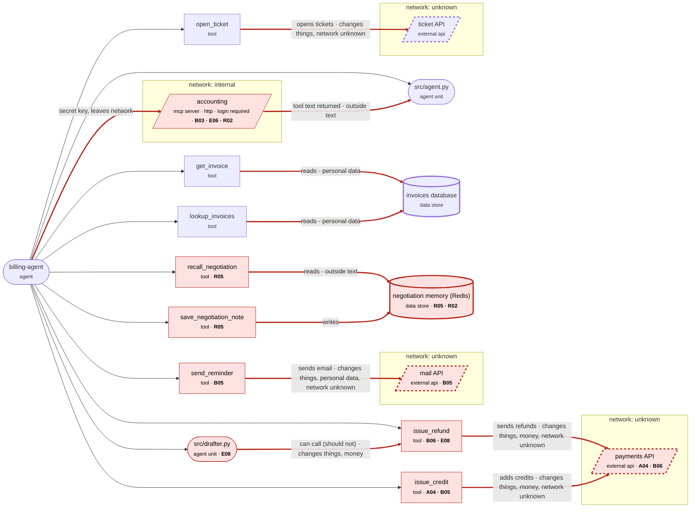

# Security map and action plan: billing-agent

Review of `evals/fixtures/billing-agent` at commit `unknown`, 2026-11-21T00:00:00Z.

**7 things to fix** and **1 things that need proof** were found. Each one below has a person to lead it, a place to write who is doing it, and steps to follow.

## 1. Map

This map shows what the agent connects to. Arrows point from the part that starts an action to the part it reaches.

- **Red box:** something here must be fixed. The codes in the box (like B06) are the actions in section 3.
- **Yellow box:** something here needs proof that it is safe.
- **Thick red arrow:** a connection that can cause harm if misused. Section 2 says why.
- **Dashed box:** we don't yet know which network it runs in.
- **Thick border:** found by reading the code, not just the settings files.

This map shows only the parts with actions or risky connections. The full map has 24 parts; draw it with `topology.py mermaid`.

## 2. Connections that matter

These connections could cause harm if someone misused the agent. Check them first.

| From | To | Why it matters | Open actions | Evidence |
|---|---|---|---|---|
| issue_refund | payments API | can change, send or delete things; can move money; we don't yet know which network it is in | B06 | src/tools/payments.py:56 |
| issue_credit | payments API | can change, send or delete things; can move money; we don't yet know which network it is in | A04 | src/tools/payments.py:56 |
| send_reminder | mail API | can change, send or delete things; carries personal data; we don't yet know which network it is in | B05 | src/tools/comms.py:18 |
| billing-agent | accounting | uses a secret key or token; crosses into another system or network | B03, E06, R02 | .mcp.json:3 |
| src/drafter.py | issue_refund | can change, send or delete things; can move money | E08 | src/tools/registry.py:41 |
| open_ticket | ticket API | can change, send or delete things; we don't yet know which network it is in | - | src/tools/comms.py:33 |
| get_invoice | invoices database | carries personal data | - | src/tools/invoices.py:31 |
| lookup_invoices | invoices database | carries personal data | - | src/tools/invoices.py:31 |
| recall_negotiation | negotiation memory (Redis) | brings in text an outsider could write | R05 | src/memory.py:25 |
| save_negotiation_note | negotiation memory (Redis) | can change, send or delete things | R05 | src/memory.py:25 |
| accounting | src/agent.py | brings in text an outsider could write | - | src/mcp_client.py:152 |

## 3. Action list

Fill in **Assigned to** with a person's name. The **Lead** is the team that owns the fix (see ROLES.md).

| # | What to fix | Where | Priority | Lead | Assigned to |
|---|---|---|---|---|---|
| [A04](#a04) | The model can choose which customer company gets a credit, so it could credit another company's account. | issue_credit, payments API | Must fix before release (Blocker) | Agent team | _____ |
| [B05](#b05) | The agent can email any address, give credits with no approval, and refund up to $500 with no approval. | send_reminder, mail API, issue_credit | Must fix before release (Blocker) | Agent team | _____ |
| [B06](#b06) | One approval for a small refund can be reused to refund any amount, many times. | issue_refund, payments API | Must fix before release (Blocker) | Agent team | _____ |
| [E08](#e08) | The letter-writing helper agent is meant to have no tools, but it gets all of them, including refunds and email. | src/drafter.py, issue_refund | Must fix before release (Blocker) | Agent team | _____ |
| [B03](#b03) | A secret login token for the accounting server is saved in a settings file in the code. | accounting | Fix before release, or get a written risk approval (Required) | Infrastructure | _____ |
| [E06](#e06) | The agent talks straight to the accounting server. Nothing in between checks, limits or logs each call. | accounting | Fix before release, or get a written risk approval (Required) | Infrastructure | _____ |
| [R05](#r05) | Saved notes are filed by email address only, so two customer companies with the same contact share notes. | negotiation memory (Redis), recall_negotiation, save_negotiation_note | Fix soon; track until done (Detection) | Data and privacy | _____ |
| [R02](#r02) | Text from the accounting server and saved notes reaches the model, but there is no test showing an attack in that text is stopped. | accounting, negotiation memory (Redis) | Show proof it works, or get a written risk approval (Required) | Security | _____ |

## 4. How to fix each one

### A04

**Trustworthy attribution** · Must fix before release (Blocker)

**The problem:** The model can choose which customer company gets a credit, so it could credit another company's account.

**Where:** issue_credit, payments API — `src/tools/payments.py:91`

**Lead:** Agent team · **Assigned to:** _____ · **Effort:** small

**Steps:**

1. Open `src/tools/payments.py` and go to line 91.
2. Delete the part that reads `tenant_id` from the tool arguments.
3. Always use the tenant from the run, `ctx.tenant_id`.
4. Remove `tenant_id` from the tool's input fields so the model cannot send it.
5. Add a test that sends a different `tenant_id`. The credit must go to the run's own tenant or be refused.

**You are done when:** No tool argument can change which tenant gets a credit.

### B05

**Destructive-action interception** · Must fix before release (Blocker)

**The problem:** The agent can email any address, give credits with no approval, and refund up to $500 with no approval.

**Where:** send_reminder, mail API, issue_credit — `src/tools/comms.py:17`

**Lead:** Agent team · **Assigned to:** _____ · **Effort:** medium

**Steps:**

1. Make a list of actions that move money or send messages outside: refunds, credits and emails.
2. For each one, ask a person to approve it before it runs.
3. Only send email to the customer's address on file. Refuse any other address.
4. Send email as plain text, not HTML, so it cannot load images or links from other sites.
5. Add a test for each action that runs it with no approval. Each one should be refused.

**You are done when:** Refunds, credits and emails to new addresses all wait for a person to approve them.

### B06

**Approval integrity** · Must fix before release (Blocker)

**The problem:** One approval for a small refund can be reused to refund any amount, many times.

**Where:** issue_refund, payments API — `src/tools/payments.py:73`

**Lead:** Agent team · **Assigned to:** _____ · **Effort:** medium

**Steps:**

1. Open `src/tools/payments.py` and find the line that looks up the approval (line 73).
2. Save the approved amount with each approval when it is created.
3. Before a refund runs, check that the refund amount is not more than the approved amount.
4. Check that the approval was made for this same run.
5. Mark the approval as used right after the refund. Refuse any approval that is already used.
6. Add a test that tries a bigger refund with a small approval. The test should fail the refund.

**You are done when:** A refund larger than its approval is refused, and an approval cannot be used twice.

### E08

**Bounded delegated authority** · Must fix before release (Blocker)

**The problem:** The letter-writing helper agent is meant to have no tools, but it gets all of them, including refunds and email.

**Where:** src/drafter.py, issue_refund — `src/tools/registry.py:41`

**Lead:** Agent team · **Assigned to:** _____ · **Effort:** small

**Steps:**

1. Open `src/tools/registry.py` and find `scoped` (line 41).
2. Change it so an empty list gives back a registry with no tools.
3. Add a test: make a scoped registry with an empty list and check that it has zero tools.
4. Run the drafter once and check the log shows no tool calls.

**You are done when:** The drafter cannot call any tool, and the new test passes.

### B03

**Credential lifetime and handling** · Fix before release, or get a written risk approval (Required)

**The problem:** A secret login token for the accounting server is saved in a settings file in the code.

**Where:** accounting — `config/agent.yaml:50`

**Lead:** Infrastructure · **Assigned to:** _____ · **Effort:** small

**Steps:**

1. Ask the accounting team to cancel (revoke) the token in `config/agent.yaml` line 50 today.
2. Delete the token from the file.
3. Store a new token in the company secret store, not in the code.
4. Change the agent so it stops if no token is found, instead of using a saved one.
5. Use a token that expires within a day if the accounting server allows it.

**You are done when:** No token is in the code, the old token no longer works, and the agent reads its token from the secret store.

### E06

**Enforced gateway boundary** · Fix before release, or get a written risk approval (Required)

**The problem:** The agent talks straight to the accounting server. Nothing in between checks, limits or logs each call.

**Where:** accounting — `.mcp.json:5`

**Lead:** Infrastructure · **Assigned to:** _____ · **Effort:** large

**Steps:**

1. Choose a gateway that sits between the agent and the accounting server.
2. Set it to check who is calling and which tool they may use.
3. Set a limit on how many calls the agent can make each minute.
4. Turn on a log entry for every call.
5. Change the address in `.mcp.json` so the agent connects to the gateway, not the server.

**You are done when:** Every accounting call goes through the gateway and shows up in its log.

### R05

**Memory isolation and write validation** · Fix soon; track until done (Detection)

**The problem:** Saved notes are filed by email address only, so two customer companies with the same contact share notes.

**Where:** negotiation memory (Redis), recall_negotiation, save_negotiation_note — `src/memory.py:25`

**Lead:** Data and privacy · **Assigned to:** _____ · **Effort:** medium

**Steps:**

1. Open `src/memory.py` and go to line 25.
2. Add the tenant to the key, so it looks like `neg:<tenant>:<email>`.
3. Move or delete old notes that use the old key.
4. Mark notes the agent wrote itself as not trusted, so they are not treated as facts later.
5. Add a test with two tenants and the same email. Each must see only its own notes.

**You are done when:** One tenant can never read or change another tenant's notes.

### R02

**Separate data from instructions and test injection containment** · Show proof it works, or get a written risk approval (Required)

**The problem:** Text from the accounting server and saved notes reaches the model, but there is no test showing an attack in that text is stopped.

**Where:** accounting, negotiation memory (Redis)

**Lead:** Security · **Assigned to:** _____ · **Effort:** medium

**Steps:**

1. Write ten fake tool results that tell the agent to send a refund or an email.
2. Feed each one to the agent in a test setup, not in production.
3. Repeat each one five times and count how often the agent obeys.
4. Save the results with the date and the code version.

**You are done when:** A dated test record shows how often attacks in tool text work, and none of them moved money or sent email.

## 5. What this report does not show

- It comes from reading code and settings. It does not prove the agent is safe when it runs.
- The map may be missing parts. Parts reached only through code are included only if the reviewer traced them.
- We don't know which network these run in: payments API, mail API, ticket API.
